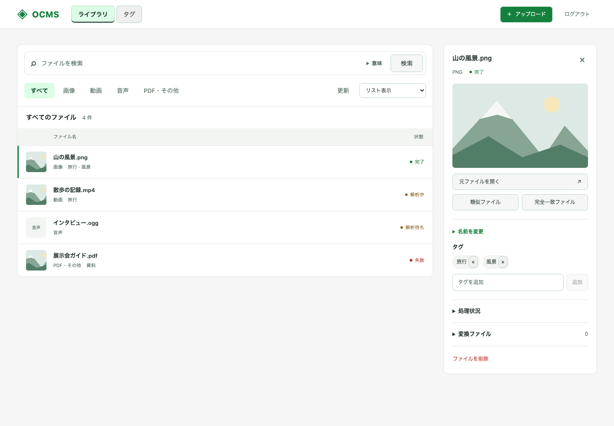
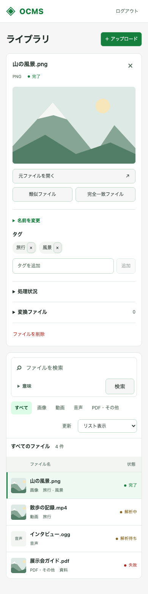
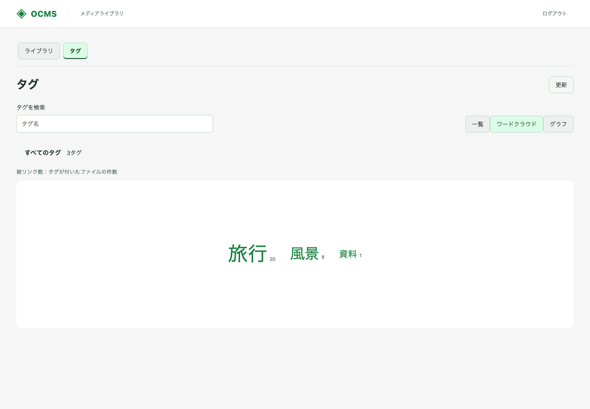
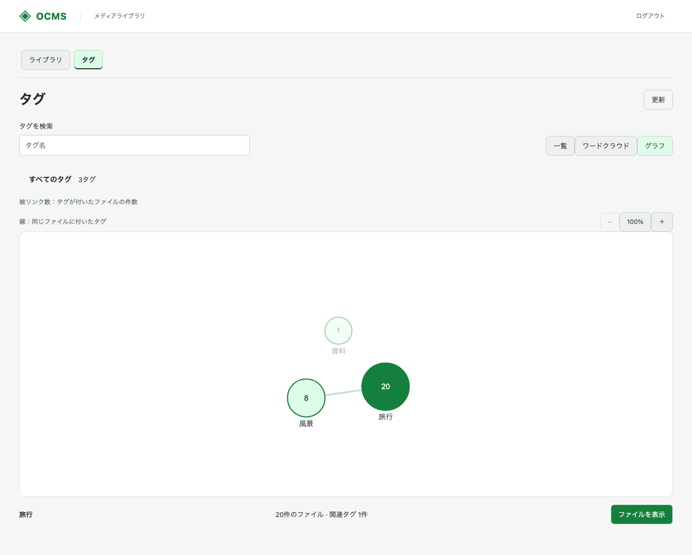
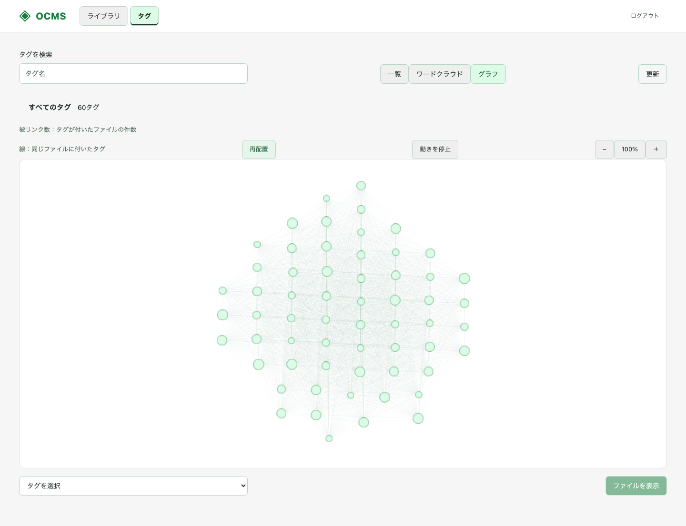
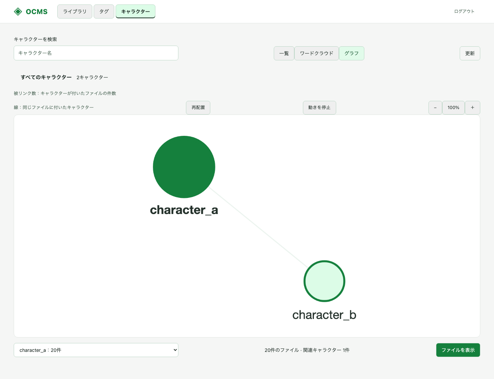
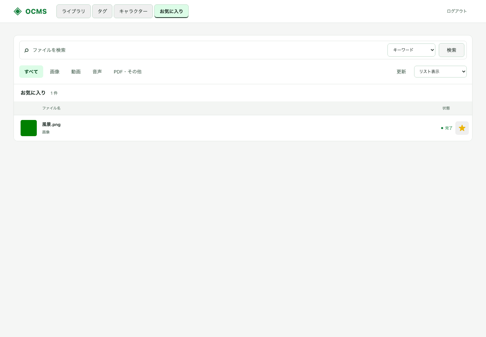
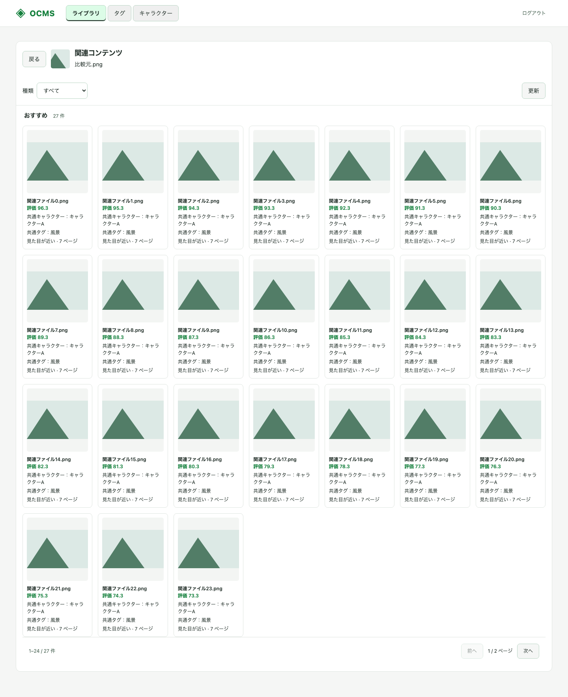
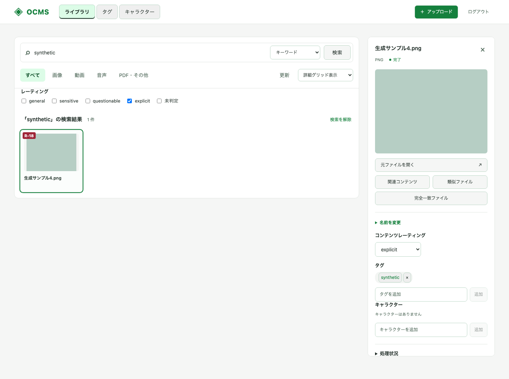
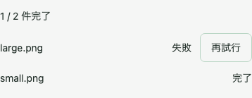

# 実装・検証状況

2026-10-23時点。保存・配信基盤に加え、Media Workerと実推論Runtime、HydraによるOIDC認証、OTLP三信号の受信をDocker Compose上で検証した。仕様全体の受け入れ完了を意味しない。

## 実装範囲

BFF / Catalog / Transfer / Search / Media Worker / 推論Runtimeを別プロセスで起動する。BFFに暗号鍵やS3資格情報は渡さず、CatalogとTransferは別DBロールで自身のスキーマだけを操作する。Searchはファイル名・タグをCatalogで、本文をPGroongaで検索し、pHash・Chromaprint・pgvectorの検索候補を統合する。結果を返す前に、Catalogが許可したAssetだけへ絞り込む。ファイル名・タグの一致を共有Blob内の別Assetへ流用しない。

Transferは平文をファイルへ保存せず、読み取りストリームからSHA-256を計算し、独立したDEKとnonceでAES-256-CTR暗号化する。S3オブジェクトは暗号文のみで、平文と同じ長さを持つ。DEKはBlob IDをAADに含めてAES-256-GCMでラップする。

S3への書き込み前に `storage.upload_objects` へ処理記録を登録し、暗号文保存後にBlobを確定する。同時重複はSHA-256/サイズのUNIQUE制約で収束する。Upload ID単位のadvisory lockで再送を直列化し、Catalogの完了に失敗しても、再送で確定済みBlobを再利用できる。CatalogはAsset参照・Upload完了・Outboxを同じトランザクションで保存する。WorkerはOutboxを取り込み、Jobの一意制約で重複配送を吸収する。JobはSKIP LOCKEDで取得し、90秒のリースを20秒ごとに更新する。異常終了時は期限後に再取得でき、最大4回まで再試行する。失敗処理をUIから再試行できる。

書き込み記録を残したまま失敗したオブジェクトは、1時間の猶予後、Uploadのロックと確定Blobの不在を確認して回収する。確定済みBlobの参照管理GCは未実装で、共有ファイルを誤って削除しないよう物理削除しない。

## 受け入れ基準の対応

| ID | 状態 | 検証内容・残作業 |
|---|---|---|
| AC-01 | Hydra実接続検証済み・Pocket ID未検証 | Hydra 2.3.0のDiscovery・署名付きID Token・Code Flow + PKCEを実行。state/nonce/PKCE改変・コールバック再利用を拒否し、セッション・CSRF・別OIDC主体のACL・ログアウトを確認。Pocket ID固有の接続は残る |
| AC-02 | 検証済み | 実S3暗号文のサイズとSHA-256を平文と比較。全体復号が元データと一致 |
| AC-03 | 検証済み | YAMLの検証、旧/新KEKのDEK復元、誤ったBlob IDでのunwrap拒否 |
| AC-04 | 検証済み | 実DBのDEKを新世代へ再ラップし、Transfer再起動後の復号成功とS3暗号文不変を確認 |
| AC-05 | 検証済み | 先頭・末尾・中間・1/15/17バイト位置、suffix、416、HEAD、If-Range、複数Rangeの全体応答。静的ファイル・メディアのキャッシュと、ETag再検証時のセッション・ACL分離も確認（末尾のHTTPキャッシュ更新を参照） |
| AC-06 | 検証済み | 生成したH.264/AAC派生MP4をブラウザで再生し、12.03秒の動画の約6.04秒位置へUIからシーク。readyState=4、配信元が派生content URLであることも確認 |
| AC-07 | 検証済み | 別名・別所有者の同一平文が同じBlobを参照 |
| AC-08 | 検証済み | 8並列アップロードで同じBlobへ収束、Outboxは1件 |
| AC-09 | 検証済み | 画像WebP/PNG、動画H.264/AAC MP4 faststart、音声Opus/Ogg、PDFページPNGを生成。復号配信、派生Range、S3暗号文の長さ/ハッシュ、コンテナ識別子を確認 |
| AC-10 | 検証済み | 別所有者の同一BlobでRendition IDを共有。同じプロファイルの再要求・Job再試行で重複する派生結果を作らない |
| AC-11 | 検証済み | 文字PDF、スキャンPDF、画像OCR、音声ASRの実処理結果をPGroongaで検索。ページ番号とstart_ms/end_msを確認。英語の生成資料で検証し、日本語PGroonga演算子も別途確認 |
| AC-12 | 検証済み | PNGとリサイズJPEG、再エンコード動画、スキャンPDFとその元画像で、DCT pHashの類似候補を確認。実データでの閾値・動画時系列の精度評価は残る |
| AC-13 | 検証済み | 実Chromaprintを計算し、同じ読み上げ音声をMP3/OGGへ別々にエンコードした候補を検出 |
| AC-14 | 検証済み | 実EmbeddingGemma 2の画像・動画・音声ネイティブEmbeddingを768次元pgvectorへ保存。テキストから3種類を検索し、赤い車の画像が魚の画像より上位になることを確認。ハイブリッド検索とACL分離も検証 |
| AC-15 | 一部検証済み | 別ユーザーの一覧・全文/意味/ハイブリッド検索・詳細・配信・削除・重複結果・派生結果を分離。read Grantで閲覧可能・変換要求不可を検証。Grant変更の全組み合わせは残る |
| AC-16 | 検証済み | Go全5サービスと推論RuntimeのTrace / Metric / Logを実Collectorで受信。主要Span 12種とMetric 10種、HTTP親子関係、DBに保存した非同期JobのTrace伝搬、全6サービスのLog相関・リソース属性・Metric属性を照合。監査イベント9種と成功時の主体・処理結果・Trace相関、失敗JobのError Span・カウンタ・監査ログも検証 |
| AC-17 | 一部検証済み | S3/DB停止後の復旧、Catalog完了失敗からの再送、孤立書き込み記録の回収。JobのBlob/リース/期限照合、Search停止からのJob再試行とready復旧も検証。確定Blob GC、DB COMMIT応答喪失の実注入・Worker強制終了専用シナリオは残る |
| AC-18 | 一部検証済み | Collector受信データとアプリ標準出力でも、実OIDCのcode/state/nonce・セッション/CSRF・生成資格情報/KEK・本文/検索/ヘッダーの検査用文字列が含まれないことを確認。構造化ログにCookie・DEK・本文を渡さない。全入力・DEK全件・依存サービスの網羅検査ではない |
| AC-19 | 生成メディアで検証済み | 実WD14による画像・動画・PDFの一般タグ付与、タグ検索とACL、推論結果の重複再利用、手動タグの保持、再試行後の編集・削除維持を確認。実データでのタグ精度評価は残る |
| AC-20 | 生成データ・実APIで検証済み | 固定重みによる推薦、完全一致除外、Asset別メタデータ、ACL・Grant変更、推薦理由、連続探索と復帰を確認。大規模ライブラリの性能・推薦品質の評価は残る |
| AC-21 | 一部検証済み | 実DBでユーザー・Asset分離、read共有、冪等性、登録順・ページング、キーワード検索を確認。3表示・詳細・閲覧と検索スコープはUI／Go契約試験で確認。実モデルによるお気に入り内の意味・ハイブリッド検索は未検証 |
| AC-22 | 生成データで一部検証済み | DB・APIのレーティング保存、手動保持、重複再利用、ACL、検索と3表示を確認。実WD14は単一生成画像のみ。Worker経由の実メディア結合試験と精度評価は未実施 |
| AC-23 | 生成データ・実APIで検証済み | 実TF-IDF、情報不足・空の区別、抽選・多様性・履歴、キャッシュとセッションの永続化・失効、ACL分離、PC・モバイルの画面復帰を確認。実利用の品質・大規模性能は未評価 |
| AC-24 | 生成データで検証済み | 複数選択・失敗後の継続・再試行UI、実DB/S3の部分再送・改ざん拒否・結合・境界Range・ACL・重複排除・一時データ回収を確認。再読み込み後の自動復元は対象外 |

## 実行結果

以下をローカルのDocker Engine 29.2.1 / Compose 5.6.0、linux/arm64コンテナで実行した。

- `docker compose build`：Go、TypeScript strictチェック、Vite、PGroonga/pgvectorイメージ、実モデル用Python Runtimeのビルド成功。
- `docker compose up -d --wait`：BFF / Catalog / Transfer / Search / Worker / Runtime / PostgreSQL / SeaweedFSの8コンテナがhealthy。
- 独立した `ocms-init-check` プロジェクトの空ボリュームから初回起動：マイグレーション001〜003、PGroonga/pgvectorの導入と8サービスのhealthyを確認し、検証用スタックだけを削除。
- `python3 scripts/integration.py`：実API・DB・S3を使う基盤の結合検証が成功。
- `python3 scripts/media-integration.py`：実メディア10件を生成・投入してAC-09〜14を検証。最終コードで `--resume` による派生Range・MP4 faststart・各モードACLの回帰検証も成功。
- 2ページのスキャンPDF：両ページの暗号化プレビュー・OCR・ネイティブEmbeddingを確認し、存在しないページが404になることも検証。
- `python3 scripts/job-recovery.py`：Workerの秘密情報非保持、実Jobの読み出し認可、read Grantでの変換要求拒否、Search停止からのJob再試行と派生再利用を検証。
- `PYTHONPYCACHEPREFIX="$PWD/.cache/pycache" python3 scripts/recovery.py`：通常の結合検証に加え、障害・鍵更新の検証が成功。
- `go test -race ./...`：暗号化/復号、鍵設定、Range契約、BFF認証/CSRF、pHashの明度変化耐性、Chromaprintのビット解釈・時間ずれ、推論ベクトル検証のテストが成功。
- `go vet ./...`：指摘なし。
- `compose.verify.yaml` の実Hydra・Collectorを起動し、`scripts/verify-oidc.py`、`scripts/verify-otel-workload.py`、`scripts/verify-otel.py` が成功。再現手順・検査範囲はREADMEの「Hydra OIDC・OTLPの実接続検証」を参照。
- 人による検証用の入口を `localhost:4446`、OIDC版OCMSを `localhost:8081`、Grafanaを `localhost:3000` に追加。ブラウザでAlice選択・同意・認証済みSPAへの復帰・画像アップロード・派生表示を実行した。Grafana LGTMのTempo / Prometheus / Lokiで実Trace・Metric・Logを取得し、専用ダッシュボードでも表示を確認。追加構成は起動したまま利用でき、自動試験の実行は手動利用の前提ではない。
- HTTP計測の属性からURL・クエリ・Cookie・本文を除外し、FastAPIの入力値を含み得る標準例外ログを無効化。HTTPの分散Trace伝搬・秘密情報非出力・206応答の維持をGoの回帰テストでも検証。
- フロントエンド依存のインストール時audit：0件。
- ブラウザ：開発ログイン、検索モード、派生ファイル/Job状態、動画描画・再生・途中シークを確認。

結合テストで見つけたRange解除（SDKのStat呼び出し）と並列重複処理での接続プール枯渇を修正し、同じ結合テストを再実行して通過した。

## 実PDFの解析失敗の修正

Grafanaの失敗ログ・Traceと実Jobを照合し、以下を修正した。

- 70ページPDFがWorkerとTransferそれぞれの固定50ページ制限で拒否されていた。両サービスが共有する `MEDIA_MAX_PDF_PAGES` に統一し、既定値を500へ変更。
- 9ページPDFの埋め込みが毎回600秒で中断され、成功済みの推論まで再計算していた。Job期限を既定7200秒へ変更し、004のチェックポイント表に推論結果を保存。実際の再起動後にページ結果の再利用を確認し、Job完了後は削除。
- CPU推論をfloat32・4スレッドへ変更し、glibcのarena制限と推論後のメモリ返却を追加。本文は全文を1000文字ずつに分割。生成画像での連続推論は約4秒だったが、6GBのColimaでは実ページの推論時にOOMが残ったため、32GBのホスト上でVMを12GBへ増量。最終構成ではRuntimeの再起動なしで処理が完了。
- 生のツール診断・本文を出さずに、期限超過、作業領域不足、メモリ不足、推論サービス停止を区別するログを追加。不正入力は自動再試行を繰り返さず、PDFのページ完了・埋め込みの進捗も記録。

| 実ファイル | 最終状態 | ページプレビュー | ページ埋め込み | 本文を含むベクトル総数 | 追加検証 |
|---|---|---|---|---|---|
| 9ページPDF | ready、両Job完了 | 9 | 9 | 28 | 最終ページの全体/非整列Range、全文検索、意味検索、チェックポイント削除 |
| 70ページPDF | ready、両Job完了 | 70 | 70 | 141 | 最終ページの全体/非整列Range、全文検索、意味検索、チェックポイント削除 |

`scripts/verify-pdf-recovery.py <blob-id> ...` で再検証できる。本文・ファイル名・検索語・資格情報は検査結果へ出さない。結果はGit対象外の `.cache/pdf-recovery-results.json` に保存する。AC-09〜14の回帰試験、追加した30秒動画の実変換・ASR・ネイティブ動画埋め込み、Go race/vet、制限境界・チェックポイント検証・ツール診断の非出力テストも成功した。

検証用の不正PNGや空ファイルによる過去の失敗ログは履歴として残る。今回修正対象とした実PDF2件の失敗Jobは解消し、検証用構成は起動したままにしている。

## ライブラリ画面の情報構成（2026-10-22）

一覧の上に検索・種類フィルターを集約し、ファイル名と処理状態を一覧の主情報にした。詳細はプレビュー、元ファイル、タグ、比較操作の順に配置し、処理状況と変換ファイルは折りたたみに収めた。類似・完全一致は選択ファイルから実行し、結果見出しに比較元を表示する。技術構成の常設説明と単一項目のサイドバーを削除した。

PDF検索結果では一致ページのプレビューを表示する。タグ保存後も検索のページ・時刻を保持する。狭い画面では詳細を一覧の上に表示し、選択時に詳細見出しへフォーカスを移す。

- `web/` の `npm ci` と `npm run build`：成功。
- `npm run test:ui`：生成データのAPI応答を使うChromiumの画面回帰テスト10件が成功。検索3方式、種類フィルター、比較元・解除、タグ保存、PDF一致ページ、再試行、空結果・エラー、削除確認、アップロード、認証方式の表示、狭い画面でのフォーカスを確認。1440 / 1024 / 800 / 390 / 320px幅で横スクロールが出ないことも確認。
- 今回はDocker Engineが停止しているため、実サービスとの結合試験・実動画再生・実OIDCログインは再実行していない。以下は生成データの画面で、実メディアの検証結果ではない。

[モバイル画面（生成データ）](library-ia-mobile.png)

## 一覧の表示切り替え（2026-10-23）

更新ボタンの右隣に表示方法のドロップダウンを追加した。表示を切り替えても、検索結果・種類フィルター・選択中のファイルを保持する。

選んだ表示方法はブラウザのlocalStorageに保存し、同じ接続先を再読み込みした場合や新しいタブで開いた場合に復元する。未保存・不正な保存値ではリスト表示にする。保存が制限された環境でも、その画面での表示切り替えは利用できる。別のブラウザ・端末との設定同期は行わない。

| 表示方法 | 表示内容 |
|---|---|
| リスト表示（初期表示） | 左端をサムネイルに変更。ファイル名・タグ・処理状態・検索の一致箇所を表示 |
| グリッド表示 | サムネイルのみの正方形。画像は枠を満たすようクロップし、ファイル名は読み上げとツールチップで確認 |
| 詳細グリッド表示 | 正方形のカードにサムネイルとタイトルを表示。画像はクロップせず、縦横比を保って枠内に収める |

表示方法の保存を追加した際は、`web/` の `npm ci --cache ../.cache/npm`・`npm run check`・`npm run build` とPlaywrightの画面回帰テスト31件が成功した。追加3件で全表示方法の再読み込み・新規タブでの復元、不正な保存値、保存機能が使えない場合の切り替えを確認。Chromiumはサンドボックスの起動制限を避けて制限外で実行した。フロントエンドのみの変更のため、Go・実サービスの結合試験は再実行していない。

画像・動画・PDFは認証付きの既存プレビューURLを遅延読み込みし、PDF検索結果では一致ページを指定する。音声やプレビューを取得できないファイルは代替表示にする。処理状態が変わるとプレビューを再取得する。元ファイルの一括ダウンロードや一覧ごとの変換要求は行わない。

`web/` の `npm ci`・`npm run build` と、生成データのAPI応答を使う画面回帰テスト15件が成功。新規5件でメニュー位置、サムネイルURL、縦長・横長画像、正方形の寸法、表示切り替え後の選択・フィルター・比較結果、プレビュー失敗からの復帰、PDF一致ページを確認した。両グリッドについて、詳細の開閉時と1440 / 1024 / 800 / 390 / 320px幅で横スクロールがないことも確認。実サービスを使う結合試験は今回は再実行していない。

[グリッド表示（生成データ）](library-grid.png) / [モバイル](library-grid-mobile.png)

[詳細グリッド表示（生成データ）](library-detailed-grid.png) / [モバイル](library-detailed-grid-mobile.png)

## フロントエンドの整形・lint（2026-10-23）

`web/` にBiome 2.6.2を固定バージョンで導入した。2スペース、シングルクォート、セミコロンの整形設定と推奨lintルール、import順の整理を有効にした。依存パッケージ、ビルド成果物、Playwright出力、`package-lock.json` は対象外とする。

既存ファイルを整形し、ボタンのtype、暗黙のany、未使用import、非nullアサーションを修正した。既存のEffectの実行タイミング、検索フォーム・ボタングループの構造、字幕契約のないアップロードメディア、別コンテナの画像セレクターは理由付きの局所的な抑制コメントで扱う。関数間の空行は開発規約に追加したが、Biomeには強制するルールがないため手動・レビューで確認する。

`web/` の `npm ci --cache ../.cache/npm`、`npm run format:check`、`npm run lint`、`npm run check`、`npm run build` が成功した。`npm run test:ui` はサンドボックス内でChromiumのMachポート作成を拒否されたため、権限制限の外で再実行して既存15件が成功した。実サービスを使う結合試験は、今回の変更がフロントエンドの開発ツール導入とlint対応のため再実行していない。

## コミット前のフロントエンド自動修正（2026-10-23）

Husky 9.1.7とlint-staged 17.6.0を固定バージョンで導入した。`web/` の `npm ci`・`npm install` でコミット前フックを登録し、ステージ済みファイルに `biome check --write --error-on-warnings` を実行する。修正は再ステージし、未解決のエラー・警告があればコミットを止める。対象外のファイルと削除のみの変更は処理を省く。

`npm ci --cache ../.cache/npm`、`npm run check`、`npm run build` が成功した。一時Gitリポジトリの実コミットで、空白を含むファイル名の自動修正・再ステージ、未ステージ部分の保持、lint警告によるコミット拒否と変更の復元、フロントエンド変更なし・削除のみのコミットを確認した。`.git` がない環境でも `prepare` が成功することを確認した。画面・サービスの実装変更はないため、画面回帰テストとサービス結合試験は再実行していない。

## shadcn/uiと緑系テーマへの移行（2026-10-23）

Button・Input・Label・Native Select・Progressをshadcn/uiベースのローカル部品へ移行した。Radix UI、Tailwind CSS 4、CVA、`cn()` を導入し、`web/components.json` に部品追加用の設定を置いた。Native Selectは既存のflex配置を保つため、ラッパーを追加せずブラウザ標準の矢印を使う。進捗表示はRadixのProgressを使い、値・上限・読み上げ用の名前を設定した。

背景・枠線・選択状態・主要操作・フォーカスを緑系のCSS変数に統一した。失敗と削除は赤、処理待ちは黄褐色で区別する。ヘッダー、検索、種類フィルター、表示切り替え、一覧と詳細の配置は維持した。Tailwind Preflightは読み込まず、既存の余白・幅・文字サイズを保っている。

- `web/` の `npm ci --cache ../.cache/npm`、`npm run check`、`npm run build`：成功。
- `UI_SCREENSHOTS=1 npm run test:ui`：Chromiumで17件が成功。既存15件に加え、移行前の主要6領域の座標・幅・高さとの一致（1440 / 1024 / 800 / 390 / 320px、3表示方法）と、アップロード進捗のアクセシビリティ・二重送信防止を検証した。寸法の基準はmacOSのChromiumで移行前に記録した。
- 生成データのPC・モバイル画面6枚を更新した。実サービスの結合試験・実OIDC・実メディア再生は、UI部品とテーマの変更のため再実行していない。

[PC画面（生成データ）](library-ia.png) / [モバイル画面（生成データ）](library-ia-mobile.png)

## SSOログインボタンの文字色修正（2026-10-23）

通常リンク用のCSSがshadcn/uiの文字色を上書きし、SSOログインボタンの背景と文字が同じ緑になっていた。通常リンクの色指定から `.ui-button` を除外し、ボタンのvariantに応じた文字色を使うよう修正した。配置と寸法は変更していない。

既存の認証画面テストに、SSOボタンの緑背景・白文字、およびホバー・フォーカス時にも白文字を保つ検査を追加した。修正前に文字色の不一致を再現し、修正後は `npm ci --cache ../.cache/npm`、`npm run check`、`npm run build`、`UI_SCREENSHOTS=1 npm run test:ui`（17件）が成功した。実OIDCログインは再検証していない。

[SSOログイン画面（生成データ）](login-sso.png)

## ページネーションと詳細の追従（2026-10-23）

通常一覧を1ページ24件のAPI取得に変更し、先頭200件より後のファイルにも移動できるようにした。前へ・次へ、現在ページ、表示範囲と総件数を表示する。種類はページ取得前にCatalogで絞り込み、総件数にもACLと論理削除を適用する。同じ作成日時ではAsset IDの降順で順序を固定する。offset方式のため、移動中の追加・削除で表示位置が変わる場合がある。

検索・比較は取得済み結果を24件ずつ表示し、既存の検索最大200件・類似最大20件・完全一致最大200件の上限は維持する。検索・種類・比較元の変更では先頭へ戻り、表示方法と選択中の詳細はページを移動しても保持する。最終ページの最後のファイルを削除すると、有効なページへ戻る。

幅800pxを超える画面では詳細パネルを画面内に追従させ、内容が長い場合はパネル内をスクロールする。ページ最下部でも見出しが隠れないよう下余白を確保する。幅800px以下では従来どおり一覧の上に配置する。

- `npm ci --cache ../.cache/npm`、`npm run check`、`npm run build`：成功。
- Playwrightの画面回帰テスト21件：成功。追加4件で217件の移動、表示と選択の保持、最終ページの削除、検索・比較・種類変更、詳細の追従と内部スクロールを検証。ChromiumはサンドボックスのMachポート制限のため制限外で実行した。
- `go test -race ./...`、`go vet ./...`：成功。ページ指定の既定値・境界値・不正値の回帰テストを追加した。
- `scripts/pagination-integration.py`：実API・DBで217件のページ取得、同時刻の並び順、種類別件数、read Grantと非公開・削除済みファイルの除外、不正な指定の400応答を確認。生成したDB行は削除した。
- `scripts/integration.py`：認証・CSRF、保存・Range、並列重複排除、一覧以外のACLと検索、削除、DBロール分離の既存結合試験も成功。
- Dockerイメージを再ビルドし、Catalog・開発用BFF・OIDC用BFFへ反映。メディア処理・実動画再生・実OIDCログイン・OTLPの試験は今回再実行していない。

[ページ操作とスクロール中の詳細（生成データ）](library-pagination.png)

## 残る実装・評価

1. Pocket IDとの実接続、セッションの共有永続化、Grant管理の外部契約/UIと網羅テスト。
2. Upload状態の細分化・期限切れ処理、確定Blobの参照管理GC。
3. 動画pHashの時間的整合性を使う二次判定、音源の切り出し・長さ違いの評価、類似閾値の実データ評価。
4. 日本語・多言語OCR/ASRの精度評価。Tesseractの`eng+jpn`と多言語Whisperを使うが、今回のメディアテストは英語の生成資料。日本語PGroongaの索引検索は別途成功を確認。
5. 負荷・キャンセル・Worker強制終了シナリオ。今回のCollectorとGrafana LGTMはローカル検証専用。本番向けの認証・TLS・保持運用は別途必要。
6. 生メディアを入力する `/api/v1/search/by-media`、追加変換プロファイル、検索・比較APIの結果上限を超えるページング、各処理上限の設定化。

## 実装上の制約

- 検索は最大200結果、最大1000 Blob候補。候補生成後のCatalog認可で非公開情報を除外するため、大量の非公開候補が上位にある場合の検索再現率には改善の余地がある。
- 画像のMIMEヘッダー、PDF署名、FFprobeによる解析、画素数・時間・ページ数・作業領域・メモリ・実行期限を制限する。全形式・圧縮爆弾への網羅的な耐性試験は未完了。
- 動画pHashは5秒間隔・最大12フレームの初期実装。動画Embeddingは全体を30秒単位で処理する。動画の順序/時間を使う知覚類似の二次判定は残る。
- プレビュー・変換は標準プロファイルのみ。画像WebP/PNG、動画H.264/AAC MP4、音声Opus/Ogg、PDFページPNGを実装する。手動画質切替、AVIF/JPEG等の追加プロファイルは未実装。
- CPU推論は動画1区間でも数十秒かかる場合がある。大規模処理の速度や検索品質を保証する評価は行っていない。モデルのリビジョン・次元・プレフィックスは統一している。
- Workerの作業平文はtmpfsで処理後に削除し、鍵・S3資格情報はTransferに限定する。ONNX版Runtimeは画像・音声をメモリ上で扱い、作業メディアをファイルへ保存しない。
- アプリログとOTLPの非出力検査にはWorker/Runtimeを含む。依存サービスやDocker自身の診断・設定出力、運用環境での収集・保持・アクセス制御は別途評価が必要。

## 参照した一次資料

- [EmbeddingGemma 2のマルチモーダルAPI](https://ai.google.dev/gemma/docs/embeddinggemma/multimodal-embeddinggemma-with-sentence-transformers)
- [PGroonga公式Dockerイメージ](https://github.com/pgroonga/docker)
- [pgvector](https://github.com/pgvector/pgvector)
- [faster-whisperとPyAV 19の非互換](https://github.com/SYSTRAN/faster-whisper/issues/1589)：旧バックエンドではPyAV 18.1.0へ固定した。ONNX移行後は両依存を削除済み。ASRへの16kHz波形入力は維持する。
- [Hydra公式Quickstart](https://www.ory.com/docs/oel/hydra/quickstart)
- [OpenTelemetry Go Exporters](https://opentelemetry.io/docs/languages/go/exporters/)
- [Grafana Docker OpenTelemetry LGTM](https://grafana.com/docs/opentelemetry/docker-lgtm/)

## コンポーネント分割とStorybook（2026-10-23）

`main.tsx` を起動処理に絞り、認証・API通信・ポーリング・更新を `App.tsx` に分離した。ヘッダー、ログイン、アップロード操作と進捗、検索、種類・表示切り替え、一覧、詳細、サムネイル、状態表示を `web/src/components/library/` に配置し、propsとコールバックで接続する。型と表示用の関数は `web/src/lib/assets.ts` で共有する。サービス責務・API契約・仕様§3と§14のACには変更がない。

Storybook 10.6.3に61のStoryを追加した。ライブラリの3表示、空一覧、検索中、選択・ページ操作、PDF一致ページ、処理失敗、進捗、ログイン2方式、既存のshadcn/ui部品を確認できる。Controls、Actions、Interactions、AccessibilityパネルとPC・モバイルのViewportを用意した。MSWが生成メディアを返し、それ以外の `/api/` 通信を遮断する。実APIやログインは不要で、動画・音声の実再生は検証対象に含めない。

- Node.js 24.18.0で `npm ci --cache ../.cache/npm`、`npm run check`、`npm run build`、`npm run build-storybook`：成功。依存のauditは0件。静的ビルドは `web/storybook-static/` に出力。
- `npm run test:ui`：既存の画面回帰テスト21件が成功。表示・余白、検索、比較、タグ編集、アップロード、削除確認、ページ操作、フォーカス移動を維持。
- `npm run test:storybook`：Chromiumで61件が成功。描画に加え、検索・フィルター、選択・ページ操作、タグの整形と保存、比較、失敗処理の再試行、ファイル選択を操作してコールバックを検証。
- Storybookをブラウザで開き、一覧表示・Controls・生成プレビュー画像3件の読み込みとページ例外がないことを確認。
- アクセシビリティ検査は `test: 'todo'` とし、指摘をパネルへ表示する。既存ファイルボタンの可視テキストとアクセシブル名の不一致が残っており、適合確認済みとはしない。
- UIの分割と検査環境の追加に限定したため、Go・実サービス・DB・S3・推論の結合試験は再実行していない。

## アップロードボタンの配置変更（2026-10-23）

アップロードボタンを「OCMS｜メディアライブラリ」のヘッダー右側へ移し、本文の「ライブラリ」見出しとその行を削除した。狭い画面ではヘッダー内の余白を調整する。

- `web/` の `npm ci --cache ../.cache/npm`、`npm run check`、`npm run build`：成功。
- `UI_SCREENSHOTS=1 npm run test:ui -- --update-snapshots`：21件が成功。ヘッダーからのファイル選択、アップロード完了、処理中の二重送信防止、1440 / 1024 / 800 / 390 / 320px幅での表示を確認し、配置の基準値と一覧のスクリーンショットを更新した。Chromiumの起動にはサンドボックス外での実行が必要だった。
- 表示配置のみの変更のため、Go・実サービスの結合試験は再実行していない。

## 全画面のファイル閲覧（2026-10-23）

詳細プレビューのクリック、一覧のダブルクリック、選択済みファイルの再選択から、暗い背景の全画面閲覧画面を開けるようにした。動画・音声は標準プレイヤーで再生し、派生MP4・Opusがある場合は優先する。画像は元画像を表示し、PDFはPDF.jsで元ファイルを描画する。PDFの検索一致ページと動画・音声の一致時間を引き継ぐ。未対応形式や読み込み失敗時には元ファイルへのリンクを表示し、他のファイルへの移動を維持する。

左右スワイプ・左右キー・前後ボタンで一覧順に移動し、通常一覧のAPIページ境界も越える。画像・PDFは画面に合わせた表示を100%として500%まで拡大でき、ピンチと拡大後のドラッグに対応する。拡大中のドラッグやピンチではファイルを切り替えない。PDF内のページは別の前後ボタンで移動する。閉じるボタンとEscapeで一覧に戻り、キーボードフォーカスを復帰する。閲覧中は背景のスクロール・操作を抑止する。

PDF.js 6.4.299はPDF表示時だけ読み込む。Worker・CMap・フォント・画像デコーダーを同梱し、外部CDNへ接続しない。BFFのCSPはPDF用のBlobフォントとWebAssemblyを許可する。インラインスクリプト・JavaScriptのeval・外部スクリプトは許可しない。PDFの描画用Canvasは最大約1600万画素に抑える。サービスの責務とAPI契約は変更せず、仕様§12を更新した。関連するACは動画シークのAC-06、配信・認可のAC-05 / AC-15で、今回その実サービス経由の再検証はしていない。

- Node.js 24で `npm ci --cache ../.cache/npm`、`npm run check`、`npm run build`：成功。依存auditは0件。サンドボックス内の `npm ci` は完了したが、HuskyのGit設定書き込みは制限された。
- Playwright 28件：成功。追加7件で全表示方法からの起動、全画面サイズ、拡大・ドラッグ、フォーカス循環と復帰、320 / 390px幅、実PDFの複数ページ描画とCSP、ページ境界の移動と取得失敗後の再試行、未対応形式と読み込み失敗、CDPによるタッチのピンチ・スワイプ、生成WebM / WAVの実再生とプレイヤー切り替えを確認した。
- `npm run test:storybook`：既存61件が成功。Chromiumを使う検証はサンドボックスのMachポート制限を避けて制限外で実行した。
- 作業ディレクトリ内のGoキャッシュを指定した `go test -race ./...` と `go vet ./...`：成功。CSPの許可範囲を確認する回帰テストを追加した。
- 開発用BFFとOIDC用BFFを再ビルド・更新。DB・S3・メディア処理・実OIDC認証・OTLPの結合試験は再実行していない。
- ブラウザ検証はChromiumと生成データによるもの。Safari / iOS実機、全PDFの文字・画像形式、巨大PDFの性能評価は未実施。PDFのテキスト選択・注釈編集は対象外。

[モバイルの画像閲覧](library-viewer-mobile.png) · [PDFの拡大表示](library-viewer-pdf.png)

## WD14一般タグの自動付与（2026-10-23）

画像・動画・PDFのメディア解析後に `tags.generate` Jobを作成し、独立したRuntimeでWD 1.4 ConvNext Tagger V2を実行する。category 0の一般タグだけを閾値0.35で採用し、キャラクターとレーティングを除外する。動画は全体から最大12フレーム、PDFは各ページを処理し、最大スコアで集約した上位256タグを付与する。音声は対象外。

Catalogは推論結果をBlob単位で保存し、各Assetのタグへ一度だけ追加する。既存の手動タグを保持し、自動タグも付与後に編集・削除できる。重複Assetにはモデルの結果だけをコピーし、別Assetの手動タグを共有しない。状態同期で新しい重複Assetへの適用漏れを補う。内部の保存APIはJob・Blob・リース・期限を照合する。新しいテーブルと適用済みフラグ、Job種別、既存の解析済みファイルの処理待ちはマイグレーション005で追加する。適用前に旧Workerを停止する手順をREADMEに記載した。

検証結果：

- `go test -race ./...` と `go vet ./...`：成功。フレームの全体サンプリング、スコア集約・不正値拒否、Workerに認可を拒否されたJobがCatalogへ保存できないことを含む。
- RuntimeのPython単体テスト3件：一般タグの分類・閾値、異常出力の拒否、白背景・余白・BGR・画素値の前処理を確認。
- `scripts/media-integration.py --resume`：既存の実生成メディアでAC-09〜14、タグJobを含む完了待ち、検索のACL分離が成功。
- `scripts/tagging-integration.py`：新しいBlobになるメタデータを付けた生成PNG・MP4・PDFで、新規Jobの作成から実推論・保存・検索を確認。別ユーザーの閲覧と検索の拒否、手動タグ保持、タグ削除後のJob再試行、同一Blobの重複アップロードでの結果再利用も成功。合計100件を超えるタグの編集、手動タグが512件ある場合の保持、513件目の拒否も確認した。
- `npm ci --cache ../.cache/npm`、`npm run check`、`npm run build`：成功。追加したWD14のJob表示に対するPlaywrightテスト1件も成功し、生成データの画面を下に掲載した。ChromiumはsandboxのMachポート制限で起動できなかったため、UIテストをsandbox外で実行した。
- ローカルDBへ005を適用し、解析済みの既存ファイルのタグ付けJob 24件と、新規アップロード3種類のJob完了を確認。Runtime・Worker・Catalogを更新し、OIDC・OTLP検証サービスも起動を維持した。

タグの精度は実際の画像や動画で別途評価が必要。動画はサンプリングするため、短時間だけ現れる内容を取りこぼす場合がある。タグJobは推論途中のチェックポイントを持たず、失敗時は画像・フレーム・ページの推論から再実行する。今回の変更で障害復旧スクリプトやOIDC・OTLP全体の検証は再実行していない。

## 詳細パネルのファイル名・タグ編集（2026-10-23）

詳細のプレビュー下にファイル名入力を追加し、Enter・フォーカス移動で自動保存、Escapeで編集を取り消せるようにした。タグは折り返すチップで表示し、Enter・追加ボタンによる1件ずつの追加と、×による削除に対応する。カンマでは分割しない。空文字・重複タグ・既存APIのバイト数と件数上限を送信前に検査する。

保存中は編集を無効化し、日本語変換中のEnterと二重送信を防ぐ。失敗時は入力と再試行操作を残す。更新結果はAsset IDで照合して詳細・一覧・比較元へ反映し、検索結果のページ・再生時刻を保持する。一覧の再取得失敗は保存失敗と区別して知らせる。既存のCatalog PATCH・認可を利用し、API・DB・サービスの変更はない。

`npm ci --cache ../.cache/npm`、`npm run check`、`npm run build`、`npm run test:storybook`（68件）、`npm run test:ui`（40件）が成功した。保存・削除・失敗後の再試行、通信中の選択変更、比較元名の更新、一覧再取得失敗、PDFページ・動画時刻の保持を生成データで確認した。1440px・390px・320pxで長い名前と多数の長いタグが横にはみ出さないことを確認し、画面例とレイアウト基準を更新した。ブラウザはサンドボックスのMachポート制限により通常起動できず、制限外でテストを実行した。npm依存のauditは0件。Go・実DB・S3を使う結合試験は、フロントエンドのみの変更のため再実行していない。

## ライブラリ画面の情報構成の改善（2026-10-23）

「探す・選ぶ・閲覧する」の流れに合わせて、検索、種類、表示方法、結果件数、一覧をひとつの領域にまとめた。アップロードはライブラリ見出しの横に置く。検索方式は選択中の方式を表示し、開いたときだけ変更できる。

詳細はプレビュー、元ファイル、比較操作、名前変更・タグ、処理状況、変換ファイルの順とした。名前変更は折りたたみ、保存方法の常設説明と処理状態の重複表示を削除した。保存中・失敗・再試行の表示は維持する。狭い画面では詳細を一覧領域の上に表示する。

- `npm ci --cache ../.cache/npm`、`npm run check`、`npm run build`：成功。npm ciのHusky登録はサンドボックスのGit設定書き込み制限で失敗したが、依存関係のインストールは完了した。
- `npm run test:ui`：生成データのChromium回帰テスト41件が成功。検索方式と名前変更の開閉、キーボード操作、保存、比較、アップロード、320px幅までの横スクロール防止を確認し、配置のスナップショットを更新した。
- `npm run test:storybook`：16ファイル・68件が成功。ブラウザテストはChromium起動に必要なサンドボックス外実行で確認した。
- API・サービスの変更はなく、実サービスとの結合試験は今回再実行していない。以下は生成データによる画面。

## タグ一覧・ワードクラウド・共起グラフ（2026-10-23）

ライブラリと並列に「タグ」を追加した。タグ名の部分一致検索、件数付き一覧、ワードクラウド、グラフを切り替えられる。被リンク数は閲覧可能なAssetのうちタグが付いた件数で、文字サイズと円の大きさへ反映する。グラフの線は同じAssetに付いたタグ同士を結び、線幅は共起件数で変わる。タグ選択で関連を強調し、拡大・縮小・スクロールに対応する。タグからライブラリの完全一致フィルターへ移動でき、解除・種類別表示・ページ移動を維持する。

Catalogに `GET /api/v1/tags?q=...` を追加し、一覧・件数・線を同じDBスナップショットから取得する。非公開・削除済みAssetを除外し、同じAsset内の重複タグは1件とする。タグは上位200件、グラフは上位60件に制限し、表示範囲と検索による絞り込みを画面に示す。Asset一覧に完全一致の `tag` 条件を追加した。DB変更・マイグレーションは不要。仕様§3の責務を維持し、§10・§12を更新した。関連する受け入れ基準はAC-15・AC-19。

- `npm ci --cache ../.cache/npm`、`npm run check`、`npm run build`：成功。依存auditは0件。HuskyのGit設定への書き込みはサンドボックスで制限されたが、依存関係のインストールは完了した。
- 既存のPlaywright 41件と追加したタグ画面6件：成功。検索、空状態、失敗と再試行、古い検索応答の破棄、件数によるサイズ差、線・選択・拡大、完全一致ファイル一覧への移動・解除、上限表示、多数の長いタグ、390 / 320px幅を検証。ナビゲーション追加に合わせて配置の基準値を更新した。ChromiumはMachポート制限のため制限外で実行した。
- `npm run test:storybook`：既存68件が成功。
- `go test -race ./...`、`go vet ./...`：成功。
- `python3 scripts/tags-integration.py`：実BFF・Catalog・DBで、重複タグの件数、共起数、read Grant、非公開・削除済みの除外、大文字小文字を区別しない検索、完全一致フィルターのページング、編集・削除後の集計、200タグ・60ノードの上限、未認証の拒否を確認。生成したDB行は削除した。
- `python3 scripts/pagination-integration.py` と `python3 scripts/integration.py`：成功。既存の一覧・保存・Range・重複排除・ACL・タグ編集の回帰を確認。
- Catalog・開発用BFF・OIDC用BFFを更新。検証サービスは起動を維持した。メディア推論・実OIDCログイン・OTLPの全体試験は今回再実行していない。

全タグのページング、巨大ライブラリでの集計性能評価、Safari / iOS実機の検証は未実施。グラフの関連は表示範囲内のタグ同士で計算し、タグ間の独立した参照関係を保存する機能は持たない。

[スマートフォンのタグ画面（生成データ）](tags-mobile.png)

## タグ可視化のライブラリ導入とヘッダー統合（2026-10-23）

ワードクラウドの自前の折り返し配置をd3-cloud 1.2.9へ、グラフの自前の力学計算・SVG描画をCytoscape.js 3.34.4へ置き換えた。クラウドはライブラリが配置した単語をSVGで描画し、クリックとEnter・Spaceでファイル一覧へ移動する。配置できなかった単語は一覧へ誘導する。グラフの配置・描画・ドラッグ・パン・ズームはCytoscape.jsを使う。件数によるサイズ差・共起線・関連の強調を維持し、両ビューにキーボード用のタグ選択を設けた。ResizeObserverでサイズ変更に追従し、切り替え時は配置処理・監視・グラフを破棄する。可視化の依存はタグの可視化を開く際に遅延読み込みする。

OCMS、ライブラリ・タグの切り替え、アップロード、ログアウトを共通ヘッダーの一段にまとめた。固定の「メディアライブラリ」ラベル、本文のナビゲーション行、本文冒頭の重複見出し行を削除した。h1は読み上げ用に残す。狭い画面ではOCMSの文字とアップロードの可視ラベルを省略し、アクセシブルな名前を維持する。タグ画面の更新は検索・表示方法の操作列へ移した。

- `npm ci --cache ../.cache/npm`、`npm run check`、`npm run build`：成功。依存auditは0件。
- `npm run test:ui -- --update-snapshots`：48件が成功。ヘッダーの操作、1段表示、本文の重複行の削除、クラウドのサイズ差・クリック、ライブラリのグラフ描画・選択・ズーム、長いタグと表示上限、既存の検索・編集・閲覧・ページングを確認した。PC・390 / 320px幅の画面例と配置の基準値を更新した。
- `npm run test:storybook`：68件が成功。ブラウザ試験はChromiumのMachポート制限を避けて制限外で実行した。
- フロントエンドだけの変更で、API・DB・認可・集計方法は変更していない。Go・実サービスの結合試験とSafari / iOS実機の検証は今回再実行していない。

## 被リンク数を反映した動的グラフ（2026-10-23）

Cytoscape.jsの配置をcytoscape-cola 2.5.1へ変更した。Colaの重なり回避・ラベル境界を含めた余白・継続シミュレーションを利用し、ドラッグ中も周囲のノードが追従する。独自の力学計算は追加していない。初期配置の後は利用者のズーム・パンを維持し、「再配置」で配置をやり直せる。

被リンク数（タグが付いた閲覧可能なAsset数）による円の大小差を広げ、線を細く薄くした。縮小時は小さなラベルを隠し、ホバー・選択で強調する。選択したタグへ表示が寄り、詳細は既存のタグ選択とファイル一覧への導線で確認できる。グラフ領域を広げ、動きの停止・再開を追加した。画面が非表示になったときとアンマウント時は計算を停止する。動きを減らす設定では静止から始め、明示的な再開もできる。

- `HUSKY=0 npm ci --cache ../.cache/npm`、`npm run check`、`npm run build`：成功。依存auditは0件。可視化は遅延読み込みを維持する。可視化チャンクは約543 kB（gzip約175 kB）となり、Viteの500 kB警告が出る。
- `npm run test:ui`：50件が成功。追加した検証では60タグ・1,770本の共起線を描画し、ラベルを含む境界の重なりが0件であること、被リンク数によるサイズ差、実際のマウスドラッグによる周囲の追従、手動ズームの保持、停止時の静止、再開、動きを減らす設定を確認した。
- 継続シミュレーションの描画を待つようテストを調整し、グラフ2件を `--repeat-each=3` で再実行。6件すべて成功し、画面例を更新した。
- `npm run test:storybook`：既存68件が成功。
- UIと依存ライブラリの変更に限定し、API・DB・ACL・被リンク数の集計方法は変更していない。Go・実サービスの結合試験とSafari / iOS実機の検証は今回再実行していない。

全タグの同時表示や巨大グラフの性能を保証するものではない。表示上限は従来どおり60タグで、検索・ズーム・パンで対象を探索する。

## 検索方法メニューの階層削減（2026-10-23）

検索方法のNative Selectを包んでいた折りたたみを削除し、検索欄から「キーワード」「意味」「キーワード＋意味」を直接選べるようにした。選択中の方式と「検索方法」のアクセシブルな名前を維持し、不要になったポップアップ用CSSを削除した。

- `npm ci --cache ../.cache/npm`、`npm run check`、`npm run build`：成功。`npm ci` 内のHusky設定はサンドボックスのGit設定書き込み制限で警告が出たが、依存インストールは完了した。
- `npm run test:ui`：50件成功。3方式の検索API要求、検索欄から検索方法・検索ボタンへのTab移動、1440 / 390 / 320pxでの検索方法の表示を確認した。
- `npm run test:storybook -- src/components/library/SearchForm.stories.tsx`：5件成功。ChromiumのMachポート制限のため、ブラウザテストは制限外で実行した。
- Dockerイメージを再ビルドし、開発用BFF・OIDC用BFFへ反映。検索処理の変更はないため、実推論・サービス結合試験・実OIDCログインは再検証していない。

[PC画面（生成データ）](library-search-mode-1440.png) / [モバイル画面（生成データ）](library-search-mode-390.png)

## 独立したキャラクターメタデータ（2026-10-23）

キャラクターをタグとは別のデータとして追加した。Assetとの関連は `catalog.asset_characters`、Blob単位のWD14推論結果は `catalog.wd14_character_results` に保存する。一般タグの配列・推論結果テーブルは流用しない。Asset応答の `characters`、更新APIの同名フィールド、完全一致の `character` 条件、専用の `GET /api/v1/characters` を追加した。通常のキーワード検索にもキャラクター名を含める。集計・件数・共起はCatalogが閲覧可能なAssetだけから計算する。

RuntimeはWD14のcategory 4を閾値0.85で抽出し、一般タグとは別に返す。画像・動画・PDFで最大スコアを集約し、上位256件を各Assetへ一度だけ追加する。手動入力を保持し、上限はタグとは別に512件・1件256バイトとする。Assetの行ロックを取得してから関連行を更新し、同時編集を保護する。適用対象はロック済みAssetに限定し、その間に追加された重複Assetは次回の状態同期で補う。削除済みのキャラクターを再試行で復元せず、重複Assetへはモデル結果だけを渡す。

ヘッダーに「キャラクター」を追加し、名前検索、件数付き一覧、ワードクラウド、共起グラフから完全一致のファイル一覧へ移動できる。詳細にはタグとは別の追加・削除欄を設けた。可視化の部品をタグ画面と共有し、表示名と取得APIを切り替える。320 / 390px幅ではヘッダーの余白を調整し、操作を横幅内に収めた。

検証結果：

- `go test -race ./...`、`go vet ./...`：成功。
- RuntimeのPython単体テスト4件：成功。category 4の閾値・一般タグとレーティングの除外・上限を確認。
- `npm ci --cache ../.cache/npm`、`npm run check`、`npm run build`：成功。npmの依存auditは0件。prepareのGitフック設定はsandboxの書き込み制限で適用されなかったが、依存のインストールと検証は完了した。
- Playwright 53件、Storybook 68件：成功。キャラクターの検索・一覧・クラウド・共起・完全一致フィルターへの移動・解除・独立した編集・狭い画面を追加確認した。詳細欄の追加による高さの変更を確認し、レイアウト基準を更新した。ChromiumのMachポート制限のためブラウザ試験はsandbox外で実行した。
- `scripts/characters-integration.py`：成功。実BFF・Catalog・DBでACL、件数・共起、検索・ページング、タグとの独立性、200件・60ノードの上限を確認。生成した推論結果を内部APIへ送り、Jobリースの拒否、保存・キャッシュ再利用、手動入力の保持、512件制限、削除後の再試行、重複Asset、手動編集と自動適用の同時実行を確認した。生成したDB行は終了時に削除する。
- `scripts/tags-integration.py`、`scripts/integration.py`、`scripts/media-integration.py --resume`：成功。既存のタグ集計、保存・配信・ACLとAC-09〜14のメディア検索を回帰確認した。
- `scripts/tagging-integration.py`：実WD14で新規の生成PNG・MP4・PDFを処理し、一般タグとキャラクター結果の別保存、手動キャラクター保持、削除後の再試行、重複Assetへの結果のみの適用を確認した。

ローカルDBへ006を適用し、完了済みタグJob 31件の再実行を確認した。更新した開発環境とOIDC・OTLP検証サービスは起動を維持している。READMEに既存DBの移行手順を記載し、仕様§4・§8・§10・§12とAC-19を更新した。AC-15の認可境界を維持する。

生成した車・PDFには既知キャラクターが含まれないため、実モデルによるキャラクター識別の正答率は未評価。キャラクターが検出される場合の保存・表示は合成スコアと生成した推論結果で検証した。他のTaggerの接続、キャラクターの別名統合・個別プロフィール、巨大ライブラリの性能評価は今回の対象に含めていない。障害復旧・OIDC・OTLPの全体試験は再実行していない。

## CIとRelease時のGHCR公開（2026-10-23）

`.github/workflows/ci.yml` にブランチpush・PRのCIを追加した。Goのraceテスト・vet、SPAのBiome・TypeScript・本番ビルド、Storybookビルド、Chromiumの画面回帰・Storyテスト、Runtimeの単体テスト、3種類のDockerイメージビルドを実行する。

`.github/workflows/release.yml` はReleaseの `published` で共通CIのGo・SPA・Runtime検証を呼び出し、成功後にGoサービス共通・Runtime・PostgreSQLの3イメージを `linux/amd64` 向けにビルドしてGHCRへpushする。公開ジョブだけに `packages: write` を付け、`GITHUB_TOKEN` で認証する。Releaseタグを検証してイメージタグに使い、通常Releaseだけ `latest` を更新する。公開処理は同時実行しない。

ローカルの検証結果：

- actionlint 1.7.12による2ワークフローの構文・式・ジョブ依存関係の検査：成功。
- `go test -race ./...` と `go vet ./...`：成功。
- Node.js 24で `HUSKY=0 npm ci --cache ../.cache/npm`、`npm run check`、`npm run build`、`npm run build-storybook`：成功。既存のチャンクサイズ警告は残る。
- `npm run test:ui`：53件成功。`npm run test:storybook`：68件成功。Chromiumはsandbox外で実行した。生成された画像の変更は今回のコミットに含めない。
- 既存のPython 3.12 Runtimeイメージにテストソースを読み取り専用マウントして単体テスト：4件成功。ホストのPython 3.9ではCI用のNumPyを導入できず、コンテナで検証した。
- 3種類のDockerfileのネイティブ（arm64）ビルド：成功（既存キャッシュを使用）。Mac上のamd64ビルドでは `go mod download` 中にGoランタイムが異常終了した。Runtime・PostgreSQLのamd64検証ビルドは中止し、GitHubのamd64ランナー上での実行は未検証。

Gitリモートは未設定のため、GitHub Actionsの実行とGHCRへの実push・pullは未検証。リモートへの反映後、ActionsとPackage書き込み権限を有効にしてReleaseを公開する必要がある。実DB・S3・モデルを使う結合試験と仕様§14のAC全項目はCIの対象外で、今回も再実行していない。

### GitHub上で判明したCIの修正（2026-10-23）

初回のGitHub ActionsではGo・Runtime単体テストと3種類のamd64イメージビルドが成功した。SPAはレイアウト座標の比較基準 `library-wireframe-linux.txt` が未登録で失敗し、Releaseの公開ジョブも実行されなかった。`UI_SCREENSHOTS` を指定しなくても座標比較は実行されるため、macOSでの成功だけではLinux CIを確認できていなかった。

Playwright 1.62.1の公式Ubuntu 24.04コンテナでLinux用の基準値を生成し、既存のmacOS版と全75行が一致することを確認して追加した。基準値の更新を無効にした `CI=true npm run test:ui` が53件、`npm run test:storybook` が68件成功した。コンテナ内の `npm ci`、`npm run check`、`npm run build` と、actionlintによるワークフロー検査も成功した。検査の省略やCI内での基準値の自動更新は行わない。

今後のブラウザテストの失敗に備えて、`web/test-results/` を7日間保持するArtifact出力も追加した。公開済みReleaseのタグは変更していない。古いタグのReleaseを再実行しても、そのタグの修正前のコードが使われるため、修正を含むReleaseで公開する必要がある。

## RuntimeのCPU・CUDAイメージ分離（2026-10-24）

RuntimeのDockerfileに`RUNTIME_VARIANT=cpu|cuda`を追加した。既定はCPU版。PyTorch公式のCPU / cu130用indexから`torch`・`torchvision`・`torchcodec`を同じ版で導入し、その後の依存解決でも版が置き換わらないよう制約を付ける。FastAPIの要求と整合するようOpenTelemetry SDK・HTTP exporterを1.44.0へ揃え、ビルド中に`pip check`を実行する。

通常CIとReleaseのビルドをCPU版・CUDA版に分け、キャッシュも分離した。新しいReleaseではRuntimeを`<release>-cpu`・`<release>-cuda`で公開し、通常Releaseだけ`latest-cpu`・`latest-cuda`も付ける。従来の`<release>`・`latest`はCUDA版の別名として維持する。既存の公開済みタグは変更しない。

イメージ内の検査をDockerfileのビルド工程に組み込み、PyTorch関連3パッケージの版、CPU版へのNVIDIA・Triton依存の混入、TorchVisionのネイティブ演算、推論ライブラリとアプリのimport、モデルが未ロードであることを確認する。モデル取得や実推論はこの検査では行わない。現在の推論先はCPU固定のままで、CUDA版を選ぶだけではGPU推論は有効にならない。

検証結果：actionlintによる2ワークフローの検査、Dockerfileの`--check`、通常Release / プレリリースのタグ重複検査、`git diff --check`は成功。[GitHub ActionsのCI](https://github.com/usbharu/ocms/actions/runs/40055545103)では全7ジョブが成功し、CPU版・CUDA版のネイティブamd64ビルド、両版の`pip check`・イメージ内検査、既存のGo・SPA・Runtime単体テストを確認した。モデルは取得していない。

ローカルColimaのamd64エミュレーションではCPU版の依存導入に時間がかかったため中断し、CUDA版はDocker HubのDNSエラーで失敗した。上記GitHubのネイティブ環境で両版を検証した。GPU実機での推論と、新タグのGHCR公開は未検証。実サービスへのデプロイや結合試験は今回行っていない。

## RuntimeをONNXへ統一（2026-10-24）

EmbeddingGemma 2・Whisper・WD14をONNX Runtime 1.23.2へ統一した。PyTorch・TorchVision・TorchCodec・SentenceTransformers・CTranslate2・faster-whisper・PyAVを実行時依存から削除した。画像・音声の前処理はTransformersのNumPy/Pillow実装を使い、動画はWorkerが抽出したフレームを処理する。Runtimeで不要になったFFmpegも削除した。仕様§3の責務分離とHTTP契約は維持する。

Embeddingのfp32 ONNXモデルは`onnx-community/embeddinggemma-2-ONNX`の`daa72c51243991dfcaf9f9137d2c573d8f7790c0`へ固定した。元の重み・プロンプト・768次元・正規化を維持する。旧バックエンドで生成した人工入力10件の参照ベクトルを保存し、`scripts/verify-onnx-runtime.py`で4モダリティと検索順位を比較した。コサイン類似度の最小値は0.99999822、成分差の最大値は0.00023725だった。モデルID・リビジョンを維持するため、この移行による再索引は不要。モデルの取得元コミットは`/healthz`の`artifact_revision`で別に示す。

Whisperは`onnx-community/whisper-tiny`の`ff4177021cc41f7db950912b73ea4fdf7d01d8e7`へ固定した。言語判定、beam幅3、タイムスタンプの単調性・ペア制約、30秒単位の処理と末尾の引き継ぎを実装した。デジタル無音は認識を実行しない。`ASR_MODEL=tiny`と`INFERENCE_DTYPE=float32`のみ対応し、他の指定は起動時に拒否する。従来のbfloat16や任意のASRモデル指定はそのまま移行できない。

CPU版は`onnxruntime`、CUDA版は`onnxruntime-gpu[cuda,cudnn]`を導入し、両者を混在させない。ビルド中に`pip check`、不要な推論依存の混入検査、モデル取得を伴わないONNXのネイティブ演算とアプリimportを実行する。推論先は引き続きCPU固定。CUDAライブラリ同梱版を選んでもGPU推論には切り替わらない。

ローカルの検証結果：

- Runtime単体テスト11件：成功。メディアトークン数、出力の検証、Whisperの時刻制約・キャッシュ再利用、認証、プロンプトとモデル識別を検査した。
- `scripts/verify-onnx-runtime.py --speech-wav ...`：成功。実モデルによる旧ベクトルとの比較、英語生成音声の認識・時刻、無音、40秒の入力で30秒境界の前後を確認した。
- arm64 CPUイメージのビルド、`pip check`とイメージ内検査：成功。OCIレイヤー合計は圧縮時174,992,800 bytes、展開後tar合計584,110,080 bytes。モデルは含まない。この値はamd64版やGHCRの公開サイズを示すものではない。
- ONNX版Runtimeを接続した開発スタックで`scripts/media-integration.py`：AC-09〜14とACL分離の検査がすべて成功。画像・動画・音声・PDFの変換、OCR・実ASR・Chromaprint・pHash・4モダリティの実Embeddingを通した。
- `scripts/tagging-integration.py`：成功。実WD14による画像・動画・PDFのタグ付け、永続化、ACL付き検索、重複Blobの推論再利用、手動編集の独立性と512タグ上限を確認した。
- actionlintによるCI・Releaseワークフローの検査と`git diff --check`：成功。

2026-10-25、コミット`cd61d7d075b4c1679d33a69e8bcc380ce8ed997d`を`codex/onnx-runtime`へpushし、[GitHub ActionsのCI](https://github.com/usbharu/ocms/actions/runs/40111490177)の全7ジョブが成功した。Goのraceテスト・vet、SPAとStorybookの検査・ビルド・ブラウザテスト、Runtime単体テスト、4種類のamd64イメージビルドを確認した。RuntimeのCPU版・CUDA版とも`pip check`と、モデル取得を伴わないONNXのネイティブ演算・アプリimportの検査が成功した。GPU実機での推論はこのCIの対象外。

実モデルの検証は英語の生成資料が中心で、日本語・多言語の精度評価やGPU実機の検証は行っていない。モデルのfp32重みには数GBのキャッシュ領域が必要で、小さいイメージだけで低メモリ環境の動作を保証するものではない。公開済みRelease・本番サービスは変更していない。ローカルの検証サービスはONNX版Runtimeで起動したまま維持する。

## ユーザー別のお気に入り（2026-10-25）

AC-21を追加し、CatalogのDBへユーザー・Asset単位のお気に入りを保存する実装を追加した。read共有でも自分の登録状態だけを変更できる。削除・権限喪失後の記録は保持し、最新ACLで一覧・件数・検索結果から除外する。同じBlobを共有する別Assetへ状態をコピーしない。

ヘッダーは「ライブラリ」「タグ」「キャラクター」「お気に入り」の順とした。各行・カードの右側、詳細パネル、閲覧ダイアログから登録・解除できる。登録済みは黄色の塗りつぶしの星で示す。お気に入り一覧は登録日時降順で、3表示・種類・ページ送り・キーワード／意味／ハイブリッド検索に対応する。検索と比較では結果上限より前にCatalogでお気に入りとACLを照合する。検索時の関連度順と既存の候補上限は維持する。

今回の検証：

- `go test -race ./...` と `go vet ./...`：成功。4検索モード共通の最終認可にお気に入り条件が渡り、認可結果だけからスニペットと上位結果を返す回帰試験を追加した。
- `web/` の `npm ci`、`npm run check`、`npm run build`、`npm run build-storybook`：成功。
- Chromiumの `npm run test:ui`：macOSとLinuxで各57件成功。3表示の登録・解除、保存失敗・保存中、再読み込み、検索3方式のスコープ、詳細・閲覧との同期、最終ページでの解除、キーボード操作とフォーカス、320px幅を検査した。黄色の変更後にもお気に入り4件を再実行し、色と状態表示の非重複を確認した。
- `npm run test:storybook`：16ファイル・71件成功。登録済み、保存中、空状態のStoryを追加した。
- Dockerのアプリイメージビルド：成功。既存サービスを変更せず、別のComposeプロジェクト `ocms-favorites` とポート18080、独立したDB・S3ボリュームで検証した。
- `scripts/favorites-integration.py`：成功。ユーザー・Asset分離、read共有、CSRF、別ログイン後の保持、並列登録・日時の冪等性、解除・再登録、登録順、204件のページング、種類、削除・権限喪失／再付与、200件超の候補からのお気に入り限定キーワード検索を確認した。
- `scripts/integration.py`：同じ分離環境で成功。既存の暗号化保存・Range配信・並列重複排除・ACL・DBロール分離も確認した。

今回はWorkerと実推論Runtimeを分離環境では起動していない。実モデルによる意味・ハイブリッド検索、実メディアの再生成、OIDC・OTLP検証は再実行していない。意味・ハイブリッド検索のお気に入り条件はGoの最終認可契約試験と生成API応答を使うUI試験で確認した。既存の実推論検証結果を今回の追加機能の実モデル検証済みとは扱わない。

007は `007_favorites.up.sql` としてgolang-migrateで適用する。履歴のない既存DBは適用済み番号をbaselineへ登録し、未適用分だけを実行する。適用・更新手順はREADMEの「お気に入り」「DBマイグレーションと更新」を参照する。

[狭い画面のお気に入り詳細グリッド（生成データ）](favorites-mobile.png)

### 8081検証環境のDB更新（2026-10-25）

既存の `ocms` Compose環境はお気に入り対応イメージへ更新されていたが、既存DBに007が未適用だったため、ライブラリ・お気に入り一覧APIが503を返していた。`ocms-postgres-1` で `/migrations/007_favorites.sql` を適用し、再起動なしで復旧した。8081の実Hydra OIDCログイン後、ライブラリ一覧・お気に入り一覧・お気に入り内キーワード検索が200を返すことを確認した。メディア名・検索結果・セッション情報は出力していない。実モデルによる意味・ハイブリッド検索はこの確認の対象外。既存の検証サービスは起動を維持している。

## 詳細パネルのタグから検索（2026-10-25）

ライブラリの詳細パネルでタグ名をクリックすると、そのタグの完全一致フィルターへ移動する。タグ一覧・キャラクター一覧の既存の遷移処理を共通化し、検索語・種類・比較条件を解除して先頭ページを表示する。詳細パネルは閉じ、結果見出しにタグ名を表示する。API・DBとキャラクター欄の操作は変更していない。

タグ名は削除用の×と独立したボタンにし、Tab・Enter・Spaceで操作できる。保存中は検索と削除の両方を無効化する。長いタグは折り返し、320px幅でも横にはみ出さない。仕様§12を更新した。関連するACはAC-15・AC-19で、実サービスの認可・タグ生成の再検証は今回行っていない。

検証結果：

- `web/` の `npm ci`、`npm run check`、`npm run build`：成功。依存取得は一時ディレクトリのnpmキャッシュを使用した。prepareのHusky設定はGit設定への書き込み制限で適用されなかった。
- `npm run test:storybook`：69テスト成功。タグ検索コールバック、Enter・Spaceでの検索、保存中の無効化を確認。
- `npm run test:ui -- --config .cache/playwright-tag-search.config.ts`：57テスト成功。標準ポート4173が使用中のため、一時設定で4188を使用。Chromiumの起動はサンドボックス外で実行した。
- 検索・比較・通常一覧の2ページ目からのタグ検索、種類・検索語・検索方法のリセット、日本語・カンマ・記号を含むタグの受け渡し、削除時に検索が発生しないこと、キーボード操作、長いタグの320px幅を確認。

画面例：[PC](library-tag-search.png)、[320px幅](library-tag-search-mobile.png)。生成データとAPIモックによる確認で、DB・S3には接続していない。一時テスト設定はコミット対象に含めない。

## 詳細パネルのキャラクターから検索（2026-10-25）

タグ名と同様に、詳細パネルのキャラクター名からキャラクターの完全一致フィルターへ移動できるようにした。検索語・種類・比較条件を解除して先頭ページを表示し、詳細パネルを閉じる。既存の共通処理を使い、一般タグの`tag`条件とは独立した`character`条件を渡す。API・DBの変更はない。仕様§12とREADMEを更新した。関連するACはAC-15・AC-19。

- `npm run check`、`npm run build`：成功。
- `npm run test:storybook`：70テスト成功。キャラクター検索コールバック、Enter・Space、保存中の無効化を確認。
- Playwright：61テスト成功。標準ポートとの競合を避け、一時設定で4188を使用。検索・比較・通常一覧の2ページ目からの条件解除、キャラクターと一般タグの分離、日本語・カンマ・記号、削除と検索の独立、Spaceでの検索、長い名前の320px幅を確認。

画面例：[PC](library-character-search.png)、[320px幅](library-character-search-mobile.png)。生成データとAPIモックによるUI検証で、実サービスの結合試験は今回行っていない。

## ファイルを起点にした関連コンテンツ（2026-10-25）

ファイル詳細に「関連コンテンツ」を追加した。比較元のサムネイル・名前と戻る操作を上部に置き、推薦を評価順の詳細グリッドで表示する。評価はキャラクター50％・タグ30％・知覚類似20％の合算で、未生成の項目の重みを他へ移さない。カードには小数1桁の評価値と共通キャラクター・タグ、見た目や音の類似理由を表示する。名前が多い場合は先頭3件と残り件数を表示し、全文はツールチップで確認できる。評価値と理由は読み上げの説明にも関連付けた。

24件単位のページ移動、種類フィルター、既存の詳細・全画面閲覧を利用できる。別のファイルを比較元にして探索を続け、「戻る」で比較元・ページ・選択を復元する。最初の画面へ戻るとライブラリの条件・ページ・選択を復元する。読み込み・空・エラーと再試行・類似解析待ちを区別し、戻った後に遅れて届く結果やエラーを適用しない。狭い画面では比較ボタンを折り返し、追加ボタンによる横方向のはみ出しを防いだ。

BFF経由の `GET /api/v1/assets/{id}/recommendations` をSearchに追加した。Catalogの内部APIがAsset自身のタグ・キャラクターから上位1,000件を選び、Searchの知覚類似候補（最大1,000 Blob）と統合する。候補をCatalogで最終認可し、比較元の権限も再確認する。比較元自身・同一Blob・0点を除外し、丸める前の評価の降順・同点ならAsset IDの昇順で最大200件を返す。共有Blobに属する別Assetへメタデータの評価や理由を流用しない。既存の類似・完全一致APIは維持し、追加のマイグレーション・推論・閲覧履歴は導入していない。

検証結果：

- `go test -race ./...`、`go vet ./...`：成功。重み・集合の重複・空集合・同点・上限・完全一致除外・認可・比較元の権限失効・DBや依存サービスの障害を検証した。BFFのルーティング・セッション主体・Cookie非転送も確認した。
- SPAの `npm ci --cache ../.cache/npm`、`npm run check`、`npm run build`、`npm run build-storybook`：成功。既存の大きなチャンクに関するVite警告は残る。sandbox内のnpm ciではHuskyのGit設定書き込みが制限されたが、既存のフック設定を維持した。
- macOSとLinuxのChromiumでPlaywright 58件、Storybook 72件：成功。追加シナリオで推薦順・理由、ページ移動、種類、連続探索、ライブラリへの復帰、全画面閲覧、空・待機・失敗と再試行、読み込み中の復帰、320 / 390 / 800 / 1024 / 1440px幅を確認した。ボタン追加後の配置を各OSで測定し、レイアウト基準を更新した。macOSのブラウザはMachポート制限を避けてsandbox外で実行した。
- `python3 scripts/recommendations-integration.py --media`：成功。実PostgreSQL・Catalog・Search・BFFで、Jaccard係数、重複タグ、同一Blobでも異なるメタデータ、削除、ACL、read Grantと失効、画像・音声の索引、最も近い実際のページ、1,000件超の候補と最終200件上限を検証した。専用の生成DB行は試験後に削除し、既存の生成画像・音声も推薦APIで照合した。
- `python3 scripts/media-integration.py --resume`：成功。既存の生成メディアを再利用し、実コーデック・OCR・ASR・Embedding・pHash・ChromaprintによるAC-09〜14とACLの回帰を確認した。
- アプリイメージを再ビルドし、Catalog・Search・開発用BFF・OIDC用BFFへ反映した。検証サービスは起動したまま維持した。OIDC・OTLPの全体試験と障害復旧試験は今回の変更では再実行していない。

推薦は候補上限内の順位であり、全ライブラリの厳密な総合順位を保証しない。種類フィルターも取得済み最大200件内で適用する。推薦品質の実データ評価、大規模ライブラリの性能評価、意味の近さ・個人の好みによる推薦は対象外。

## PR #7のmain取り込みと競合解消（2026-10-25）

タグ・キャラクター検索の共通処理へ関連コンテンツの探索履歴リセットを取り込み、双方の実装記録を保持した。関連コンテンツから名前検索へ移動した後、新たな探索の「戻る」で古い探索履歴へ戻らないことをタグ・キャラクターそれぞれの回帰テストで確認した。

`npm run check`、`npm run build`と、検索・関連コンテンツに絞ったPlaywright 17テストが成功した。標準ポートとの競合を避け、一時設定で4188を使用した。Go・実サービスの結合試験は今回のフロントエンド競合解消では再実行していない。

## コンテンツレーティング（2026-10-25）

WD14のcategory 9を通常タグ・キャラクターと分離し、`general`・`sensitive`・`questionable`・`explicit` の最大スコアの段階を自動設定する。同点は制限の強い段階を選ぶ。動画・PDFは判定したフレーム・ページのうち最も制限の強い段階を採用する。判定前と対象外の音声は `unrated` として扱う。

008でAssetのレーティング・手動設定フラグ・自動適用フラグと、Blob単位の `catalog.wd14_rating_results` を追加した。手動設定はAsset行のロック下で保護し、再試行・状態同期で上書きしない。新しい重複Assetには推論結果だけを適用する。既存DBへの適用手順をREADMEに記載し、完了済みタグJobを再実行する。サービス責務と認可境界は仕様§3に従い、仕様§4・§8・§10・§12とAC-22へ契約を追記した。

ライブラリの右側詳細パネルで確認・手動設定できる。検索条件は4段階と未判定を個別に切り替え、既定はすべてオン、すべてオフは0件とする。通常一覧の総件数とページ分割、検索・類似・完全一致・推薦の結果上限より前に条件を適用する。判定済みのgeneral以外は、リスト・グリッド・詳細グリッドで共通の「R-18」を表示する。未判定にバッジは付けない。

検証結果：

- `go test -race ./...`、`go vet ./...`：成功。使い捨てのPostgreSQLに001〜007を適用し、`OCMS_TEST_DATABASE_URL` を指定して追加のDBテストを実行した。保存、手動上書きの保持、再試行、キャッシュ結果の重複Assetへの適用、同時更新、ACL、空条件、件数・ページ分割を確認した。Searchは最終認可後・上限適用前の絞り込みを4モードで検証した。
- Runtimeの単体テスト12件：成功。カテゴリ分離、最大スコア、同点、欠損・不正値を検証した。既存のONNX推論環境で、変更したTaggerに生成した白色画像を渡す実WD14推論も成功した。
- `HUSKY=0 npm ci`、`npm run check`、`npm run build`、`npm run build-storybook`：成功。npm auditは0件。既存の大きなチャンクに関するVite警告は残る。
- macOS・LinuxのChromiumでPlaywright各59件、macOSでStorybook 72件：成功。追加シナリオで各段階・全オフの検索、手動保存、3表示のバッジ、390px幅の収まりを確認した。追加欄による配置寸法の変更を測定し、画面比較の基準値を更新した。macOSのブラウザはMachポート制限を避けてsandbox外で実行した。既存タググラフのズーム値比較が一度失敗したが、並列数2での全体再実行は成功した。

実サービスへの更新と既存DBへの007の適用は行っていない。実モデルの確認は単一の生成画像のみで、実メディアをアップロードしてWorkerからCatalogへ保存する結合試験、動画・PDFの実モデルによるレーティング判定、精度評価は未実施。OIDC・OTLPと障害復旧の全体試験も再実行していない。検証サービスは起動を維持した。

PR作成前に最新main（`6576833`）を取り込み、タグ・キャラクター名からの検索との共存を確認した。macOSで `npm run check`・`npm run build`、Playwright 69件（並列数2）・Storybook 74件が成功した。Linuxの全体試験はmain取り込み後には再実行していない。

## golang-migrateによるDB更新（2026-10-25）

初期化時だけSQLを実行する方式を置き換え、golang-migrate v4.19.1をGoライブラリとして導入した。`ocms migrate up` を実行するComposeの `migrate` サービスを追加し、バージョン・dirty状態・順序・排他は同ツールに委ねる。SQLは共通アプリイメージに同梱し、Catalogと検証用OIDC BFFは移行の正常終了後に起動する。管理資格情報を通常サービスへ渡さず、既存のDBロール分離を維持する。

既存の001〜006は `.up.sql` へ改名し、psql固有のロール作成を管理接続のセッション設定によるSQLに置き換えた。001・002にも明示的なトランザクションを追加した。履歴のない既存DBは適用済み番号を確認して一度だけ `baseline` で登録し、適用済みSQLを再実行しない。dirty状態の自動解除と自動ダウングレードは行わない。golang-migrateにはチェックサム履歴がないため、適用済みSQLを変更しない運用が必要。

検証結果：

- `go test -race ./...` と `go vet ./...`：成功。危険なコマンド・不正な引数・旧形式のSQL名・psql固有記法・資格情報を含む設定のエラー秘匿を確認した。
- Dockerのアプリイメージビルド：成功。SPAの型検査とビルドもDocker内で実行した。
- `scripts/migration-integration.py`：実PostgreSQLの一時コンテナで成功。空DB、再実行、4並列の排他、引用符を含むテスト用パスワード、DBロール分離を確認した。
- 履歴なしDBのbaseline必須、002／004からの未適用SQL・ロール・バックフィルの反映、既存データ保持、失敗したDDLのロールバック、dirtyによる再実行拒否、明示的な `force` 後の復旧、初回失敗時の `force -1` からの再実行を確認した。
- 古いイメージでの新しいDBへの適用と、旧ファイル名のSQLの見落としを拒否することを確認した。ドライバーエラーとPostgreSQLの詳細ログに、生成した資格情報が出ないことも確認した。
- 実Composeの依存関係で、移行失敗時にCatalogが起動しないこと、修復後にhealthyになること、完了済みの移行コンテナも次回更新時に再実行されることを確認した。
- actionlintによるCI・Releaseワークフローの検査と `git diff --check`：成功。CIにも使い捨てDBの移行試験を追加した。

試験用のコンテナ・ネットワーク・ボリュームは終了時に削除した。既存の8080／8081と推論・OIDC・OTLPの共有検証環境は変更していない。今回、保存・配信全体の結合試験、実メディアの推論、OIDC・OTLP試験は再実行していない。通常更新でも既に動いているプロセスは依存条件だけでは停止しないため、READMEの手順でアプリを停止してから移行する。

### PR #11の初回起動競合の修正（2026-10-25）

GitHub Actionsの移行試験は初回の `up` が `MIGRATION_DATABASE_UNAVAILABLE` で失敗していた。PostgreSQL初期化中の一時サーバーはUnixソケットだけで接続を受けるが、ホスト指定なしの `pg_isready` がその時点で成功し、別コンテナからのTCP接続を早く開始していた。Composeと試験の準備完了判定を `pg_isready -h 127.0.0.1` に変更した。

初期化フックを一時停止する回帰試験で、Unixソケットの判定が成功してもTCP接続と移行は失敗する状態を再現し、初期化完了後のTCP待機から移行が成功することを確認した。`scripts/migration-integration.py` は起動抑止・復旧を含め全項目成功。変更は起動判定と試験に限定し、Go・SPAのコードは変更していない。

## PR #8のmain取り込みと競合解消（2026-10-25）

お気に入りと、mainの関連コンテンツ・タグ／キャラクター検索・golang-migrateを統合した。一覧カードには星と推薦理由を共存させ、関連コンテンツから戻っても登録状態を保つ。お気に入り一覧へ戻る場合は最新の一覧・件数を再取得する。画面を切り替えた後に古い探索履歴を復元しないよう履歴を解除する。

007を `007_favorites.up.sql` へ改名し、更新手順をgolang-migrateへ統一した。旧方式で007まで手動適用済みのDBは `baseline 7` で引き継ぎ、006までなら `baseline 6` の後に未適用の007を実行する。関連コンテンツが利用するAC-20を維持し、お気に入りはAC-21へ移した。双方の仕様・検証記録を保持した。

- `go test -race ./...`、`go vet ./...`、SPAの `npm run check`・`npm run build`：成功。
- macOS・LinuxのChromiumでUI試験各74件、Storybook 77件：成功。macOSは一時設定で4189を使用した。お気に入り変更後に関連コンテンツから戻る2シナリオを追加し、両OSのレイアウト基準をPlaywrightで再生成した。
- Dockerアプリイメージのビルドと、007を含む `scripts/migration-integration.py`：成功。
- 独立したCompose環境で `scripts/favorites-integration.py`：成功。試験用コンテナ・DB・S3ボリュームは終了時に削除し、既存の8080／8081環境は変更していない。

実モデル推論・OIDC・OTLPの全体試験は今回再実行していない。

### タググラフのズーム試験の安定化（2026-10-25）

PR #8のpush側CIで、タグ選択のアニメーション途中に拡大を押したため、期待値150%に対して143%となる失敗が発生した。同じコミットのpull_request側CIは成功していた。相対ズームの検証前に「全体を表示」で100%へ戻し、その表示を確認してから拡大するよう試験を修正した。製品のアニメーションとズーム処理は変更していない。

Linux Chromiumで該当試験を20回連続実行し、すべて成功した。`npm run check` と `git diff --check` も成功。

## PR #14のmain取り込みと競合解消（2026-10-25）

mainの `08f751f` を取り込み、お気に入りとレーティングのAsset応答・一覧・検索・類似検索・画面表示を統合した。両方の条件はANDで適用し、各機能の状態と認可を保持する。007はmainのお気に入り用SQLを維持し、レーティングを `008_content_ratings.up.sql` へ改名した。更新手順はgolang-migrateへ統一し、お気に入りのAC-21を保持してレーティングをAC-22へ移した。

- `go test -race ./...`、`go vet ./...`、SPAの依存導入・`npm run check`・`npm run build`：成功。
- 使い捨てDBでgolang-migrateによる001〜008の初回適用と007→008の更新：成功。お気に入り・手動タグの保持、未判定の初期値、完了済みタグJobの一度だけの再キューを確認した。DBテストではお気に入りとレーティングの併用条件・件数・応答フィールドも確認した。
- macOS・LinuxのChromiumで、お気に入り・レーティング・レイアウトに絞ったPlaywright各9件：成功。ライブラリとお気に入りの両画面で、手動編集と各段階の検索、全オフ、3表示のバッジを確認した。両機能を統合した配置をmacOS・Linuxで測定し、比較基準を再生成した。

実モデル・OIDC・OTLP・障害復旧の全体試験は、今回の競合解消では再実行していない。稼働中の既存DB・サービスは更新していない。レーティング節に記載した001〜007のDB検証は、マイグレーション改名前の実行記録である。

### PR #14の比較API URL修正（2026-10-25）

main取り込み後のCIで、比較操作・ページング・保存後の再取得に関する画面テスト5件が失敗した。条件のない比較APIにも末尾の `?` を付けたため、既存のURL待ち受けとAPIモックが一致していなかった。クエリがある場合だけ `?` を付けるよう修正し、お気に入りとレーティングの条件は保持した。既存テストと比較APIの契約は変更していない。

`npm run check`・`npm run build`、macOSの関連Playwright 13件が成功した。LinuxのChromiumでもPlaywright全76件とStorybook全77件が成功した。Go・DB・Runtimeは変更しておらず、今回のURL修正では再検証していない。

URL修正後のGitHub ActionsではPR側の全ジョブが成功したが、push側はタググラフのズーム試験が150%に対して145%となり失敗した。選択内容が表示されてもCytoscapeの移動アニメーションは継続するため、選択状態の反映とアニメーションの完了を待ってから全体表示・拡大を検証するようテストを修正した。製品のグラフ処理と150%の期待値は保持した。Linuxで該当試験を30回連続実行し、すべて成功した。修正後のPlaywright全76件とStorybook全77件も成功した。

## 意味検索の無効化フラグ（2026-10-25）

`SEMANTIC_SEARCH_ENABLED`（既定 `true`）をSearchとWorkerへ追加した。`false` では意味・ハイブリッド検索をHTTP 503（`SEMANTIC_SEARCH_DISABLED`）で拒否し、Embedding Jobの取得・再試行・期限切れによる失敗確定を停止する。新規Jobもキューに保持し、既存ベクトル・チェックポイントは保持する。停止中のEmbedding JobをAsset状態の集約から除外し、音声などタグJobがない場合もメディア処理完了後に `ready` へ移る。再有効化で通常のJob取得・状態集約へ戻る。既に失敗確定したJobは通常の再実行操作が必要。

- 全マイグレーション適用済みの使い捨てPostgreSQLに `OCMS_TEST_DATABASE_URL` を向けた `go test -race ./...`：成功。意味・ハイブリッド検索の依存先呼び出し前の拒否、既定の有効動作、不正設定の拒否、無効化中のキーワード検索とCatalogでの最終認可を確認した。Workerでは待機・再試行・期限切れ・失敗済みEmbedding Jobの保持、試行回数の保持、タグJobの取得と状態判定、再有効化後のJob取得・状態復帰を確認した。
- `go vet ./...`：成功。通常Composeと検証用オーバーレイ双方で、`true`・`false` がSearchとWorkerへ渡ることを `docker compose config --format json` で確認した。

仕様§9.4とREADMEに運用設定・反映手順を追記した。SPAの選択肢は変更せず、無効化中はキーワード検索を選ぶ。RuntimeはASR・自動タグでも利用するため起動を維持する。実モデルによるメディア結合試験、OIDC・OTLP・障害復旧試験は今回再実行していない。稼働中のサービスと `.env` は更新していない。
その後のCIでは、待機を追加しても148%で失敗した。グラフの最大ズームは4倍で、ランダム配置後の全体表示倍率が高い場合は1.5倍の拡大が上限に達する。試験を全体表示100%→縮小67%→拡大100%へ変更し、上限に達しない範囲で同じ倍率変化を確認するようにした。製品コードは変更していない。Linuxで変更後の試験を30回連続実行し、すべて成功した。Biome検査も成功した。

## お気に入りからの個人向け推薦（AC-23、2026-10-25追記）

専用Pythonサービス `recommender` とSearchの推薦API、ヘッダーの「おすすめ」を追加した。TF-IDFの好みベクトルで関連度を求め、類似度の二乗・タグ/キャラクターの多様性・直近3回の先頭24件の表示履歴で抽選する。学習不成立の「情報が足りません」と、学習成立後の候補0件を区別する。

マイグレーション009で候補計算キャッシュ・推薦セッション・表示履歴を追加。モデルは保存せず、計算結果を主体・入力指紋・エンジン版・期限で再利用する。ページごとにCatalogの最新認可を通し、入力・ACL変更や期限切れ時はセッションを失効させる。お気に入りと同じBlobは除外する。

検証結果：

- 実PostgreSQLの使い捨てDBに001〜009を適用。Catalog/SearchのDBロールで、ユーザー分離、read共有、権限喪失、登録・解除、タグ編集、削除、レーティング、空ライブラリ、セッション復元・失効、依存障害を確認した。
- 実scikit-learnサービスを通したAPI検証で、計算キャッシュ利用とSearchインスタンス再生成後の復元を確認。小規模な生成データでは初回約60ms、キャッシュ利用時約10ms、更新時のエンジン呼び出し増加なし。性能保証ではない。
- 固定乱数のGo試験で関連度・多様性・履歴の重み、重複なし抽選、結果上限・変化を確認した。
- Pythonの既存・推薦単体テスト19件が成功。推薦エントリーポイントがメディアモデルを読み込まないこと、内部認証、計算競合、入力値を返さないエラーを確認した。
- PC 1440px・モバイル375px/320pxのPlaywrightで情報不足・空・失敗と再試行、更新、フィルター変更、登録反映、ページ移動、探索からの復帰、横はみ出し・キーボード操作を確認した。320px幅はナビゲーションの余白だけを縮め、既存のレイアウト基準値を維持した。
- `scripts/migration-integration.py` が成功。空DB、既存履歴からの更新、ロール分離、排他・dirty・復旧・Compose起動抑止を確認した。
- Goのraceテスト・vet、SPAのcheck・build、Playwright全79件、Storybookビルドと77件のブラウザテストが成功した。CPU版（ARM64）・CUDA版（AMD64）のRuntimeイメージで依存整合性・ネイティブ演算・起動を確認した。

実利用の推薦品質、大規模ライブラリの性能、GPU実機動作は未検証。CUDA版のARM64ビルドは既存の固定版 `onnxruntime-gpu==1.23.2` の対応配布物がなく失敗したため、CIと同じAMD64版で検証した。メディア処理・検索の実コーデック/実モデル、OIDC・OTLPの結合試験は今回再実行していない。保存済み推薦の履歴は応答した先頭ページを基準とし、実際に閲覧したかどうかは収集しない。

### PR #23のRuntime単体テスト修正

CIはリポジトリのルートからテストを実行するため、推薦サービスの分離起動を検査する子Pythonプロセスが `recommendation_server` をimportできず失敗した。親のunittestによる検索パス追加は子プロセスには引き継がれない。子プロセスの作業ディレクトリをテストファイルの所在へ明示し、失敗時には標準エラーを表示するよう修正した。

修正前にルートからの実行で同じ失敗を再現し、修正後はルートとruntimeディレクトリの両方からPython全19件が成功した。製品の推薦処理・依存関係・CIコマンドは変更していない。
## 複数ファイル・分割アップロード（2026-10-25）

複数ファイルを順番に送信し、個別の進捗・完了・失敗と再試行を表示する。8 MiBを超えるファイルは部分ごとに送信し、失敗した部分を最大3回送信する。同じ画面からの再試行では、同じUpload Sessionと受信済み部分を再利用する。ページ再読み込み後の自動復元には対応しない。

009でTransfer専用の `storage.upload_parts` を追加した。部分は独立したDEKでAES-256-GCM暗号化してS3へ一時保存し、全体をメモリや平文ファイルへ保持せず、1部分ずつ認証復号して従来のBlob保存・重複排除・Catalog完了処理へ渡す。保存途中の部分は受信済みに含めず、完了後と25時間経過後に回収する。鍵再ラップも部分のDEKを対象とする。サービス責務は仕様§3、契約は§4・§7・§10とAC-23へ反映した。

検証結果：

- `go test -race ./...`、`go vet ./...`：成功。部分の境界、欠損・不正番号・未保存状態の結合拒否を追加した。
- SPAの `HUSKY=0 npm ci`、`npm run check`、`npm run build`、`npm run build-storybook`：成功。依存導入は書き込み可能なローカルキャッシュを指定し、auditは0件。既存のViteチャンクサイズ警告は残る。
- Chromiumのライブラリ・アップロード試験50件：成功。複数選択、1件失敗後の継続、最大3回の送信、同じSessionでの部分再開、狭い画面を確認した。macOSのChromiumはMachポート制限のためsandbox外で実行した。
- アップロード関連のStorybook試験7件：成功。複数ファイルの選択・再試行操作と進捗表示を確認した。
- 独立したComposeのDB・S3で `scripts/upload-integration.py` と `scripts/integration.py`：成功。所有者・CSRF、範囲外番号・サイズ不一致、順序が逆の送信、同一部分再送・内容競合、未保存部分の再送、GCM改ざん拒否、結合後の全体一致、8 MiB境界のRange、完了再送、空ファイル、ちょうど8 MiB、別所有者との重複排除、完了後・期限後の回収と既存の保存・配信を確認した。
- `scripts/migration-integration.py --image ocms-uploads-test:local`：成功。使い捨てDBで001〜009の初回適用・更新・排他・dirty状態・起動抑止と復旧を確認した。検証用イメージはローカルGoでLinux向けにビルドしたバイナリ・ビルド済みSPA・SQLを既存のアプリ用ベースイメージへ配置した。

試験用のComposeコンテナ・DB・S3ボリュームは終了時に削除した。既存の8080／8081環境のDB・サービスは更新していない。実モデル推論・OIDC・OTLPの全体試験、分割送信中の実際の鍵更新・S3/DB停止注入、大容量負荷試験は今回未実施。

### 複数ファイルの並列アップロード（2026-10-25）

SPAの送信を最大3ファイルの並列処理へ変更した。完了・失敗した枠で次のファイルを開始する。ファイルごとの進捗・失敗表示、同じUpload Sessionでの再試行、分割部分の順次送信と最大3回の送信を維持する。全件終了後は、選択順で最後に成功したファイルを開く。仕様§7とAC-24、READMEを更新した。

- Node.js 24で `HUSKY=0 npm ci --cache ../.cache/npm`、`npm run check`、`npm run build`：成功。既存のViteチャンクサイズ警告は残る。
- macOS Chromiumでライブラリ49件とアップロード2件：成功。通信を保留した5ファイルで同時実行数3、待機中の後続、完了・失敗後の枠の再利用、全件終了までの再試行抑止、完了順に依存しない詳細選択を確認した。既存の分割再試行試験は、並列化後も失敗確定を待つよう調整し、受信済み部分の再利用を確認した。ChromiumはsandboxのMachポート制限で起動できず、sandbox外で実行した。

変更はSPAの送信スケジュールに限定し、Go・DB・Transferの契約は変更していない。実サービスでのアップロード結合試験、大容量負荷試験、実モデル・OIDC・OTLPの検証は今回再実行していない。最大3並列は負荷試験による推奨値ではない。

## 解析サムネイルの共用とPDF処理の軽量化（2026-10-25）

画像のタグ・画像Embeddingは保存済みの `thumbnail-v1` を取得し、元画像の再ダウンロードと再変換を省く。PDFは初回解析時に1600pxのページプレビューから512pxの `pdf.thumbnail-{page}-v1` を作り、pHash・タグ・画像Embeddingで共用する。本文を全ページまとめて抽出し、改ページから白紙ページを含むページ番号を保つ。1ページ2 MiB・全体256 MiBを超える本文は切り捨てず失敗させる。OCRは文字のないページの1600pxプレビューを使う。

PDF描画は最大8ページずつ行い、保存・抽出後に各画像を削除する。新しいPDFの描画プロセス数は、解析・タグ・Embeddingで各ページを描画していた3N回から、解析時の `ceil(N/8)` 回になる。本文抽出はN回から1回になる。タグ・Embeddingは元PDFを取得しない。既存PDFは保存済みプレビューを縮小し、元PDFを再描画しない。動画の各処理は従来の時間サンプリングと縮小フレームを維持する。元ファイルのSHA-256と完全一致判定は変更しない。

派生画像はTransfer経由で読み出す。既存の内部content APIに `rendition` を追加し、TransferからWorkerへのJob認可に `rendition_blob_id` を追加した。実行中Jobの対象Blob・リース・期限に加えて、その元Blobに派生Blobが属することをDBで確認してから復号する。仕様§8.2とREADMEを更新した。関連するACはAC-09〜12・AC-14・AC-15・AC-17〜19。DBマイグレーションは不要で、既存Jobの自動再実行は行わない。

検証結果：

- `go test -race ./...` と `go vet ./...`：成功。pHashの既存出力との一致、明度変化への耐性、長い本文・白紙ページ・末尾ページ・本文上限、Transferの拒否時の処理、PDFサムネイルのページ上限を確認した。
- 全マイグレーションを適用した使い捨てPostgreSQLと、既存の `ocms:local` イメージ内の実FFmpeg・Poppler・Tesseractで、新しいGoテストバイナリを実行した。3ページPDFの本文・白紙OCR・ページpHash・縮小画像の保存と取得、タグ・Embeddingでの再描画なし、Embeddingの再試行時のチェックポイント再利用、旧プレビューからの縮小、欠損ページの拒否が成功した。推論API・Transferの保存と配信はテスト用の応答で、実モデルやS3の検証ではない。
- 12ページPDFを8ページ・4ページに分けて実描画し、ゼロ埋めを含むページファイル名の対応と画像サイズを確認した。画像のタグ・EmbeddingはPATHからコーデックを除いた状態でも、保存済みサムネイルの内容をそのまま使って成功した。
- DBで別Blob・不正リース・期限切れ・完了済みJobからの派生画像取得を拒否し、正しいJobと派生Blobの組み合わせを許可した。

この作業ツリーには開発スタックの初期設定がないため、`scripts/media-integration.py`・`scripts/tagging-integration.py`・`scripts/job-recovery.py` は未実行。実モデルによる検索・タグ・キャラクター・レーティングの精度、縮小方法変更によるPDFのpHash差、実データでの全体処理時間・大規模PDFの資源使用量は未評価。完了済みのベクトル・タグ・pHashは保持し、既存の検証済みACを今回の実装で再検証済みとは扱わない。

## PWA対応（2026-10-27）

本番SPAにWeb App Manifest、ホーム画面用PNGアイコン、standalone表示、Service Workerを追加した。通信失敗時はホームでオフライン案内と再読み込み操作を表示する。保存対象は公開の案内HTMLとCSSに限定し、API・認証・メディアはサーバーへの要求を維持する。オフライン閲覧・検索・アップロードは対象外。仕様§12に挙動を追記し、既存の認証・ACL契約（AC-01・AC-15）を維持する。

`npm ci --cache ../.cache/npm`、`npm run check`、`npm run build` は成功。ChromiumのPWA回帰試験3件で、マニフェスト・アイコンの寸法、オフライン起動・スタイル・再接続、API・認証・Range・検索POSTの非保存、旧キャッシュ回収と他キャッシュの保持、320px幅での表示を確認した。`npm run test:ui` も全84件成功。npmのprepareでHuskyのGit設定書き込みが権限制限により失敗したが、依存パッケージのインストールは成功した。

実機でのiOSホーム画面追加・各ブラウザのインストールUI、実OIDCとDocker配信を組み合わせたPWA検証は未実施。GoサービスやDBの変更はなく、Go試験とDB/S3・メディア結合試験は今回実行していない。

## SPAのパスベースルーティング（2026-10-26）

React RouterのBrowserRouterを導入し、主要5画面、共通ファイル詳細、全画面閲覧を別URLで開けるようにした。検索・絞り込み・ページ・比較元をURLに保持し、直接アクセス・再読み込み・ブラウザの戻る／進むで復元する。ヘッダーはリンクになり、新しいタブで開ける。レーティング未選択は `ratings=none`、タグ・キャラクター画面は検索語と一覧／クラウド／グラフの表示方法も保持する。

関連コンテンツは探索開始時の履歴へ戻る。タブ内の履歴エントリーに取得結果・未送信入力・推薦セッションを対応づけ、認証主体の変更時に破棄する。個人向けおすすめの共有URL・再読み込みでは先頭ページから新しいセッションを取得し、直接指定したファイルは維持する。セッションIDはURLへ含めない。URLの変化は同期的に反映し、データ取得は既存の読み込み表示と要求世代による応答の破棄で制御する。

BFFは画面パスのGET・HEADでSPAを配信し、未知の画面は404で案内を表示する。API・認証・静的ファイルのエラーはSPAへ置換しない。OIDCの `return_to` は検証済みローカルパスだけをサーバー側の認証flowへ保存する。既存のstate・nonce・PKCE・Cookie・CSPを維持し、検索クエリや復帰先をログ・Traceへ追加しない。詳細・比較元は既存APIで認可し、削除・未許可と通信失敗を区別する。Catalog・検索API・DBの変更はない。仕様§12とREADMEを更新した。関連するACはAC-01・AC-15・AC-18で、実サービス全体の再受け入れ検証ではない。

検証結果：

- Go 1.26.5で `go test -race ./...`、`go vet ./...`：成功。
- `web/` の `npm ci`、`npm run check`、`npm run build`：成功。
- `npm run test:ui -- --workers=4`：89件成功。日本語条件、ページ・選択・全画面、比較探索、履歴復元、未送信入力、ログイン復帰、通信失敗の再試行、未許可ファイル、古い応答の破棄を確認した。
- `npm run build-storybook`、`npm run test:storybook`：成功。17ファイル・79件のテストを確認した。
- BFFのHTTPテストで画面・静的ファイル・APIの配信境界、GET・HEAD、復帰先の拒否、認証flowへの保持、署名付きID TokenとPKCE verifierを使うコールバック、元URLへの復帰、state不一致・コールバック再利用の拒否を確認した。

合成データによる直接URLの画面を [path-routing.png](path-routing.png) に保存した。Chromiumはサンドボックス内で起動できなかったため、ブラウザ試験は通常のローカル権限で実行した。このチェックアウトには開発スタックの初期設定がなく、実Hydra・Pocket ID・実メディア・実ACLによる結合試験は今回実行していない。

## ルーティングの追加検証と実環境確認（2026-10-27）

ブラウザ・実サービスで追加検証し、次の3件を修正した。

- 詳細・全画面閲覧中に権限を失うと、定期ポーリングの404／403を無視していた。選択・閲覧・履歴キャッシュを解除し、見つからない表示へ切り替える。
- 検索・比較結果の最終ページを超えるURLでは、表示ページだけが補正されていた。フィルター後の件数に合わせてURLも置換する。
- 同じ履歴エントリーを再訪して未送信入力を編集した後、再び戻ると古い入力を復元していた。画面を離れる際に最新のスナップショットを保存する。

`npm run test:routing` にChromium・Firefox・WebKitとAndroid／iPhone相当のブラウザ構成を追加した。Safariのリンク移動は標準のOption＋Tabに合わせ、URL更新後は閲覧内容の描画完了を待って次の操作を行う。`npm run test:live` はモックを使わず、実BFFとHydraのユーザー選択・同意から元URLへ戻る操作、別ユーザーのACL、合成画像の配信・検索・履歴を検証する。実機の検証ではない。

実環境の検証スクリプトも更新した。OIDC試験に深いURL・日本語条件の復帰とGET／HEAD配信・不正復帰先の拒否を追加した。OTelとJob復旧の待機条件は、自動タグJobの追加後も完了を検出できるよう、Job数が2件であることではなく、必要なJob種別の存在と全Jobの完了を確認する。

最終結果：

| 検証 | 結果 |
|---|---|
| Go race・vet | 成功。全体のrace付き実行は3回繰り返して成功し、最終実行も失敗なし。通常実行では環境依存DBテスト7件をスキップ |
| 使い捨てDB＋実scikit-learn | SearchのDBテスト2件を別途実行し成功。開発DBを使用せず、試験用コンテナを終了後に削除 |
| BFF復帰先のfuzz | 20秒・483,163入力で成功 |
| SPA | check・build成功、既存・追加のUIテスト95件成功 |
| クロスブラウザ | 最終一巡で120件成功。反復試験では240件中2件がWebKitの描画待ち不足で失敗したため、待機を修正して一巡し直した |
| Storybook | build成功、17ファイル・79件成功 |
| Runtime | コンテナ内の単体テスト19件成功 |
| 保存・配信・アップロード・ページング・タグ・キャラクター・お気に入り・推薦 | 各結合スクリプト成功 |
| 実メディア | 実コーデック・OCR・ASR・Embedding・pHash・ChromaprintによるAC-09〜14とACLの検査成功 |
| DBマイグレーション | 使い捨てDBで適用・排他・baseline・dirty状態・復旧・Composeの起動抑止を確認し成功 |
| Hydra OIDC・OTLP | 深いURLへの認証復帰、三信号、主要Span・Metric、相関、機密情報の非出力の検査成功 |
| 実サービスのブラウザ試験 | 3シナリオ成功 |
| Jobの認可・リース・再試行 | Search停止からの復旧を含め成功 |
| S3／DB障害・孤立オブジェクト回収 | 成功 |
| 鍵更新 | `scripts/recovery.py` の最初のrewrapが非ゼロ終了。その後の手動rewrapは成功したが、原因の特定・復旧試験の完走は未了 |

追加検証には専用Composeプロジェクト `ocms-routing-test` を使い、既存のDB・S3ボリュームは使用していない。公開モデルのキャッシュだけを再利用した。開発SPA（8080）、OIDC SPA（8081）、検証ガイド（4446）、Grafana（3000）は起動を維持する。失敗した鍵更新試験の設計に従い、両世代を含む鍵ファイルを保持しており、削除していない。Pocket ID固有の接続、CUDA、実機ブラウザ、上記以外の環境依存DB単体テストは未検証。

## HTTPキャッシュの更新（2026-10-27）

仕様§5.5・§5.6とAC-05を更新し、静的ファイルとメディア配信のキャッシュを実装した。Viteの内容ハッシュ付きファイルは `public, max-age=31536000, immutable`、HTML・PDF.jsの固定URLなどは内容のSHA-256をETagにした `public, no-cache` とする。静的ファイルのETagはBFF起動時に計算するため、ビルドの更新時はBFFを再作成する。

元ファイル・プレビュー・派生メディアは `private, no-cache` でブラウザ内の保存を許可する。BFFは `Vary: Cookie` を付ける。再利用前にセッション・最新ACL・派生Blobの所属・Blobのready状態を確認し、ETagが一致すれば304を返す。304ではS3読み出し・復号・本文の再送を省く。その他のAPI・エラー・Worker内部配信は保存禁止を維持した。メディアの再検証には毎回通信が必要で、取得済み平文のブラウザからの消去は保証しない。

- `go test -race ./...`、`go vet ./...`：成功。静的ファイルのキャッシュ・304・ビルド変更時のETag更新、メディアの弱いETag・リスト・ワイルドカード、BFFの認証・期限切れ・エラー時の保存禁止とヘッダーの重複防止を検証した。
- 分離したCompose環境（`ocms-cache-test`、ポート18088）の実BFF・Catalog・Transfer・Search・Worker・PostgreSQL・S3で `scripts/integration.py`：成功。保存・配信・Range・並列重複排除・ACL・DBロール分離の既存検査を通した。
- 同じ環境で追加した `scripts/cache-integration.py`：成功。静的HTML・Viteの生成ファイル、元ファイル・プレビュー2ページ・派生ファイルの200/206/304、GET/HEAD、Rangeより先のETag照合、ページごとのETag、未認証・Grant付与/取り消し・ログアウト・削除後の再検証を確認した。派生ファイルは生成バイト列とDBの試験用レコードで用意し、検査後に派生レコードを削除する。

Go 1.26.5と作業ディレクトリ内のキャッシュを使用した。実コーデック・推論・OIDC・ブラウザの自動キャッシュ動作は今回再検証していない。フロントエンドのソースと依存関係は変更していないため、SPAのビルド・UIテストは再実行していない。既存の共有検証サービスは変更せず、試験用Composeのコンテナ・ネットワーク・ボリュームは終了時に削除した。

### PR #27へのmain取り込み（2026-10-27）

SPAルーティングとHTTPキャッシュの配信ハンドラーの競合を解消した。既存の静的ファイルと既知の画面パスのHTMLにはmainのキャッシュ処理を使い、深いURLでもGET／HEADのETag再検証で304を返す。未知の画面は404・保存禁止を維持する。両方の実装・検証履歴を保持し、関連する仕様は§5.6・§12、AC-05である。

`go test -race ./internal/bff ./internal/transfer` と `go vet ./internal/bff ./internal/transfer` は成功した。主要画面・詳細・全画面の深いパスでのキャッシュ再検証と、未知のパスがHTMLのETagを提示しても304にならないことを回帰テストで確認した。SPAのソース変更はなく、ブラウザ・実サービスの結合試験は今回再実行していない。

## 一覧のページ表示件数（2026-10-27）

ライブラリ・お気に入り・検索・関連コンテンツ・おすすめの表示を1ページ200件に変更した。おすすめAPIのページ区切りも200件に揃え、検索・比較・推薦の取得上限は維持する。仕様§10.4・§12とREADMEを更新した。

Goのraceテスト・vet、SPAのcheck・build、Chromiumのページ境界とルーティングの回帰テストを確認した。Firefox・WebKitはブラウザー実行ファイルがなく未検証。実サービスを使った再検証は行っていない。
## サムネイルと動画フレームの生成順序（2026-10-27）

画像・動画のサムネイルをWebP・MP4への変換前に保存する。動画のpHash・タグ・Embeddingでは、従来の採取時刻とサイズを保ちつつ入力シークでフレームを抽出する。入力の形式やキーフレーム間隔によって効果や抽出結果は変わり得る。保存後すぐに一覧へ表示されるかは、画面側の再取得にも依存する。

生成した60秒のH.264動画では0・7.5・30・55秒のPNGが従来の出力と一致し、55秒のフレーム抽出は出力シークの0.50秒から入力シークの0.02秒になった。単一の生成動画での参考値であり、実データ全般の改善量ではない。`go test -race ./...` と `go vet ./...` は成功した。実モデル・S3を使うメディア結合試験は実施していない。

## 画像・PDFサムネイルのWebP共用（2026-10-27）

新規の画像・PDFは、一覧とpHash・タグ・画像Embeddingで長辺512pxのWebPを共用し、解析用PNGを保存しない。80,000バイト未満を目標に解像度を保って画質を段階的に下げるが、上限は保証しない。画像OCRは作業中のPNGを使い、PDFは1600pxのPNGページプレビューを保存してOCRに使う。先頭ページを単独で描画し、残りは最大8ページずつ処理する。既存のPNGサムネイルとPDFプレビューへフォールバックする。既存データの自動再処理・削除は行わない。

WebPは非可逆圧縮で、従来PNGとのタグ・Embedding・pHashの精度差や実データにおける容量・処理時間は未評価。80 kBを保証する設計ではなく、目標を超える画像もあり得る。PDFの高解像度プレビューはPNGのままで、保存容量を占める。関連するACはAC-09〜12・AC-14・AC-15・AC-17〜19。

検証結果：`go test -race ./...`、`go vet ./...`、SPAの `npm run check`・`npm run build` が成功。使い捨てDBと実FFmpeg・Poppler・Tesseractで、3ページPDFのWebP保存、解析用PNGを保存しないこと、ページ別の解析・既存PNGへのフォールバックを確認した。高ノイズ・透過画像で80 kBを超えても512pxを維持することを確認した。サムネイルの画面回帰テスト4件も成功した。実モデル・S3を使うメディア結合試験は未実施。

## 画像・PDFサムネイル生成の高速化（2026-10-27）

画像は元画像を一度だけデコードしてOCR用PNGとWebPを同時に生成する。PDFはPopplerで最大8ページ分のPPMを生成し、ページごとにプレビューPNGとサムネイルWebPを同時に生成する。PPMは長辺1600pxで最大約61 MBを8ページ分保持し、ページごとに削除する。PNGは従来と画素を保ちつつ圧縮方式が変わるため、ファイルサイズは増減する。80,000バイト目標、512pxの寸法と画質の再試行は維持する。

FFmpeg・Popplerの生成データで計測した。3840×2160のPNGから2形式を生成する処理は5回の中央値が0.14秒から0.12秒になった。8ページの生成PDFの描画と2形式の生成は3回の中央値が1.68秒から1.28秒になり、先頭ページのプレビューPNGは21,393バイトから22,509バイトになった。各計測は一種類の生成入力に限り、DB・S3・OCR・推論・キュー待ちを含まない。実データ全体の処理時間やメモリ使用量は未評価。

`go test -race ./...` と `go vet ./...` は成功。使い捨てDBと実FFmpeg・Poppler・TesseractでPDF処理と認可、既存PNGへのフォールバックを確認した。生成した透明画像ではPNG・WebPのバイト列が変更前と一致し、PDFではプレビューの全画素とWebPのバイト列が一致した。実モデル・S3を使うメディア結合試験は未実施。

## PDFページ処理の並列化（2026-10-27）

先頭ページを先に処理し、残りは最大8ページずつ描画した後、変換・派生ファイル保存・pHash・必要時OCRを最大2ページ並列に実行する。処理結果はページ順で統合する。失敗・キャンセル・リース失効では実行中の処理を中断し、全処理の終了を待ってJobを失敗させる。各ページの一時ファイルを分離し、生成済み派生ファイルは既存のリース認可と再試行の仕組みを使う。複数JobやPDF描画自体の並列化は行わない。関連するACはAC-09〜12・AC-15・AC-17〜18。

CPUを1.5コアに制限したコンテナで、生成した8ページ分のPPMからPNG・WebPを生成する部分を3回計測した。中央値は逐次0.32秒、2並列0.22秒だった。PDFの描画、保存、OCR、推論やJob待ちを含まない単一の生成入力の参考値で、実データ全体の速度と最大メモリは未評価。

`go test -race ./...` と `go vet ./...` は成功。並列上限、ページ失敗時のキャンセル、親コンテキストのキャンセルをテストした。使い捨てDBと実FFmpeg・Poppler・Tesseractを使い、3ページPDFの並列処理、ページ順の索引、OCR、派生ファイル取得とリース認可を確認した。Transferと推論APIはテスト用応答であり、実S3・実モデル・Job復旧の結合試験は未実施。

## WorkerとRuntimeの並列数設定（2026-10-27）

Workerプロセス内のJob並列数を `MEDIA_WORKER_CONCURRENCY`（1〜8、既定2）、PDF Job内のページ並列数を `MEDIA_PDF_PAGE_CONCURRENCY`（1〜8、既定2）で設定できるようにした。複数JobはDBの行ロックとリースで取得する。停止時は実行中の処理をキャンセルし、リースを解放して再試行に戻す。状態同期とOutbox受信は同一Workerプロセス内で直列化する。ComposeのWorker上限は既定CPU 2・メモリ1536 MiB・tmpfs 1536 MiBとし、環境変数で変更できる。

`INFERENCE_WORKERS`（既定1）をUvicornの `WEB_CONCURRENCY` に渡し、Runtimeを複数プロセスにできる。各プロセスはモデルと推論ロックを持つため、増やすとメモリを消費し、CPUスレッド数はプロセスごとの `INFERENCE_THREADS` に従う。実モデルの多重実行時のメモリ・速度は未評価である。

検証：`go test -race ./...` と `go vet ./...`、Compose設定値の反映、使い捨てDBで複数Jobの同時取得・重複防止・停止時のリース解放と再試行を確認した。2プロセスのUvicornで疑似推論の同時リクエストが2プロセスへ振り分けられることを確認した。実モデル・実S3を使った複数Jobの結合・負荷試験、並列時の最大メモリは未実施。関連するACはAC-09〜11・AC-14〜18。

### PR #29へのmain取り込み（2026-10-27）

README・仕様§12・検証履歴は双方の追記を保持し、起動処理はBrowserRouterとService Worker登録を併用する形で競合を解消した。ホームが `/library` へ遷移するため、オフライン案内の対象を既知の画面・詳細・閲覧URLへ広げた。API・認証・メディア要求と未知のURLは対象外のまま、保存対象も公開の案内HTMLとCSSだけを維持する。

`HUSKY=0 npm ci --cache ../.cache/npm`、`npm run check`、`npm run build` は成功。ChromiumでPWA・ルーティングの回帰試験17件が成功し、既知の画面URL（クエリ付きも含む）のオフライン案内とオンライン復帰を確認した。Goサービスには競合解消による変更がないため、Go試験・実サービス結合試験は再実行していない。

### PR #31へのmain取り込み（2026-10-27）

サムネイル・Workerの変更とPWAの検証履歴を両方保持した。`web/` の `npm run check`・`npm run build`、ChromiumでPWAとサムネイルの画面回帰テスト7件が成功した。競合解消によるGoコード変更はなく、実サービス結合試験は再実行していない。
