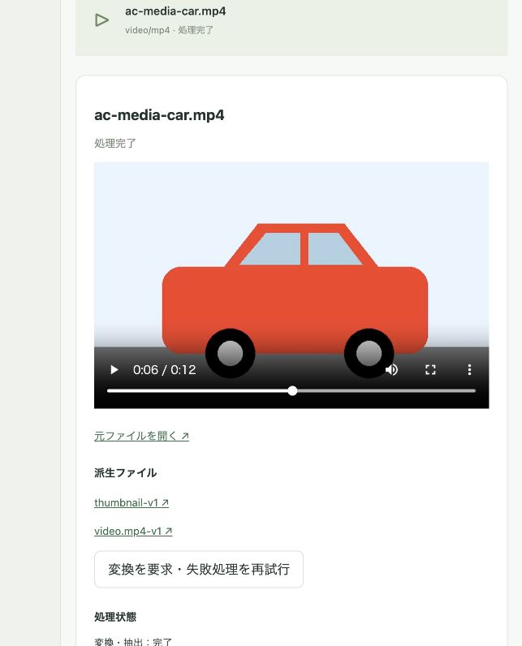
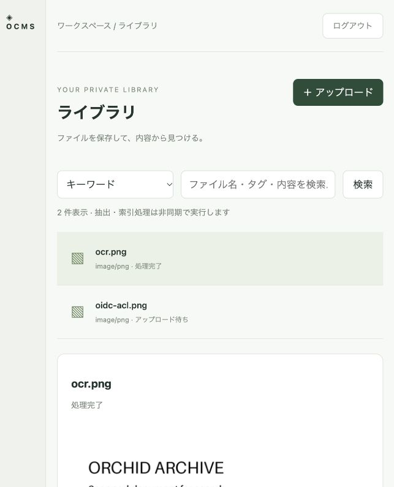
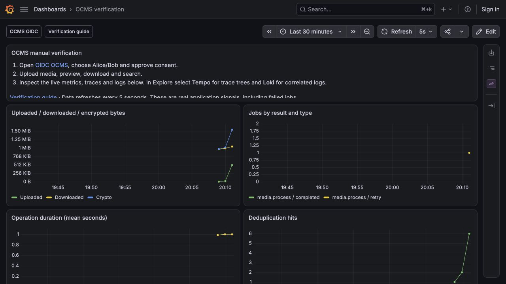
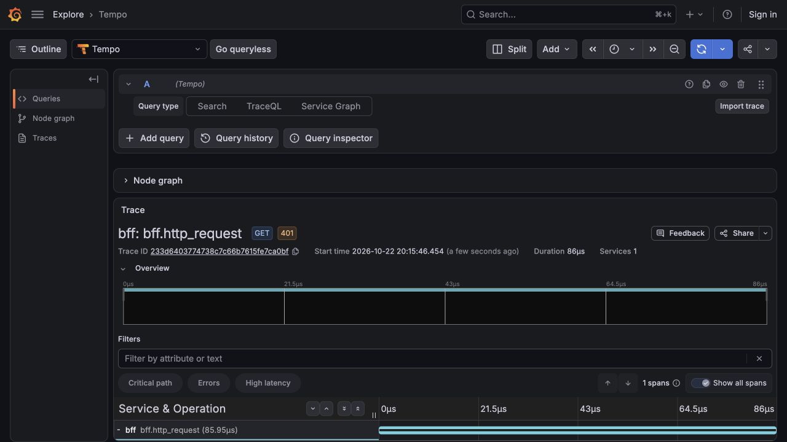
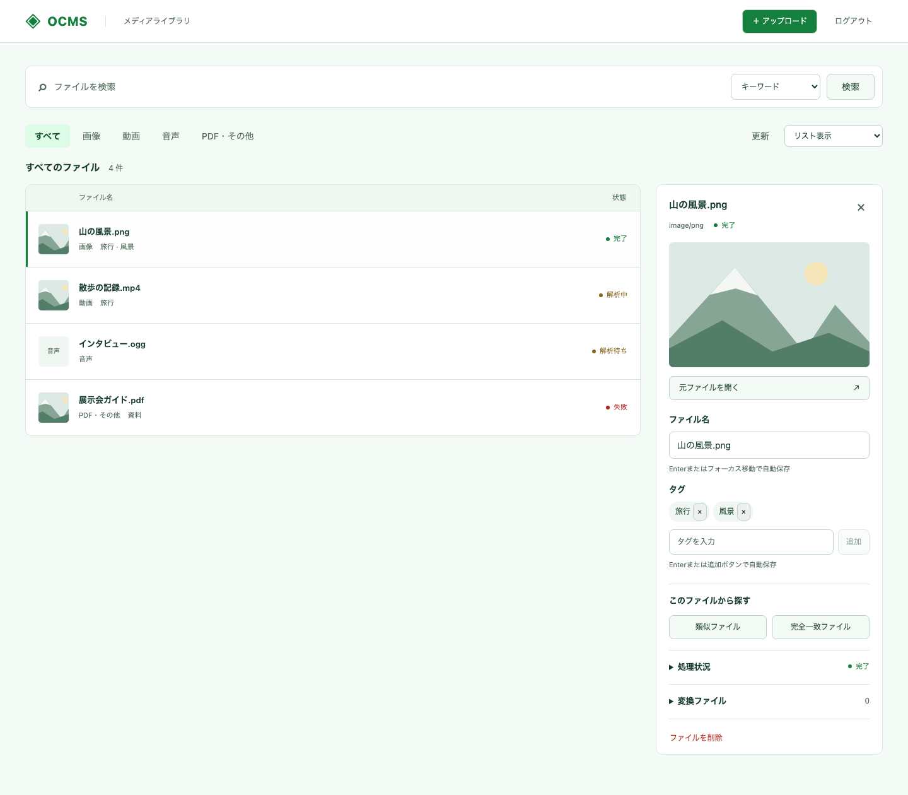
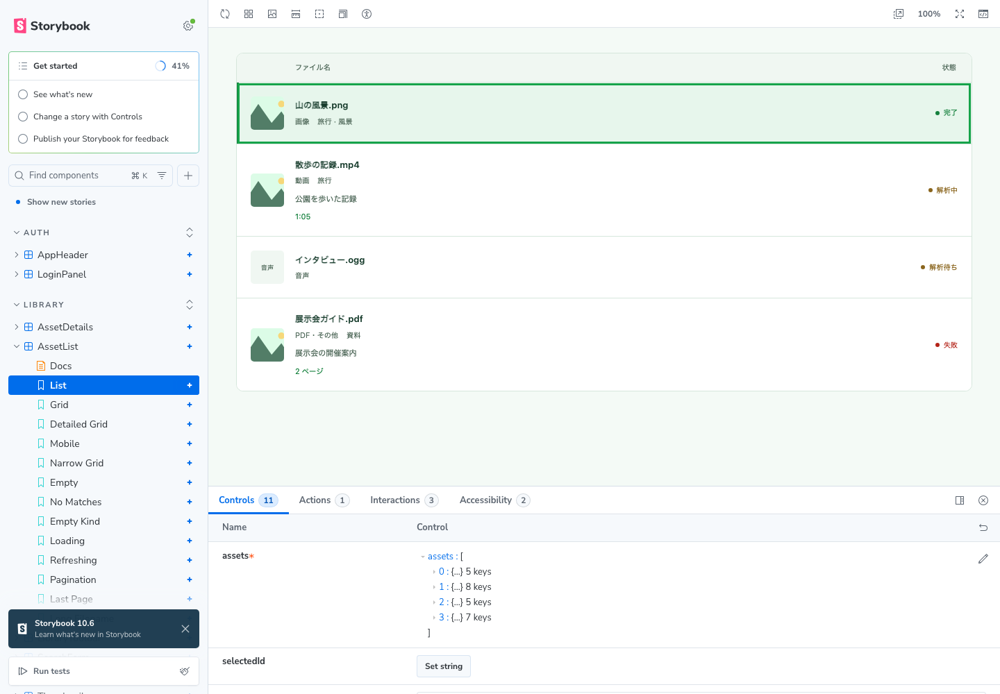
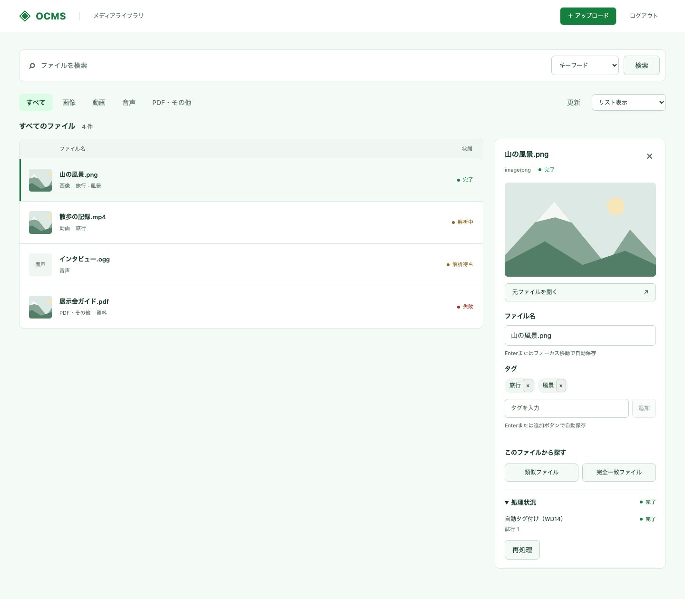

# 実装・検証状況

2026-10-23時点。保存・配信基盤に加え、Media Workerと実推論Runtime、HydraによるOIDC認証、OTLP三信号の受信をDocker Compose上で検証した。仕様全体の受け入れ完了を意味しない。

## 実装範囲

BFF / Catalog / Transfer / Search / Media Worker / 推論Runtimeを別プロセスで起動する。BFFに暗号鍵やS3資格情報は渡さず、CatalogとTransferは別DBロールで自身のスキーマだけを操作する。Searchはファイル名・タグをCatalogで、本文をPGroongaで検索し、pHash・Chromaprint・pgvectorの検索候補を統合する。結果を返す前に、Catalogが許可したAssetだけへ絞り込む。ファイル名・タグの一致を共有Blob内の別Assetへ流用しない。

Transferは平文をファイルへ保存せず、読み取りストリームからSHA-256を計算し、独立したDEKとnonceでAES-256-CTR暗号化する。S3オブジェクトは暗号文のみで、平文と同じ長さを持つ。DEKはBlob IDをAADに含めてAES-256-GCMでラップする。

S3への書き込み前に `storage.upload_objects` へ処理記録を登録し、暗号文保存後にBlobを確定する。同時重複はSHA-256/サイズのUNIQUE制約で収束する。Upload ID単位のadvisory lockで再送を直列化し、Catalogの完了に失敗しても、再送で確定済みBlobを再利用できる。CatalogはAsset参照・Upload完了・Outboxを同じトランザクションで保存する。WorkerはOutboxを取り込み、Jobの一意制約で重複配送を吸収する。JobはSKIP LOCKEDで取得し、90秒のリースを20秒ごとに更新する。異常終了時は期限後に再取得でき、最大4回まで再試行する。失敗処理をUIから再試行できる。

書き込み記録を残したまま失敗したオブジェクトは、1時間の猶予後、Uploadのロックと確定Blobの不在を確認して回収する。確定済みBlobの参照管理GCは未実装で、共有ファイルを誤って削除しないよう物理削除しない。

## 受け入れ基準の対応

| ID | 状態 | 検証内容・残作業 |
|---|---|---|
| AC-01 | Hydra実接続検証済み・Pocket ID未検証 | Hydra 2.3.0のDiscovery・署名付きID Token・Code Flow + PKCEを実行。state/nonce/PKCE改変・コールバック再利用を拒否し、セッション・CSRF・別OIDC主体のACL・ログアウトを確認。Pocket ID固有の接続は残る |
| AC-02 | 検証済み | 実S3暗号文のサイズとSHA-256を平文と比較。全体復号が元データと一致 |
| AC-03 | 検証済み | YAMLの検証、旧/新KEKのDEK復元、誤ったBlob IDでのunwrap拒否 |
| AC-04 | 検証済み | 実DBのDEKを新世代へ再ラップし、Transfer再起動後の復号成功とS3暗号文不変を確認 |
| AC-05 | 検証済み | 先頭・末尾・中間・1/15/17バイト位置、suffix、416、HEAD、If-Range、複数Rangeの全体応答 |
| AC-06 | 検証済み | 生成したH.264/AAC派生MP4をブラウザで再生し、12.03秒の動画の約6.04秒位置へUIからシーク。readyState=4、配信元が派生content URLであることも確認 |
| AC-07 | 検証済み | 別名・別所有者の同一平文が同じBlobを参照 |
| AC-08 | 検証済み | 8並列アップロードで同じBlobへ収束、Outboxは1件 |
| AC-09 | 検証済み | 画像WebP/PNG、動画H.264/AAC MP4 faststart、音声Opus/Ogg、PDFページPNGを生成。復号配信、派生Range、S3暗号文の長さ/ハッシュ、コンテナ識別子を確認 |
| AC-10 | 検証済み | 別所有者の同一BlobでRendition IDを共有。同じプロファイルの再要求・Job再試行で重複する派生結果を作らない |
| AC-11 | 検証済み | 文字PDF、スキャンPDF、画像OCR、音声ASRの実処理結果をPGroongaで検索。ページ番号とstart_ms/end_msを確認。英語の生成資料で検証し、日本語PGroonga演算子も別途確認 |
| AC-12 | 検証済み | PNGとリサイズJPEG、再エンコード動画、スキャンPDFとその元画像で、DCT pHashの類似候補を確認。実データでの閾値・動画時系列の精度評価は残る |
| AC-13 | 検証済み | 実Chromaprintを計算し、同じ読み上げ音声をMP3/OGGへ別々にエンコードした候補を検出 |
| AC-14 | 検証済み | 実EmbeddingGemma 2の画像・動画・音声ネイティブEmbeddingを768次元pgvectorへ保存。テキストから3種類を検索し、赤い車の画像が魚の画像より上位になることを確認。ハイブリッド検索とACL分離も検証 |
| AC-15 | 一部検証済み | 別ユーザーの一覧・全文/意味/ハイブリッド検索・詳細・配信・削除・重複結果・派生結果を分離。read Grantで閲覧可能・変換要求不可を検証。Grant変更の全組み合わせは残る |
| AC-16 | 検証済み | Go全5サービスと推論RuntimeのTrace / Metric / Logを実Collectorで受信。主要Span 12種とMetric 10種、HTTP親子関係、DBに保存した非同期JobのTrace伝搬、全6サービスのLog相関・リソース属性・Metric属性を照合。監査イベント9種と成功時の主体・処理結果・Trace相関、失敗JobのError Span・カウンタ・監査ログも検証 |
| AC-17 | 一部検証済み | S3/DB停止後の復旧、Catalog完了失敗からの再送、孤立書き込み記録の回収。JobのBlob/リース/期限照合、Search停止からのJob再試行とready復旧も検証。確定Blob GC、DB COMMIT応答喪失の実注入・Worker強制終了専用シナリオは残る |
| AC-18 | 一部検証済み | Collector受信データとアプリ標準出力でも、実OIDCのcode/state/nonce・セッション/CSRF・生成資格情報/KEK・本文/検索/ヘッダーの検査用文字列が含まれないことを確認。構造化ログにCookie・DEK・本文を渡さない。全入力・DEK全件・依存サービスの網羅検査ではない |
| AC-19 | 生成メディアで検証済み | 実WD14による画像・動画・PDFの一般タグ付与、タグ検索とACL、推論結果の重複再利用、手動タグの保持、再試行後の編集・削除維持を確認。実データでのタグ精度評価は残る |

## 実行結果

以下をローカルのDocker Engine 29.2.1 / Compose 5.6.0、linux/arm64コンテナで実行した。

- `docker compose build`：Go、TypeScript strictチェック、Vite、PGroonga/pgvectorイメージ、実モデル用Python Runtimeのビルド成功。
- `docker compose up -d --wait`：BFF / Catalog / Transfer / Search / Worker / Runtime / PostgreSQL / SeaweedFSの8コンテナがhealthy。
- 独立した `ocms-init-check` プロジェクトの空ボリュームから初回起動：マイグレーション001〜003、PGroonga/pgvectorの導入と8サービスのhealthyを確認し、検証用スタックだけを削除。
- `python3 scripts/integration.py`：実API・DB・S3を使う基盤の結合検証が成功。
- `python3 scripts/media-integration.py`：実メディア10件を生成・投入してAC-09〜14を検証。最終コードで `--resume` による派生Range・MP4 faststart・各モードACLの回帰検証も成功。
- 2ページのスキャンPDF：両ページの暗号化プレビュー・OCR・ネイティブEmbeddingを確認し、存在しないページが404になることも検証。
- `python3 scripts/job-recovery.py`：Workerの秘密情報非保持、実Jobの読み出し認可、read Grantでの変換要求拒否、Search停止からのJob再試行と派生再利用を検証。
- `PYTHONPYCACHEPREFIX="$PWD/.cache/pycache" python3 scripts/recovery.py`：通常の結合検証に加え、障害・鍵更新の検証が成功。
- `go test -race ./...`：暗号化/復号、鍵設定、Range契約、BFF認証/CSRF、pHashの明度変化耐性、Chromaprintのビット解釈・時間ずれ、推論ベクトル検証のテストが成功。
- `go vet ./...`：指摘なし。
- `compose.verify.yaml` の実Hydra・Collectorを起動し、`scripts/verify-oidc.py`、`scripts/verify-otel-workload.py`、`scripts/verify-otel.py` が成功。再現手順・検査範囲はREADMEの「Hydra OIDC・OTLPの実接続検証」を参照。
- 人による検証用の入口を `localhost:4446`、OIDC版OCMSを `localhost:8081`、Grafanaを `localhost:3000` に追加。ブラウザでAlice選択・同意・認証済みSPAへの復帰・画像アップロード・派生表示を実行した。Grafana LGTMのTempo / Prometheus / Lokiで実Trace・Metric・Logを取得し、専用ダッシュボードでも表示を確認。追加構成は起動したまま利用でき、自動試験の実行は手動利用の前提ではない。
- HTTP計測の属性からURL・クエリ・Cookie・本文を除外し、FastAPIの入力値を含み得る標準例外ログを無効化。HTTPの分散Trace伝搬・秘密情報非出力・206応答の維持をGoの回帰テストでも検証。
- フロントエンド依存のインストール時audit：0件。
- ブラウザ：開発ログイン、検索モード、派生ファイル/Job状態、動画描画・再生・途中シークを確認。

結合テストで見つけたRange解除（SDKのStat呼び出し）と並列重複処理での接続プール枯渇を修正し、同じ結合テストを再実行して通過した。

## 実PDFの解析失敗の修正

Grafanaの失敗ログ・Traceと実Jobを照合し、以下を修正した。

- 70ページPDFがWorkerとTransferそれぞれの固定50ページ制限で拒否されていた。両サービスが共有する `MEDIA_MAX_PDF_PAGES` に統一し、既定値を500へ変更。
- 9ページPDFの埋め込みが毎回600秒で中断され、成功済みの推論まで再計算していた。Job期限を既定7200秒へ変更し、004のチェックポイント表に推論結果を保存。実際の再起動後にページ結果の再利用を確認し、Job完了後は削除。
- CPU推論をfloat32・4スレッドへ変更し、glibcのarena制限と推論後のメモリ返却を追加。本文は全文を1000文字ずつに分割。生成画像での連続推論は約4秒だったが、6GBのColimaでは実ページの推論時にOOMが残ったため、32GBのホスト上でVMを12GBへ増量。最終構成ではRuntimeの再起動なしで処理が完了。
- 生のツール診断・本文を出さずに、期限超過、作業領域不足、メモリ不足、推論サービス停止を区別するログを追加。不正入力は自動再試行を繰り返さず、PDFのページ完了・埋め込みの進捗も記録。

| 実ファイル | 最終状態 | ページプレビュー | ページ埋め込み | 本文を含むベクトル総数 | 追加検証 |
|---|---|---|---|---|---|
| 9ページPDF | ready、両Job完了 | 9 | 9 | 28 | 最終ページの全体/非整列Range、全文検索、意味検索、チェックポイント削除 |
| 70ページPDF | ready、両Job完了 | 70 | 70 | 141 | 最終ページの全体/非整列Range、全文検索、意味検索、チェックポイント削除 |

`scripts/verify-pdf-recovery.py <blob-id> ...` で再検証できる。本文・ファイル名・検索語・資格情報は検査結果へ出さない。結果はGit対象外の `.cache/pdf-recovery-results.json` に保存する。AC-09〜14の回帰試験、追加した30秒動画の実変換・ASR・ネイティブ動画埋め込み、Go race/vet、制限境界・チェックポイント検証・ツール診断の非出力テストも成功した。

検証用の不正PNGや空ファイルによる過去の失敗ログは履歴として残る。今回修正対象とした実PDF2件の失敗Jobは解消し、検証用構成は起動したままにしている。

## ライブラリ画面の情報構成（2026-10-22）

一覧の上に検索・種類フィルターを集約し、ファイル名と処理状態を一覧の主情報にした。詳細はプレビュー、元ファイル、タグ、比較操作の順に配置し、処理状況と変換ファイルは折りたたみに収めた。類似・完全一致は選択ファイルから実行し、結果見出しに比較元を表示する。技術構成の常設説明と単一項目のサイドバーを削除した。

PDF検索結果では一致ページのプレビューを表示する。タグ保存後も検索のページ・時刻を保持する。狭い画面では詳細を一覧の上に表示し、選択時に詳細見出しへフォーカスを移す。

- `web/` の `npm ci` と `npm run build`：成功。
- `npm run test:ui`：生成データのAPI応答を使うChromiumの画面回帰テスト10件が成功。検索3方式、種類フィルター、比較元・解除、タグ保存、PDF一致ページ、再試行、空結果・エラー、削除確認、アップロード、認証方式の表示、狭い画面でのフォーカスを確認。1440 / 1024 / 800 / 390 / 320px幅で横スクロールが出ないことも確認。
- 今回はDocker Engineが停止しているため、実サービスとの結合試験・実動画再生・実OIDCログインは再実行していない。以下は生成データの画面で、実メディアの検証結果ではない。

[モバイル画面（生成データ）](library-ia-mobile.png)

## 一覧の表示切り替え（2026-10-23）

更新ボタンの右隣に表示方法のドロップダウンを追加した。表示を切り替えても、検索結果・種類フィルター・選択中のファイルを保持する。

選んだ表示方法はブラウザのlocalStorageに保存し、同じ接続先を再読み込みした場合や新しいタブで開いた場合に復元する。未保存・不正な保存値ではリスト表示にする。保存が制限された環境でも、その画面での表示切り替えは利用できる。別のブラウザ・端末との設定同期は行わない。

| 表示方法 | 表示内容 |
|---|---|
| リスト表示（初期表示） | 左端をサムネイルに変更。ファイル名・タグ・処理状態・検索の一致箇所を表示 |
| グリッド表示 | サムネイルのみの正方形。画像は枠を満たすようクロップし、ファイル名は読み上げとツールチップで確認 |
| 詳細グリッド表示 | 正方形のカードにサムネイルとタイトルを表示。画像はクロップせず、縦横比を保って枠内に収める |

表示方法の保存を追加した際は、`web/` の `npm ci --cache ../.cache/npm`・`npm run check`・`npm run build` とPlaywrightの画面回帰テスト31件が成功した。追加3件で全表示方法の再読み込み・新規タブでの復元、不正な保存値、保存機能が使えない場合の切り替えを確認。Chromiumはサンドボックスの起動制限を避けて制限外で実行した。フロントエンドのみの変更のため、Go・実サービスの結合試験は再実行していない。

画像・動画・PDFは認証付きの既存プレビューURLを遅延読み込みし、PDF検索結果では一致ページを指定する。音声やプレビューを取得できないファイルは代替表示にする。処理状態が変わるとプレビューを再取得する。元ファイルの一括ダウンロードや一覧ごとの変換要求は行わない。

`web/` の `npm ci`・`npm run build` と、生成データのAPI応答を使う画面回帰テスト15件が成功。新規5件でメニュー位置、サムネイルURL、縦長・横長画像、正方形の寸法、表示切り替え後の選択・フィルター・比較結果、プレビュー失敗からの復帰、PDF一致ページを確認した。両グリッドについて、詳細の開閉時と1440 / 1024 / 800 / 390 / 320px幅で横スクロールがないことも確認。実サービスを使う結合試験は今回は再実行していない。

[グリッド表示（生成データ）](library-grid.png) / [モバイル](library-grid-mobile.png)

[詳細グリッド表示（生成データ）](library-detailed-grid.png) / [モバイル](library-detailed-grid-mobile.png)

## フロントエンドの整形・lint（2026-10-23）

`web/` にBiome 2.6.2を固定バージョンで導入した。2スペース、シングルクォート、セミコロンの整形設定と推奨lintルール、import順の整理を有効にした。依存パッケージ、ビルド成果物、Playwright出力、`package-lock.json` は対象外とする。

既存ファイルを整形し、ボタンのtype、暗黙のany、未使用import、非nullアサーションを修正した。既存のEffectの実行タイミング、検索フォーム・ボタングループの構造、字幕契約のないアップロードメディア、別コンテナの画像セレクターは理由付きの局所的な抑制コメントで扱う。関数間の空行は開発規約に追加したが、Biomeには強制するルールがないため手動・レビューで確認する。

`web/` の `npm ci --cache ../.cache/npm`、`npm run format:check`、`npm run lint`、`npm run check`、`npm run build` が成功した。`npm run test:ui` はサンドボックス内でChromiumのMachポート作成を拒否されたため、権限制限の外で再実行して既存15件が成功した。実サービスを使う結合試験は、今回の変更がフロントエンドの開発ツール導入とlint対応のため再実行していない。

## コミット前のフロントエンド自動修正（2026-10-23）

Husky 9.1.7とlint-staged 17.6.0を固定バージョンで導入した。`web/` の `npm ci`・`npm install` でコミット前フックを登録し、ステージ済みファイルに `biome check --write --error-on-warnings` を実行する。修正は再ステージし、未解決のエラー・警告があればコミットを止める。対象外のファイルと削除のみの変更は処理を省く。

`npm ci --cache ../.cache/npm`、`npm run check`、`npm run build` が成功した。一時Gitリポジトリの実コミットで、空白を含むファイル名の自動修正・再ステージ、未ステージ部分の保持、lint警告によるコミット拒否と変更の復元、フロントエンド変更なし・削除のみのコミットを確認した。`.git` がない環境でも `prepare` が成功することを確認した。画面・サービスの実装変更はないため、画面回帰テストとサービス結合試験は再実行していない。

## shadcn/uiと緑系テーマへの移行（2026-10-23）

Button・Input・Label・Native Select・Progressをshadcn/uiベースのローカル部品へ移行した。Radix UI、Tailwind CSS 4、CVA、`cn()` を導入し、`web/components.json` に部品追加用の設定を置いた。Native Selectは既存のflex配置を保つため、ラッパーを追加せずブラウザ標準の矢印を使う。進捗表示はRadixのProgressを使い、値・上限・読み上げ用の名前を設定した。

背景・枠線・選択状態・主要操作・フォーカスを緑系のCSS変数に統一した。失敗と削除は赤、処理待ちは黄褐色で区別する。ヘッダー、検索、種類フィルター、表示切り替え、一覧と詳細の配置は維持した。Tailwind Preflightは読み込まず、既存の余白・幅・文字サイズを保っている。

- `web/` の `npm ci --cache ../.cache/npm`、`npm run check`、`npm run build`：成功。
- `UI_SCREENSHOTS=1 npm run test:ui`：Chromiumで17件が成功。既存15件に加え、移行前の主要6領域の座標・幅・高さとの一致（1440 / 1024 / 800 / 390 / 320px、3表示方法）と、アップロード進捗のアクセシビリティ・二重送信防止を検証した。寸法の基準はmacOSのChromiumで移行前に記録した。
- 生成データのPC・モバイル画面6枚を更新した。実サービスの結合試験・実OIDC・実メディア再生は、UI部品とテーマの変更のため再実行していない。

[PC画面（生成データ）](library-ia.png) / [モバイル画面（生成データ）](library-ia-mobile.png)

## SSOログインボタンの文字色修正（2026-10-23）

通常リンク用のCSSがshadcn/uiの文字色を上書きし、SSOログインボタンの背景と文字が同じ緑になっていた。通常リンクの色指定から `.ui-button` を除外し、ボタンのvariantに応じた文字色を使うよう修正した。配置と寸法は変更していない。

既存の認証画面テストに、SSOボタンの緑背景・白文字、およびホバー・フォーカス時にも白文字を保つ検査を追加した。修正前に文字色の不一致を再現し、修正後は `npm ci --cache ../.cache/npm`、`npm run check`、`npm run build`、`UI_SCREENSHOTS=1 npm run test:ui`（17件）が成功した。実OIDCログインは再検証していない。

[SSOログイン画面（生成データ）](login-sso.png)

## ページネーションと詳細の追従（2026-10-23）

通常一覧を1ページ24件のAPI取得に変更し、先頭200件より後のファイルにも移動できるようにした。前へ・次へ、現在ページ、表示範囲と総件数を表示する。種類はページ取得前にCatalogで絞り込み、総件数にもACLと論理削除を適用する。同じ作成日時ではAsset IDの降順で順序を固定する。offset方式のため、移動中の追加・削除で表示位置が変わる場合がある。

検索・比較は取得済み結果を24件ずつ表示し、既存の検索最大200件・類似最大20件・完全一致最大200件の上限は維持する。検索・種類・比較元の変更では先頭へ戻り、表示方法と選択中の詳細はページを移動しても保持する。最終ページの最後のファイルを削除すると、有効なページへ戻る。

幅800pxを超える画面では詳細パネルを画面内に追従させ、内容が長い場合はパネル内をスクロールする。ページ最下部でも見出しが隠れないよう下余白を確保する。幅800px以下では従来どおり一覧の上に配置する。

- `npm ci --cache ../.cache/npm`、`npm run check`、`npm run build`：成功。
- Playwrightの画面回帰テスト21件：成功。追加4件で217件の移動、表示と選択の保持、最終ページの削除、検索・比較・種類変更、詳細の追従と内部スクロールを検証。ChromiumはサンドボックスのMachポート制限のため制限外で実行した。
- `go test -race ./...`、`go vet ./...`：成功。ページ指定の既定値・境界値・不正値の回帰テストを追加した。
- `scripts/pagination-integration.py`：実API・DBで217件のページ取得、同時刻の並び順、種類別件数、read Grantと非公開・削除済みファイルの除外、不正な指定の400応答を確認。生成したDB行は削除した。
- `scripts/integration.py`：認証・CSRF、保存・Range、並列重複排除、一覧以外のACLと検索、削除、DBロール分離の既存結合試験も成功。
- Dockerイメージを再ビルドし、Catalog・開発用BFF・OIDC用BFFへ反映。メディア処理・実動画再生・実OIDCログイン・OTLPの試験は今回再実行していない。

[ページ操作とスクロール中の詳細（生成データ）](library-pagination.png)

## 残る実装・評価

1. Pocket IDとの実接続、セッションの共有永続化、Grant管理の外部契約/UIと網羅テスト。
2. Upload状態の細分化・期限切れ処理、確定Blobの参照管理GC、マイグレーション適用履歴の管理。
3. 動画pHashの時間的整合性を使う二次判定、音源の切り出し・長さ違いの評価、類似閾値の実データ評価。
4. 日本語・多言語OCR/ASRの精度評価。Tesseractの`eng+jpn`と多言語Whisperを使うが、今回のメディアテストは英語の生成資料。日本語PGroongaの索引検索は別途成功を確認。
5. 負荷・キャンセル・Worker強制終了シナリオ。今回のCollectorとGrafana LGTMはローカル検証専用。本番向けの認証・TLS・保持運用は別途必要。
6. 生メディアを入力する `/api/v1/search/by-media`、追加変換プロファイル、検索・比較APIの結果上限を超えるページング、各処理上限の設定化。

## 実装上の制約

- 検索は最大200結果、最大1000 Blob候補。候補生成後のCatalog認可で非公開情報を除外するため、大量の非公開候補が上位にある場合の検索再現率には改善の余地がある。
- 画像のMIMEヘッダー、PDF署名、FFprobeによる解析、画素数・時間・ページ数・作業領域・メモリ・実行期限を制限する。全形式・圧縮爆弾への網羅的な耐性試験は未完了。
- 動画pHashは5秒間隔・最大12フレームの初期実装。動画Embeddingは全体を30秒単位で処理する。動画の順序/時間を使う知覚類似の二次判定は残る。
- プレビュー・変換は標準プロファイルのみ。画像WebP/PNG、動画H.264/AAC MP4、音声Opus/Ogg、PDFページPNGを実装する。手動画質切替、AVIF/JPEG等の追加プロファイルは未実装。
- CPU推論は動画1区間でも数十秒かかる場合がある。大規模処理の速度や検索品質を保証する評価は行っていない。モデルのリビジョン・次元・プレフィックスは統一している。
- Workerの作業平文はtmpfsで処理後に削除し、鍵・S3資格情報はTransferに限定する。Runtimeのメディア一時ファイルもtmpfsで処理後に削除する。
- アプリログとOTLPの非出力検査にはWorker/Runtimeを含む。依存サービスやDocker自身の診断・設定出力、運用環境での収集・保持・アクセス制御は別途評価が必要。

## 参照した一次資料

- [EmbeddingGemma 2のマルチモーダルAPI](https://ai.google.dev/gemma/docs/embeddinggemma/multimodal-embeddinggemma-with-sentence-transformers)
- [PGroonga公式Dockerイメージ](https://github.com/pgroonga/docker)
- [pgvector](https://github.com/pgvector/pgvector)
- [faster-whisperとPyAV 19の非互換](https://github.com/SYSTRAN/faster-whisper/issues/1589)：PyAV 18.1.0へ固定し、ASRには16kHz波形を渡す。
- [Hydra公式Quickstart](https://www.ory.com/docs/oel/hydra/quickstart)
- [OpenTelemetry Go Exporters](https://opentelemetry.io/docs/languages/go/exporters/)
- [Grafana Docker OpenTelemetry LGTM](https://grafana.com/docs/opentelemetry/docker-lgtm/)

## コンポーネント分割とStorybook（2026-10-23）

`main.tsx` を起動処理に絞り、認証・API通信・ポーリング・更新を `App.tsx` に分離した。ヘッダー、ログイン、アップロード操作と進捗、検索、種類・表示切り替え、一覧、詳細、サムネイル、状態表示を `web/src/components/library/` に配置し、propsとコールバックで接続する。型と表示用の関数は `web/src/lib/assets.ts` で共有する。サービス責務・API契約・仕様§3と§14のACには変更がない。

Storybook 10.6.3に61のStoryを追加した。ライブラリの3表示、空一覧、検索中、選択・ページ操作、PDF一致ページ、処理失敗、進捗、ログイン2方式、既存のshadcn/ui部品を確認できる。Controls、Actions、Interactions、AccessibilityパネルとPC・モバイルのViewportを用意した。MSWが生成メディアを返し、それ以外の `/api/` 通信を遮断する。実APIやログインは不要で、動画・音声の実再生は検証対象に含めない。

- Node.js 24.18.0で `npm ci --cache ../.cache/npm`、`npm run check`、`npm run build`、`npm run build-storybook`：成功。依存のauditは0件。静的ビルドは `web/storybook-static/` に出力。
- `npm run test:ui`：既存の画面回帰テスト21件が成功。表示・余白、検索、比較、タグ編集、アップロード、削除確認、ページ操作、フォーカス移動を維持。
- `npm run test:storybook`：Chromiumで61件が成功。描画に加え、検索・フィルター、選択・ページ操作、タグの整形と保存、比較、失敗処理の再試行、ファイル選択を操作してコールバックを検証。
- Storybookをブラウザで開き、一覧表示・Controls・生成プレビュー画像3件の読み込みとページ例外がないことを確認。
- アクセシビリティ検査は `test: 'todo'` とし、指摘をパネルへ表示する。既存ファイルボタンの可視テキストとアクセシブル名の不一致が残っており、適合確認済みとはしない。
- UIの分割と検査環境の追加に限定したため、Go・実サービス・DB・S3・推論の結合試験は再実行していない。

## アップロードボタンの配置変更（2026-10-23）

アップロードボタンを「OCMS｜メディアライブラリ」のヘッダー右側へ移し、本文の「ライブラリ」見出しとその行を削除した。狭い画面ではヘッダー内の余白を調整する。

- `web/` の `npm ci --cache ../.cache/npm`、`npm run check`、`npm run build`：成功。
- `UI_SCREENSHOTS=1 npm run test:ui -- --update-snapshots`：21件が成功。ヘッダーからのファイル選択、アップロード完了、処理中の二重送信防止、1440 / 1024 / 800 / 390 / 320px幅での表示を確認し、配置の基準値と一覧のスクリーンショットを更新した。Chromiumの起動にはサンドボックス外での実行が必要だった。
- 表示配置のみの変更のため、Go・実サービスの結合試験は再実行していない。

## 全画面のファイル閲覧（2026-10-23）

詳細プレビューのクリック、一覧のダブルクリック、選択済みファイルの再選択から、暗い背景の全画面閲覧画面を開けるようにした。動画・音声は標準プレイヤーで再生し、派生MP4・Opusがある場合は優先する。画像は元画像を表示し、PDFはPDF.jsで元ファイルを描画する。PDFの検索一致ページと動画・音声の一致時間を引き継ぐ。未対応形式や読み込み失敗時には元ファイルへのリンクを表示し、他のファイルへの移動を維持する。

左右スワイプ・左右キー・前後ボタンで一覧順に移動し、通常一覧のAPIページ境界も越える。画像・PDFは画面に合わせた表示を100%として500%まで拡大でき、ピンチと拡大後のドラッグに対応する。拡大中のドラッグやピンチではファイルを切り替えない。PDF内のページは別の前後ボタンで移動する。閉じるボタンとEscapeで一覧に戻り、キーボードフォーカスを復帰する。閲覧中は背景のスクロール・操作を抑止する。

PDF.js 6.4.299はPDF表示時だけ読み込む。Worker・CMap・フォント・画像デコーダーを同梱し、外部CDNへ接続しない。BFFのCSPはPDF用のBlobフォントとWebAssemblyを許可する。インラインスクリプト・JavaScriptのeval・外部スクリプトは許可しない。PDFの描画用Canvasは最大約1600万画素に抑える。サービスの責務とAPI契約は変更せず、仕様§12を更新した。関連するACは動画シークのAC-06、配信・認可のAC-05 / AC-15で、今回その実サービス経由の再検証はしていない。

- Node.js 24で `npm ci --cache ../.cache/npm`、`npm run check`、`npm run build`：成功。依存auditは0件。サンドボックス内の `npm ci` は完了したが、HuskyのGit設定書き込みは制限された。
- Playwright 28件：成功。追加7件で全表示方法からの起動、全画面サイズ、拡大・ドラッグ、フォーカス循環と復帰、320 / 390px幅、実PDFの複数ページ描画とCSP、ページ境界の移動と取得失敗後の再試行、未対応形式と読み込み失敗、CDPによるタッチのピンチ・スワイプ、生成WebM / WAVの実再生とプレイヤー切り替えを確認した。
- `npm run test:storybook`：既存61件が成功。Chromiumを使う検証はサンドボックスのMachポート制限を避けて制限外で実行した。
- 作業ディレクトリ内のGoキャッシュを指定した `go test -race ./...` と `go vet ./...`：成功。CSPの許可範囲を確認する回帰テストを追加した。
- 開発用BFFとOIDC用BFFを再ビルド・更新。DB・S3・メディア処理・実OIDC認証・OTLPの結合試験は再実行していない。
- ブラウザ検証はChromiumと生成データによるもの。Safari / iOS実機、全PDFの文字・画像形式、巨大PDFの性能評価は未実施。PDFのテキスト選択・注釈編集は対象外。

[モバイルの画像閲覧](library-viewer-mobile.png) · [PDFの拡大表示](library-viewer-pdf.png)

## WD14一般タグの自動付与（2026-10-23）

画像・動画・PDFのメディア解析後に `tags.generate` Jobを作成し、独立したRuntimeでWD 1.4 ConvNext Tagger V2を実行する。category 0の一般タグだけを閾値0.35で採用し、キャラクターとレーティングを除外する。動画は全体から最大12フレーム、PDFは各ページを処理し、最大スコアで集約した上位256タグを付与する。音声は対象外。

Catalogは推論結果をBlob単位で保存し、各Assetのタグへ一度だけ追加する。既存の手動タグを保持し、自動タグも付与後に編集・削除できる。重複Assetにはモデルの結果だけをコピーし、別Assetの手動タグを共有しない。状態同期で新しい重複Assetへの適用漏れを補う。内部の保存APIはJob・Blob・リース・期限を照合する。新しいテーブルと適用済みフラグ、Job種別、既存の解析済みファイルの処理待ちはマイグレーション005で追加する。適用前に旧Workerを停止する手順をREADMEに記載した。

検証結果：

- `go test -race ./...` と `go vet ./...`：成功。フレームの全体サンプリング、スコア集約・不正値拒否、Workerに認可を拒否されたJobがCatalogへ保存できないことを含む。
- RuntimeのPython単体テスト3件：一般タグの分類・閾値、異常出力の拒否、白背景・余白・BGR・画素値の前処理を確認。
- `scripts/media-integration.py --resume`：既存の実生成メディアでAC-09〜14、タグJobを含む完了待ち、検索のACL分離が成功。
- `scripts/tagging-integration.py`：新しいBlobになるメタデータを付けた生成PNG・MP4・PDFで、新規Jobの作成から実推論・保存・検索を確認。別ユーザーの閲覧と検索の拒否、手動タグ保持、タグ削除後のJob再試行、同一Blobの重複アップロードでの結果再利用も成功。合計100件を超えるタグの編集、手動タグが512件ある場合の保持、513件目の拒否も確認した。
- `npm ci --cache ../.cache/npm`、`npm run check`、`npm run build`：成功。追加したWD14のJob表示に対するPlaywrightテスト1件も成功し、生成データの画面を下に掲載した。ChromiumはsandboxのMachポート制限で起動できなかったため、UIテストをsandbox外で実行した。
- ローカルDBへ005を適用し、解析済みの既存ファイルのタグ付けJob 24件と、新規アップロード3種類のJob完了を確認。Runtime・Worker・Catalogを更新し、OIDC・OTLP検証サービスも起動を維持した。

タグの精度は実際の画像や動画で別途評価が必要。動画はサンプリングするため、短時間だけ現れる内容を取りこぼす場合がある。タグJobは推論途中のチェックポイントを持たず、失敗時は画像・フレーム・ページの推論から再実行する。今回の変更で障害復旧スクリプトやOIDC・OTLP全体の検証は再実行していない。

## 詳細パネルのファイル名・タグ編集（2026-10-23）

詳細のプレビュー下にファイル名入力を追加し、Enter・フォーカス移動で自動保存、Escapeで編集を取り消せるようにした。タグは折り返すチップで表示し、Enter・追加ボタンによる1件ずつの追加と、×による削除に対応する。カンマでは分割しない。空文字・重複タグ・既存APIのバイト数と件数上限を送信前に検査する。

保存中は編集を無効化し、日本語変換中のEnterと二重送信を防ぐ。失敗時は入力と再試行操作を残す。更新結果はAsset IDで照合して詳細・一覧・比較元へ反映し、検索結果のページ・再生時刻を保持する。一覧の再取得失敗は保存失敗と区別して知らせる。既存のCatalog PATCH・認可を利用し、API・DB・サービスの変更はない。

`npm ci --cache ../.cache/npm`、`npm run check`、`npm run build`、`npm run test:storybook`（68件）、`npm run test:ui`（40件）が成功した。保存・削除・失敗後の再試行、通信中の選択変更、比較元名の更新、一覧再取得失敗、PDFページ・動画時刻の保持を生成データで確認した。1440px・390px・320pxで長い名前と多数の長いタグが横にはみ出さないことを確認し、画面例とレイアウト基準を更新した。ブラウザはサンドボックスのMachポート制限により通常起動できず、制限外でテストを実行した。npm依存のauditは0件。Go・実DB・S3を使う結合試験は、フロントエンドのみの変更のため再実行していない。

