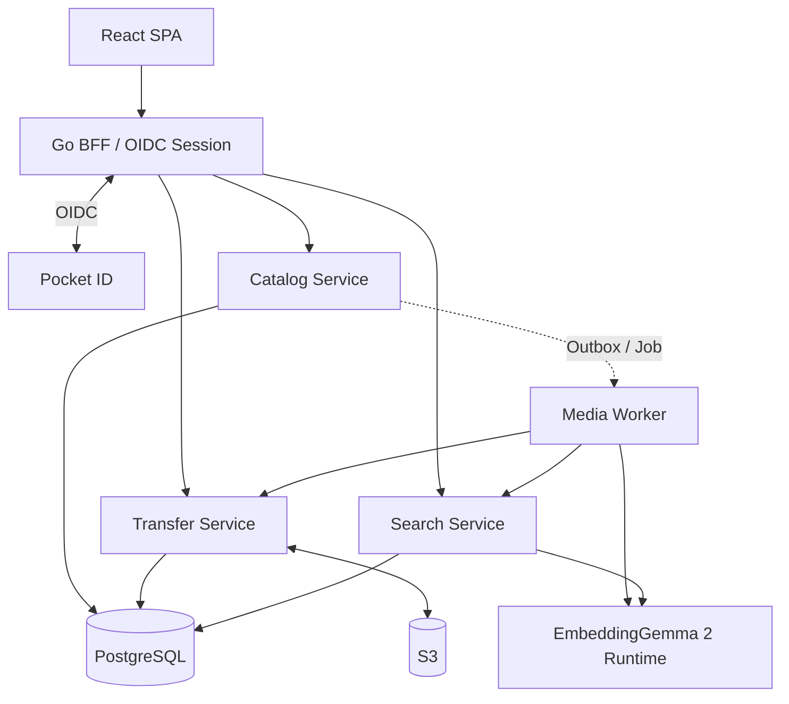
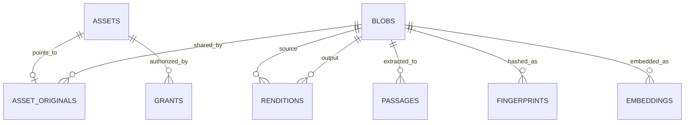
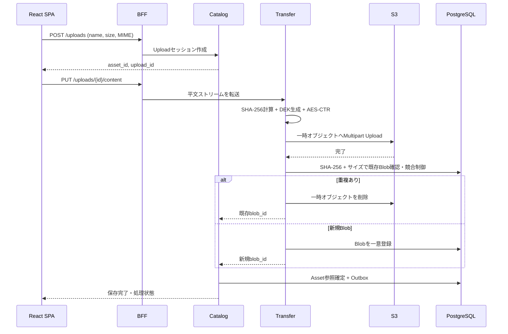

# 暗号化メディアストレージ システム仕様書

| 項目 | 内容 |
|---|---|
| 文書名 | 暗号化メディアストレージ システム仕様書 |
| バージョン | 2.0（設計ベースライン） |
| 作成日 | 2026-10-22 |
| 状態 | 要件合意済み／一部パラメータ・採用ライブラリ未確定 |
| 対象 | React SPA、Goマイクロサービス、PostgreSQL、S3互換オブジェクトストレージ |

## 1. 目的と前提

画像・動画・音声・PDFをアップロードし、サーバー側で暗号化してS3に保存する。ファイル情報・暗号鍵情報・検索用インデックスはPostgreSQLに保存する。完全一致・知覚的類似・全文・マルチモーダル意味検索を提供し、メディアの再エンコード、プレビュー、動画・音声のシーク再生に対応する。

- **E2EEは採用しない**。サーバーが平文を処理できる。
- **S3・DB・通信経路・クライアントは信頼できる**という設計上の前提を置く。保存データの改ざん検知は必須要件としない。
- 暗号化ファイルの機密性のために**AES-256-CTR**を採用する。AES-CTRは認証付き暗号ではない。暗号文の改変検出・改変への耐性は提供しない。
- マスターキーは**ローカルの設定用YAML**からロードする。KMS、Vaultは採用しない。PostgreSQLには暗号化済みDEKを保存する。
- 動画配信は**MP4 + HTTP Range（206 Partial Content）**を基本とする。**HLSは対象外**。
- ログを監査記録として利用する。監査専用DBテーブルは作成しない。
- **OpenTelemetry（Trace、Metric、Log）**に対応する。
- **インフラの構築・運用設計は対象外**。S3、PostgreSQL、Pocket ID、モデル実行環境などの用意・配置手順は定義しない。

### 1.1 機能の適用範囲

| 機能 | 対象 |
|---|---|
| ファイル形式 | 画像、動画、音声、PDF |
| SSO | Pocket ID を想定した OIDC |
| 保存 | AES-256-CTR暗号文をS3に格納 |
| 復号 | 保存時に生成したファイルごとのDEKによるサーバー側復号 |
| 重複検出 | 平文バイナリのSHA-256 + バイト数による完全一致 |
| 類似検索 | 画像pHash、動画フレームpHash、PDFページpHash、音声フィンガープリント |
| 全文検索 | ファイル名、タグ、PDF本文、OCR、文字起こし |
| 意味検索 | EmbeddingGemma 2でテキスト・画像・動画・音声を共通ベクトル空間に埋め込み |
| 派生メディア | 画像・動画・音声の再エンコード、サムネイル、PDFページプレビュー |
| 配信 | ファイルダウンロード、画像/PDFプレビュー、MP4/音声のRange再生 |

### 1.2 対象外

E2EE、DRM、HLS/ABR（回線速度に応じた自動ビットレート切替）、専用監査DB、KMS/Vault、S3/DB/ネットワークなどのインフラ設計、第三者に対する改ざん証明は実装しない。ブラウザからの途中再開可能なアップロードは初期版では対象外とする。

## 2. 採用技術

| 区分 | 技術・方式 |
|---|---|
| フロントエンド | TypeScript、React SPA |
| API / マイクロサービス | Go |
| 認証 | Pocket ID / OpenID Connect、BFFセッション |
| メインDB | PostgreSQL |
| PostgreSQL拡張 | PGroonga（日本語全文検索）、pgvector（ベクトル・bit距離検索） |
| オブジェクト保存 | S3互換ストレージ |
| ストリーム暗号 | AES-256-CTR |
| DEKラップ | AES-256-GCM（32バイトの鍵素材のラップ用途のみ） |
| 完全一致検出 | SHA-256 |
| 知覚類似 | pHash、動画のフレーム列、Chromaprint等の音響フィンガープリント |
| 再エンコード・解析 | FFmpeg/FFprobe、画像ライブラリ、PDFテキスト抽出、OCR、ASR（後二者の具体製品は未選定） |
| 意味検索モデル | `google/embeddinggemma-2`（768次元） |
| モデル実行 | 推論専用コンポーネント（当面Python + sentence-transformersを想定） |
| 非同期処理 | PostgreSQLベースのJob Queue / Transactional Outbox |
| 可観測性 | OpenTelemetry、OTLP、構造化ログ |

**注意：** EmbeddingGemma 2は**埋め込みモデル**であり、OCRやASRの代替ではない。PDFの文字抽出や時間付き文字起こしには別途抽出処理が必要。

## 3. アーキテクチャ



### 3.1 サービス責務

| サービス | 責務 | 保持しない責務 |
|---|---|---|
| **BFF / Auth** | OIDC Code Flow、セッションCookie、CSRF、フロントエンド向けAPI、内部への認証主体伝搬 | S3 I/O、暗号鍵操作 |
| **Catalog Service** | 論理Asset、所有者・ACL、アップロード状態、AssetとBlobの参照、重複結果へのアクセス制御 | 暗号化・復号、モデル推論 |
| **Transfer Service** | マスターキー読み込み、DEK生成/ラップ、AES-CTR暗号化・復号、S3 I/O、SHA-256計算、HTTP Range、Blob登録 | OCR、全文検索 |
| **Search Service** | 全文・pHash・音声フィンガープリント・ベクトル検索、検索結果統合、Catalog経由の一括認可 | 平文ファイル保存 |
| **Media Worker** | EXIF、OCR、PDF本文抽出、ASR、再エンコード、サムネイル、知覚ハッシュ、Embedding生成 | ユーザー直接認証、マスターキー参照 |
| **Embedding Runtime** | マルチモーダルEmbedding推論API | 検索DB操作、ACL判断 |

### 3.2 通信ルール

1. SPAからの要求はBFFを経由する。同期APIはHTTP/JSON、バイナリはHTTPストリーム。
2. BFFがユーザーを認証し、Catalogで認可する。サービス間ヘッダーを外部クライアントからの値として信用しない。
3. Media WorkerはTransferの内部APIから認可された復号ストリームを取得する。Worker自体にはYAMLマスターキーを渡さない。
4. 解析・再エンコード・埋め込み生成は非同期Jobとして実行する。
5. サービスはPostgreSQLのスキーマ/DBロールで論理分離する。原則として他サービスのテーブルを直接更新せず、内部API・イベントで連携する。
6. 最小構成では同一PostgreSQLクラスタを共有する。外部のメッセージブローカーは必須としない。
7. `context.Context`、リクエスト期限、キャンセルおよびトレースコンテキストを伝搬する。

## 4. データモデル

### 4.1 概念

- **Asset**：ユーザーが扱う論理ファイル。所有者、ファイル名、タグ、ACLなどを持つ。同じ内容でもユーザーごとに独立する。
- **Blob**：バイト列そのものを表す不変のS3暗号化オブジェクト。同一平文バイナリは可能な限り一つのBlobにまとめる。
- **Rendition**：既存Blobから変換された派生Blobと変換プロファイルの関係。
- **Passage**：PDFのページ、OCR抽出結果、文字起こしの時間区間などのテキスト検索単位。
- **Fingerprint**：Blobまたはそのフレーム/ページに対する知覚的特徴量。
- **Embedding**：Blob、ページ、時間区間、テキスト断片に対するベクトル。



完全一致Blobの共有と、AssetごとのACL・タグ・ファイル名は独立させる。検索インデックスは基本的にBlob単位、Asset固有の検索属性はCatalog側で管理する。

### 4.2 PostgreSQL論理スキーマ

| Schema | 主なテーブル | 所有 |
|---|---|---|
| `catalog` | `principals`, `assets`, `asset_originals`, `grants`, `upload_sessions`, `outbox_events` | Catalog |
| `storage` | `blobs`, `upload_objects` | Transfer |
| `media` | `renditions`, `processing_jobs` | Media Worker |
| `search` | `passages`, `perceptual_hashes`, `audio_fingerprints`, `embeddings` | Search |

### 4.3 主要DDL（設計ベースライン）

以下は主要カラムと制約の定義。`updated_at`更新トリガー、内部サービスのDBロール・権限、細部の参照制約、マイグレーションの順序は実装時に追加する。

```sql
CREATE EXTENSION IF NOT EXISTS pgcrypto;
CREATE EXTENSION IF NOT EXISTS vector;
CREATE EXTENSION IF NOT EXISTS pgroonga;

CREATE SCHEMA IF NOT EXISTS catalog;
CREATE SCHEMA IF NOT EXISTS storage;
CREATE SCHEMA IF NOT EXISTS media;
CREATE SCHEMA IF NOT EXISTS search;

CREATE TABLE catalog.principals (
    id UUID PRIMARY KEY DEFAULT gen_random_uuid(),
    kind TEXT NOT NULL CHECK (kind IN ('user', 'group')),
    oidc_issuer TEXT NOT NULL,
    oidc_subject TEXT NOT NULL,
    UNIQUE (kind, oidc_issuer, oidc_subject)
);

CREATE TABLE catalog.assets (
    id UUID PRIMARY KEY DEFAULT gen_random_uuid(),
    owner_id UUID NOT NULL REFERENCES catalog.principals(id),
    filename TEXT NOT NULL,
    mime_type TEXT NOT NULL,
    tags TEXT[] NOT NULL DEFAULT '{}',
    metadata JSONB NOT NULL DEFAULT '{}',
    status TEXT NOT NULL CHECK
      (status IN ('pending','uploading','stored','processing','ready','failed','deleted')),
    created_at TIMESTAMPTZ NOT NULL DEFAULT now(),
    updated_at TIMESTAMPTZ NOT NULL DEFAULT now(),
    deleted_at TIMESTAMPTZ
);

-- Asset -> オリジナルBlob。blob_idはTransfer所有スキーマの論理参照。
CREATE TABLE catalog.asset_originals (
    asset_id UUID PRIMARY KEY REFERENCES catalog.assets(id),
    blob_id UUID NOT NULL,
    created_at TIMESTAMPTZ NOT NULL DEFAULT now()
);
CREATE INDEX idx_asset_originals_blob ON catalog.asset_originals(blob_id);

CREATE TABLE catalog.grants (
    asset_id UUID NOT NULL REFERENCES catalog.assets(id),
    principal_id UUID NOT NULL REFERENCES catalog.principals(id),
    permission TEXT NOT NULL CHECK (permission IN ('read','write','admin')),
    PRIMARY KEY (asset_id, principal_id)
);
CREATE INDEX idx_grants_principal ON catalog.grants(principal_id, asset_id);

CREATE TABLE catalog.upload_sessions (
    id UUID PRIMARY KEY DEFAULT gen_random_uuid(),
    asset_id UUID NOT NULL REFERENCES catalog.assets(id),
    expected_size BIGINT NOT NULL CHECK (expected_size >= 0),
    state TEXT NOT NULL CHECK (state IN ('created','uploading','completed','failed','expired')),
    idempotency_key TEXT,
    expires_at TIMESTAMPTZ NOT NULL,
    created_at TIMESTAMPTZ NOT NULL DEFAULT now(),
    UNIQUE (asset_id, idempotency_key)
);

-- キー本体はYAMLに保存し、DBには保存しない。
CREATE TABLE storage.blobs (
    id UUID PRIMARY KEY,
    sha256 BYTEA NOT NULL CHECK (octet_length(sha256) = 32),
    size_bytes BIGINT NOT NULL CHECK (size_bytes >= 0),
    bucket TEXT NOT NULL,
    object_key TEXT NOT NULL,
    s3_version_id TEXT,
    cipher_version SMALLINT NOT NULL DEFAULT 1,
    master_key_id TEXT NOT NULL,
    encrypted_dek BYTEA NOT NULL,
    dek_wrap_nonce BYTEA NOT NULL CHECK (octet_length(dek_wrap_nonce) = 12),
    ctr_nonce_prefix BYTEA NOT NULL CHECK (octet_length(ctr_nonce_prefix) = 8),
    status TEXT NOT NULL CHECK (status IN ('ready','deleting')),
    created_at TIMESTAMPTZ NOT NULL DEFAULT now(),
    UNIQUE (sha256, size_bytes),
    UNIQUE (bucket, object_key)
);

CREATE TABLE media.renditions (
    id UUID PRIMARY KEY DEFAULT gen_random_uuid(),
    source_blob_id UUID NOT NULL,
    output_blob_id UUID NOT NULL,
    profile_id TEXT NOT NULL,
    profile_version INTEGER NOT NULL,
    encoder_version TEXT NOT NULL,
    created_at TIMESTAMPTZ NOT NULL DEFAULT now(),
    UNIQUE (source_blob_id, profile_id, profile_version, encoder_version)
);
CREATE INDEX idx_renditions_output ON media.renditions(output_blob_id);

CREATE TABLE media.processing_jobs (
    id UUID PRIMARY KEY DEFAULT gen_random_uuid(),
    event_id UUID NOT NULL,
    source_blob_id UUID NOT NULL,
    job_type TEXT NOT NULL,
    pipeline_version INTEGER NOT NULL,
    status TEXT NOT NULL CHECK
      (status IN ('queued','running','retry','completed','failed')),
    attempts INTEGER NOT NULL DEFAULT 0,
    available_at TIMESTAMPTZ NOT NULL DEFAULT now(),
    locked_until TIMESTAMPTZ,
    error_code TEXT,
    UNIQUE (event_id, job_type, pipeline_version)
);
CREATE INDEX idx_jobs_pending ON media.processing_jobs(available_at)
    WHERE status IN ('queued','retry');

CREATE TABLE search.passages (
    id BIGINT GENERATED ALWAYS AS IDENTITY PRIMARY KEY,
    blob_id UUID NOT NULL,
    kind TEXT NOT NULL CHECK (kind IN ('pdf_text','ocr','transcript')),
    ordinal INTEGER NOT NULL,
    page_number INTEGER,
    start_ms BIGINT,
    end_ms BIGINT,
    content TEXT NOT NULL,
    extractor_version INTEGER NOT NULL,
    UNIQUE (blob_id, kind, ordinal, extractor_version)
);
CREATE INDEX idx_passages_content ON search.passages USING pgroonga(content);
CREATE INDEX idx_passages_blob ON search.passages(blob_id);

CREATE TABLE search.perceptual_hashes (
    id BIGINT GENERATED ALWAYS AS IDENTITY PRIMARY KEY,
    blob_id UUID NOT NULL,
    kind TEXT NOT NULL CHECK (kind IN ('image','video_frame','pdf_page')),
    frame_ms BIGINT,
    page_number INTEGER,
    algorithm_version INTEGER NOT NULL,
    phash BIT(64) NOT NULL
);
CREATE INDEX idx_phash_hnsw ON search.perceptual_hashes
    USING hnsw (phash bit_hamming_ops);
CREATE INDEX idx_phash_blob ON search.perceptual_hashes(blob_id);

CREATE TABLE search.audio_fingerprints (
    blob_id UUID NOT NULL,
    algorithm TEXT NOT NULL,
    algorithm_version INTEGER NOT NULL,
    duration_ms BIGINT,
    fingerprint BYTEA NOT NULL,
    PRIMARY KEY (blob_id, algorithm, algorithm_version)
);

CREATE TABLE search.embeddings (
    id BIGINT GENERATED ALWAYS AS IDENTITY PRIMARY KEY,
    blob_id UUID NOT NULL,
    source_type TEXT NOT NULL CHECK
      (source_type IN ('text','image','video','audio','pdf_page')),
    passage_id BIGINT,
    page_number INTEGER,
    start_ms BIGINT,
    end_ms BIGINT,
    model_id TEXT NOT NULL,
    model_revision TEXT NOT NULL,
    vector_dimension SMALLINT NOT NULL DEFAULT 768 CHECK (vector_dimension = 768),
    embedding VECTOR(768) NOT NULL,
    created_at TIMESTAMPTZ NOT NULL DEFAULT now()
);
CREATE INDEX idx_embeddings_hnsw ON search.embeddings
    USING hnsw (embedding vector_cosine_ops);
CREATE INDEX idx_embeddings_blob ON search.embeddings(blob_id);
```

**設計上の留意点：** `UNIQUE (sha256, size_bytes)`は完全一致判定の事実上の識別子として使う。SHA-256の衝突確率は無視できる程度に小さいものの、バイト単位で必ず同一と数学的に証明するものではない。必要な場合は衝突時の追加バイナリ比較を導入する。

### 4.4 ライフサイクルと整合性

- `Asset`の作成と保存完了を分離し、`pending → uploading → stored → processing → ready`とする。処理不能時は`failed`、削除時は`deleted`。
- Blobは内容不変。変更時は新しいBlobを作成し、参照を切り替える。
- S3の完了とDB確定は原子的ではない。Upload ID単位で完了操作を冪等化し、孤立したS3オブジェクトはリコンシラが後で回収する。
- 同時アップロード時はBlobのSHA-256/サイズのUNIQUE制約で1つに収束させる。競合時の一時Blobは回収する。
- Assetが参照するBlob、および有効なRenditionで参照される派生Blobは削除しない。GCでは参照追加と`deleting`への遷移を競合なく排他制御し、猶予期間後に再確認して削除する。
- Outboxイベントはat-least-once配送、Worker処理は冪等とする。`FOR UPDATE SKIP LOCKED`等でJobを取得し、リース切れJobを再実行できるようにする。
- Blob共有に伴う処理結果（OCR、ASR、Embedding、再エンコード）はBlobごとに再利用する。Asset固有情報（ファイル名、タグ、ACL）は再利用・混同しない。

## 5. 暗号化と鍵管理

### 5.1 鍵構造

- **KEK（Master Key）**：256bit。設定用YAMLに保存する。複数世代の鍵を保持できる。
- **DEK（Data Encryption Key）**：256bit。**Blobごとに**暗号学的乱数で生成し、ファイル本体のAES-256-CTRに使用する。
- **Wrapped DEK**：KEKを使ってAES-256-GCMでDEKをラップしたもの。PostgreSQLに保存する。

### 5.2 YAML形式

ファイル例：`secrets/crypto.yaml`

```yaml
active_key_id: master-v2
keys:
  master-v1: "<base64-of-old-32-byte-key>"
  master-v2: "<base64-of-current-32-byte-key>"
```

- キー文字列はBase64エンコードした**32バイトの乱数**。パスワード文字列をそのまま鍵として使わない。
- 起動時にBase64のデコード・鍵長・`active_key_id`の存在を検証する。
- 設定ファイルはGitに含めない。ロギング・診断出力・APIレスポンスに鍵素材を含めない。
- 鍵を読み込めない場合は起動を失敗させる。既存Blobの復号に必要な旧キーは削除しない。
- KEKの世代変更はDEKの再ラップで実施でき、S3ファイル本体の再暗号化は不要。
- マスターキーの紛失は全ファイルの復号不能につながり得る。バックアップ運用の詳細は本書の対象外だが、復旧検証は受け入れ基準に含める。

### 5.3 AES-CTRによるBlob保存

- S3オブジェクトは**暗号文バイト列のみ**。独自ヘッダーやチャンクTagを付加しない。
- 平文サイズと暗号文サイズは一致する。ファイル全体をメモリに読み込まず、`io.Reader`から逐次暗号化する。
- 初期カウンタ（128bit）は`8バイトの乱数prefix || uint64_be(0)`とする。
- カウンタは16バイトのAESブロックごとにBig Endianで増加する。各BlobのDEKは独立して生成し、再利用しない。
- 再アップロードを最初からやり直す場合は新DEK・新Blob IDを発行する。同一暗号文パートのネットワークリトライは許可する。
- サイズ上限を設け、64bitブロック番号のオーバーフローを拒否する。
- **AES-CTRは認証を提供しない**。SHA-256は重複識別に使用し、転送データの改ざん検知として利用する要件は設けない。

### 5.4 DEKのラップ

- `wrapped_dek = AES-256-GCM(KEK, 12-byte-random-nonce, DEK, AAD)`。
- `AAD`には`blob_id`と固定ドメイン文字列（例：`media-storage:dek:v1`）を組み込む。
- `master_key_id`、`encrypted_dek`、`dek_wrap_nonce`、`ctr_nonce_prefix`、`cipher_version`をBlobレコードに保存する。
- DEKラップのGCMは鍵素材を誤って取り違えないために利用する。**ファイル本体には改ざん検知を要求しない**という方針とは別の処理。
- YAML内にKEKがあるため、YAMLとDBの双方にアクセスできる主体はBlobを復号できる。信頼境界として明示する。

### 5.5 シーク可能なCTR復号

AESブロック長を16バイト、平文Range開始位置を`offset`（0始まり）とすると：

```text
block_index = offset / 16
skip        = offset % 16
counter     = nonce_prefix(8 bytes) || uint64_be(block_index)
```

S3には原則として平文と**同じバイト範囲**をRange GETする。`cipher.NewCTR`を`counter`から開始し、先頭`skip`バイト分だけキーストリームを空読みしてから、Rangeで取得した暗号文を復号する。カウンタ範囲のチェックは先に実施する。

HTTPへの応答：

| リクエスト | 応答 |
|---|---|
| Rangeなし | `200 OK`、逐次復号 |
| 有効な単一Range | `206 Partial Content`と`Content-Range` |
| 範囲外 | `416 Range Not Satisfiable`、`Content-Range: bytes */<size>` |
| HEAD | `Content-Type`、`Content-Length`、`Accept-Ranges`等（本文なし） |
| If-Range不一致 | Rangeを無視した全体応答 |
| 複数Range | 初期版はRangeを無視して`200 OK`で全体返却（複数範囲multipart非対応） |

公開する`Content-Range`、`Content-Length`は平文に対する値とする。Blob/Assetの認可確認を行い、`Cache-Control: private, no-store`を基本とする。ブラウザ対応のMP4を`<video>`で再生・シークする。

## 6. 認証・認可

### 6.1 OIDC

- Pocket IDをOIDC Providerとして利用する。
- Go BFFをConfidential Clientとして登録し、Authorization Code Flow（可能ならPKCE併用）を利用する。
- BFFがトークンを保持し、SPAには`HttpOnly`、`Secure`、適切な`SameSite`属性のセッションCookieを発行する。
- `state`、`nonce`、リダイレクトURI検証、CSRF対策を実施する。
- ユーザーの識別には`(iss, sub)`を用いる。`email`は識別子として使わない。
- Pocket IDのサインイン許可はアプリ内Assetへのアクセス権とは別とする。

### 6.2 Asset ACL

- Asset所有者および明示的に付与された`read`/`write`/`admin`権限を評価する。
- Blobが別ユーザーのAssetから参照されていても、Blobそのものを直接列挙・読み出しする外部APIは提供しない。
- 検索は候補を収集後にCatalogの`BatchAuthorize`を呼び、許可されたAssetだけ返す。未許可情報を件数やスニペットに含めない。
- Workerの内部復号APIは有効なJob IDと対象Blobを照合する。

## 7. ファイルアップロード・重複排除



1. `POST /uploads`でAssetとUpload Sessionを作る。
2. 平文をTransferへ送信し、同一ストリームからSHA-256を計算すると同時にAES-CTR暗号化する。
3. S3に暗号文を一時保存する。大容量時はMultipart Uploadを使う。
4. 平文の受信サイズを申告サイズと比較する。
5. `UNIQUE (sha256, size_bytes)`を基準にBlobを一意化する。既存Blobに一致すれば一時S3オブジェクトを削除し、そのBlobを再利用する。
6. 新規Blobの場合のみBlob確定と解析Jobの発行を実施する。
7. Assetの作成は重複していても個別に行い、所有権・タグ・ファイル名を共有しない。
8. 同一アップロードのリトライはIdempotency Key / Upload IDで識別する。中断後の**部分再開**は初期対象外。

Blob削除は参照管理と分離して行い、参照がゼロになったBlobにのみGCを適用する。競合防止、冪等性、S3完了後のDB障害からの復旧は実装必須。

## 8. 非同期メディア処理と再エンコード

### 8.1 Job構成

- `media.probe`：メタ情報解析（解像度、長さ、Codec、EXIF等）
- `image.transcode`：WebP/AVIF/JPEGへの変換
- `video.transcode`：MP4（H.264/AAC）への変換、任意でWebM（VP9/Opus）
- `audio.transcode`：Opus/AACへの変換
- `preview.generate`：画像サムネイル、動画の代表画像、PDFページプレビュー
- `document.extract`：PDF本文取得と必要ページのOCR
- `audio.transcribe`：音声・動画音声のASRと時間付きPassage作成
- `fingerprint.compute`：画像・動画フレーム・PDFページpHash、音声フィンガープリント
- `embedding.generate`：EmbeddingGemma 2の埋め込み生成

### 8.2 出力プロファイル

| 入力 | 標準出力 | 目的 |
|---|---|---|
| 画像 | WebP、サムネイル | 高速な一覧・プレビュー |
| 画像 | AVIF/JPEG（任意） | 圧縮率・互換性の選択 |
| 動画 | MP4 / H.264 + AAC、`+faststart` | ブラウザでの再生・シーク |
| 動画 | MP4 1080p/720pなど（任意） | **手動**画質切替 |
| 音声 | Opus、AAC（任意） | 再生互換性・圧縮効率 |
| PDF | ページ画像 | プレビュー・OCR・画像Embedding |

**HLSプレイリスト、HLSセグメント、ABRは実装しない。** MP4は`moov` atomを先頭に配置し、HTTP Rangeでシークする。Codecやコンテナがブラウザ非対応の場合は標準MP4派生ファイルを作る。

### 8.3 派生Blobの再利用

同じ元Blobと`profile_id + profile_version + encoder_version`に対する変換は原則1回のみ実施する。生成物は独立したBlobとして暗号化してS3に保存し、`media.renditions`で元Blobに関連付ける。派生BlobもSHA-256重複排除の対象とする。

Workerはジョブ入力をTransferから復号取得する。FFmpegのシークを要する処理やMP4の`faststart`移動では一時的なシーク可能な平文ファイルが必要になる場合がある。作業領域の保護・処理後破棄・CPU/メモリ/処理時間の制限を実装上の要件とする（実行基盤の具体構成は範囲外）。

## 9. 検索設計

### 9.1 検索種別

| Mode | 目的 | 技術 |
|---|---|---|
| `keyword` | ファイル名、タグ、PDF本文、OCR、文字起こし検索 | PostgreSQL + PGroonga |
| `exact_duplicate` | 平文バイナリ完全一致検出 | SHA-256 + ファイルサイズ |
| `perceptual` | 同一または近い画像・動画・音源を探索 | pHash / フレーム列 / Chromaprint |
| `semantic` | 内容の意味に基づく検索、モダリティ横断検索 | EmbeddingGemma 2 + pgvector |
| `hybrid` | キーワード + 意味検索 | 検索順位をRRF等で融合 |

### 9.2 全文・時間付き検索

- PDFはテキストレイヤーを優先し、文字抽出できないページにOCRを適用する。
- OCRは画像ごと、PDFはページごとにPassageを保持する。
- 音声・動画のASRは`start_ms`/`end_ms`を保存する。結果から再生時間へ直接ジャンプできる。
- 日本語全文検索にはPGroongaを利用する。
- 検索結果には、許可済みAssetのファイル名、ハイライト、ページ番号や再生時刻などを返す。

### 9.3 知覚ハッシュ

- 画像の近似一致：64bit pHash。比較距離は`popcount(a XOR b)`（Hamming距離）。
- 動画：一定間隔またはシーン変化でフレームを抽出しpHashを保存。近傍フレームの数・順序・時間的整合性で二次判定。
- PDF：ページ画像を生成してpHashを保存。類似ページ検索を可能にする。
- 音声：Chromaprint等でフィンガープリント生成。近い録音・音源の検出に用いる。一般的な音の意味的類似はSemantic検索へ委ねる。
- pHashのHNSW検索は近似的な候補生成であり、完全な列挙が必要なら厳密な再計算を実施する。
- 閾値はサンプルデータで評価してから決定する。

### 9.4 EmbeddingGemma 2

- モデル：`google/embeddinggemma-2`、共通ベクトル空間：**768次元**。
- テキスト、画像、動画、音声のネイティブEmbeddingを利用する。
- 検索クエリと文書側で同一モデルリビジョン・同一次元・互換なプレフィックス設定を使用する。
- 動画は初期値30秒程度のクリップ、音声は30〜120秒の区間、PDFはテキスト断片とページ画像などの単位でEmbeddingを作成する。具体的な区間長は検索品質測定で調整する。
- モデルのコンテキストは8,192トークン。映像フレーム・音声もこの予算を消費する。長い入力は分割する。
- 推論エンジンは独立したコンポーネントとし、GoのSearch / WorkerからAPI経由で呼び出す。初期はPython `sentence-transformers`を想定。
- 検索用ベクトルは`vector(768)`に格納し、cosine距離`<=>`を利用する。モデル改訂時は別リビジョンとして再インデックスする。
- 将来次元を256/512等に短縮する場合、テーブル・インデックスを別途設計し、短縮後は再正規化する。

### 9.5 検索時のACL

1. Searchがキーワード・類似・ベクトル検索から候補Blob/Assetを取得する。
2. Catalogからその候補Blobを参照するAssetを取得する。
3. 現在のユーザーの`BatchAuthorize(read)`を実施する。
4. **許可されたAssetのみ**を集約・ランキング・スニペット生成して返却する。禁止Assetの内容や件数を公開しない。
5. インデックス更新には遅延があり得るが、ACLの最終判断は常にCatalogに問い合わせる。

共有Blobの検索結果はAssetごとに展開し、同じユーザーに同一Blobを指すAssetが複数ある場合の表示上の集約はUI/APIで指定できるようにする。

## 10. 外部API（v1）

| Method | Path | 概要 |
|---|---|---|
| `GET` | `/api/v1/me` | ログインユーザー |
| `POST` | `/api/v1/uploads` | Upload Session作成 |
| `PUT` | `/api/v1/uploads/{uploadId}/content` | 平文ストリーム送信 |
| `GET` | `/api/v1/uploads/{uploadId}` | Upload状態 |
| `GET` | `/api/v1/assets` | Asset一覧・フィルタ |
| `GET` | `/api/v1/assets/{assetId}` | 詳細、処理状態 |
| `GET` | `/api/v1/assets/{assetId}/content` | 元ファイルの復号配信（Range可） |
| `HEAD` | `/api/v1/assets/{assetId}/content` | サイズ/MIME/Range情報 |
| `GET` | `/api/v1/assets/{assetId}/preview` | プレビュー |
| `PATCH` | `/api/v1/assets/{assetId}` | ファイル名/タグ等更新 |
| `DELETE` | `/api/v1/assets/{assetId}` | 論理削除 |
| `GET` | `/api/v1/assets/{assetId}/duplicates` | 同一バイナリのAsset一覧（閲覧可能分のみ） |
| `GET` | `/api/v1/assets/{assetId}/similar` | 知覚的類似ファイル検索 |
| `POST` | `/api/v1/search` | キーワード・意味・ハイブリッド検索 |
| `POST` | `/api/v1/search/by-media` | 画像/音声などを入力とする検索 |
| `POST` | `/api/v1/assets/{assetId}/renditions` | 再エンコード要求 |
| `GET` | `/api/v1/assets/{assetId}/renditions` | 派生メディア一覧 |
| `GET` | `/api/v1/assets/{assetId}/renditions/{renditionId}/content` | 派生メディア配信（Range可） |
| `GET` | `/api/v1/jobs/{jobId}` | 非同期ジョブ状態 |

一覧APIは `limit`（1〜200、既定200）、`offset`（0以上、既定0）、`kind`（省略、`image`、`video`、`audio`、`document`）、`q`（ファイル名・タグ）を受け付ける。`document` は画像・動画・音声以外を含む。応答の `assets` は作成日時の降順、同時刻の場合はAsset IDの降順で並べ、`total` は同じ検索条件・種類・ACLで絞り込んだ総件数とする。未許可・削除済みAssetは件数にも含めない。不正なページ指定は400とする。offset方式のため、ページ移動中の追加・削除によって位置が変わる場合がある。

```http
GET /api/v1/assets?limit=24&offset=24&kind=image
```

```json
{"assets":[],"total":24}
```

### 10.1 代表的なリクエスト

```http
POST /api/v1/uploads
Content-Type: application/json

{"filename":"sample.mp4","mime_type":"video/mp4","size_bytes":104857600}
```

```http
PUT /api/v1/uploads/{uploadId}/content
Content-Type: application/octet-stream
Content-Length: 104857600

<binary stream>
```

```http
GET /api/v1/assets/{assetId}/content
Range: bytes=2500000-2999999
```

```http
POST /api/v1/search
Content-Type: application/json

{
  "query": "海辺の夕焼けを撮影した動画",
  "mode": "hybrid",
  "media_types": ["image", "video"],
  "limit": 20
}
```

レスポンスでは`asset_id`、ファイル名、`mime_type`、検索モード、スニペット、`page_number`、`start_ms`/`end_ms`等の該当位置を返す。内部の生のcosine距離やRRF点数を異なる検索モード間で同じ尺度として扱わない。

### 10.2 内部API（論理契約）

| 呼び出し | 用途 |
|---|---|
| `Catalog.Authorize(assetId, principal, action)` | 単一Asset ACL |
| `Catalog.BatchAuthorize(assetIds, principal, read)` | 検索結果のACL |
| `Catalog.CompleteUpload(uploadId, blobId)` | Upload完了・参照確定・Outbox |
| `Transfer.ReadBlob(blobId, optionalRange, jobContext)` | Worker用復号ストリーム |
| `Transfer.StoreDerivative(sourceBlobId, profile, stream)` | 派生Blob保存・重複排除 |
| `Search.UpsertPassages(blobId, version, passages)` | OCR/ASR等反映 |
| `Search.UpsertEmbeddings(blobId, modelRevision, vectors)` | ベクトル反映 |

外部でユーザー指定の生`blob_id`から任意のファイルを取得できる経路は提供しない。

## 11. OpenTelemetry・ログ

### 11.1 基本方針

- Goの全サービスでOpenTelemetryの**Traces、Metrics、Logs**を出力できるようにする。
- 標準リソース属性として`service.name`、`service.version`、必要なら`deployment.environment.name`を設定する。
- W3C Trace Context（`traceparent`など）を同期HTTPで伝搬する。非同期JobにはTrace Contextを保存し、Worker側のSpanと関連付ける（必要に応じてSpan Link）。
- `slog`ベースの構造化ログを基本とし、`trace_id`/`span_id`を含める。OTLPのログ出力に対応する。
- OTel Collector、バックエンド製品、ダッシュボードなどの**運用インフラは本書の対象外**。

### 11.2 主要Span

`bff.http_request`、`catalog.create_upload`、`transfer.encrypt_stream`、`transfer.s3_upload`、`transfer.decrypt_range`、`transfer.deduplicate`、`media.transcode`、`media.ocr`、`media.transcribe`、`search.keyword`、`search.semantic`、`embedding.encode`。

### 11.3 主要Metric

| Metric | 型 | 内容 |
|---|---|---|
| `media.upload.duration` | Histogram | アップロード時間 |
| `media.upload.bytes` | Counter | 受信バイト数 |
| `media.download.bytes` | Counter | 配信バイト数 |
| `media.dedup.hits` | Counter | 重複ヒット数 |
| `media.dedup.saved_bytes` | Counter | 重複排除による節約推定量 |
| `media.transcode.duration` | Histogram | 再エンコード時間 |
| `media.job.completed` | Counter | Job完了/失敗 |
| `media.search.duration` | Histogram | 検索時間 |
| `media.embedding.duration` | Histogram | 推論時間 |
| `media.crypto.bytes` | Counter | 暗号化・復号バイト数 |

`asset_id`、`blob_id`、`upload_id`のような高カーディナリティ値はMetric属性に入れず、Trace/Log側に記録する。

### 11.4 監査ログ

最低限のイベント：`auth.login`、`asset.created`、`asset.downloaded`、`asset.updated`、`asset.deleted`、`asset.permission_changed`、`crypto.dek_unwrapped`、`media.transcode_failed`、`search.executed`。ユーザー主体、Asset ID、処理結果、`trace_id`を構造化して出力する。

マスターキー、DEK、Cookie、OIDCトークン、検索対象の平文コンテンツはログに記録しない。監査専用テーブルは作らない。

## 12. フロントエンド

- TypeScript + React SPAでログイン、アップロード、ファイル一覧/詳細、プレビュー、タグ編集、検索を提供する。
- 一覧は1ページ24件とし、前後のページ移動と表示範囲・件数を表示する。通常一覧はAPIからページ単位で取得し、検索・比較は取得済み結果をページ分割する。検索・比較APIの既存の結果上限は維持する。検索・種類・比較元の変更時は先頭ページへ戻す。
- 幅800pxを超える画面のファイル詳細はスクロールに追従し、長い内容は詳細内でスクロールする。幅800px以下では一覧の上に表示する。
- 動画はブラウザ標準の`<video controls>`と認証済みURLを利用する。`preload="metadata"`を基本とし、MP4 + Rangeで再生・シークする。
- 音声は`<audio>`、画像はプレビューURL、PDFはブラウザ表示またはページプレビューを使う。
- 再エンコードJobは非同期の状態（待機/実行中/完了/失敗）を表示する。
- 検索モードはキーワード、意味、ハイブリッド、完全一致、知覚類似で切替できる。
- 意味検索・ASR結果は対象ページ・再生時間へジャンプ可能にする。
- アップロードは進捗表示とエラー表示に対応する。初期版の失敗時は再アップロードとする。

## 13. 処理品質・エラー要件

- ファイルサイズ、同時処理数、Jobタイムアウト、検索件数、動画変換プロファイルは設定値とし、具体的な上限は負荷試験後に決める。
- エラーを`AUTH_REQUIRED`、`FORBIDDEN`、`NOT_FOUND`、`UPLOAD_FAILED`、`MEDIA_UNSUPPORTED`、`TRANSCODE_FAILED`、`INDEX_PENDING`等の安定したエラーコードで返す。
- APIのタイムアウト、クライアント切断、Worker停止でキャンセルを伝播する。
- S3操作とDBトランザクションの間の障害、Job重複配送、同時Blob確定、鍵不足などをテストする。
- 不正なMIME主張、破損メディア、極端な解像度/長さ、圧縮爆弾に相当する入力を適切に制限する。
- フルテキスト/OCR/ASR/Embeddingは結果が出揃うまで**最終的整合性**を前提とする。検索不能のJob状態をUIで区別する。

## 14. 受け入れ基準

| ID | 検証項目 | 合格条件 |
|---|---|---|
| AC-01 | OIDC SSO | Pocket IDログインからSPAの認証済み操作まで動作 |
| AC-02 | 暗号化保存 | 平文をS3へ直接格納せず、AES-CTR暗号文として保存 |
| AC-03 | 鍵管理 | YAMLの現行/旧KEKで対応するDEKを復元できる |
| AC-04 | マスターキー更新 | 新KEKへのDEK再ラップ後、S3再暗号化なしで復号できる |
| AC-05 | Range復号 | ファイル先頭・中間・末尾および非16バイト境界を正確に復号 |
| AC-06 | 動画シーク | MP4をブラウザで再生し、途中位置にシークできる |
| AC-07 | 完全一致 | 同一バイナリの別名アップロードが同一Blobを参照する |
| AC-08 | 重複競合 | 同時アップロードでもBlobの重複保存が収束する |
| AC-09 | 派生ファイル | 画像/動画/音声を指定プロファイルに変換・暗号化保存できる |
| AC-10 | 派生結果の共有 | 同一Blob/同一プロファイルの処理結果を再利用できる |
| AC-11 | OCR/ASR | PDF本文・OCR・文字起こしをページ/時間付きで検索できる |
| AC-12 | pHash類似 | 画像・動画フレーム・PDFページの類似候補を取得できる |
| AC-13 | 音声フィンガープリント | ほぼ同一の音源を候補として検出できる |
| AC-14 | 意味検索 | テキスト→画像/動画/音声の横断検索が動作する |
| AC-15 | ACL | 別ユーザーの未許可Assetが検索・ダウンロードに現れない |
| AC-16 | OTel | サービス横断Trace、主要Metric、相関ログを出力できる |
| AC-17 | 障害復旧 | S3/DB障害、Job再実行、孤立オブジェクト回収が動作 |
| AC-18 | 秘密情報の非出力 | ログ/Trace/API応答にKEK/DEK/トークンが出力されない |

## 15. 実装順序

1. **基盤**：Go BFF + Pocket ID SSO、Catalog、PostgreSQL、S3接続、OTel初期化。
2. **暗号化Transfer**：YAML鍵ロード、DEKラップ、AES-CTR Stream、Range、Upload Session。
3. **重複排除**：SHA-256、共有Blob、参照管理、GC、競合/障害テスト。
4. **Media Worker**：FFprobe、画像/動画/音声変換、PDF・OCR・ASR、派生Blob。
5. **知覚類似**：pHash、動画フレーム列、音響フィンガープリント。
6. **意味検索**：EmbeddingGemma 2 Runtime、pgvector、マルチモーダル/ハイブリッド検索。
7. **品質評価**：検索精度・再生シーク・並列処理・鍵更新・可観測性の受け入れテスト。

## 16. 未確定項目（詳細実装で決定）

これらは未確定であり、**要件を満たす範囲で初期値を選び、実測により調整する**。

| 項目 | 現時点の方針 |
|---|---|
| 最大ファイルサイズ・同時アップロード | ベンチマーク後に設定 |
| Image処理ライブラリ | FFmpeg + 必要に応じてlibvips等 |
| OCRエンジン | 未選定（日本語・PDF対応必須） |
| ASRエンジン | 未選定（必要言語とタイムスタンプ精度を評価） |
| 音声フィンガープリント閾値 | 実データで評価 |
| 動画pHash抽出間隔と整列方法 | フレーム抽出・時系列整合性を評価 |
| Embedding分割粒度 | 動画30秒、音声30〜120秒を仮初期値に評価 |
| 検索順位融合 | RRFを初期案として評価 |
| ブラウザ対応変換プロファイル | H.264/AAC MP4を標準とし、追加形式を検証 |
| Upload途中再開 | 初期版対象外。必要なら再設計 |
| 物理DBロール・GC協調プロトコル | API/DBトランザクション設計時に詳細確定 |

## 17. 技術リファレンス

以下は設計判断で参照した公式・一次資料（確認日：2026-10-22）。

- Google AI for Developers, [EmbeddingGemma 2 Model Card](https://ai.google.dev/gemma/docs/embeddinggemma/model_card_2)
- Google Developers Blog, [EmbeddingGemma 2: The Developer Guide](https://developers.googleblog.com/embeddinggemma-2-the-developer-guide/)
- [EmbeddingGemma 2 のマルチモーダル利用ガイド](https://ai.google.dev/gemma/docs/embeddinggemma/multimodal-embeddinggemma-with-sentence-transformers)
- [pgvector](https://github.com/pgvector/pgvector)
- [PGroonga チュートリアル](https://pgroonga.github.io/ja/tutorial/)
- [Pocket ID: Connect an app](https://pocket-id.org/docs/setup/connect-an-app)
- [OpenTelemetry for Go](https://opentelemetry.io/docs/languages/go/)
- [Go crypto/cipher](https://pkg.go.dev/crypto/cipher)

---

本仕様書は、機能・データ・API・暗号化・検索・可観測性の**アプリケーション設計ベースライン**を定義する。インフラ設計や特定デプロイ環境に関する詳細は含まない。
