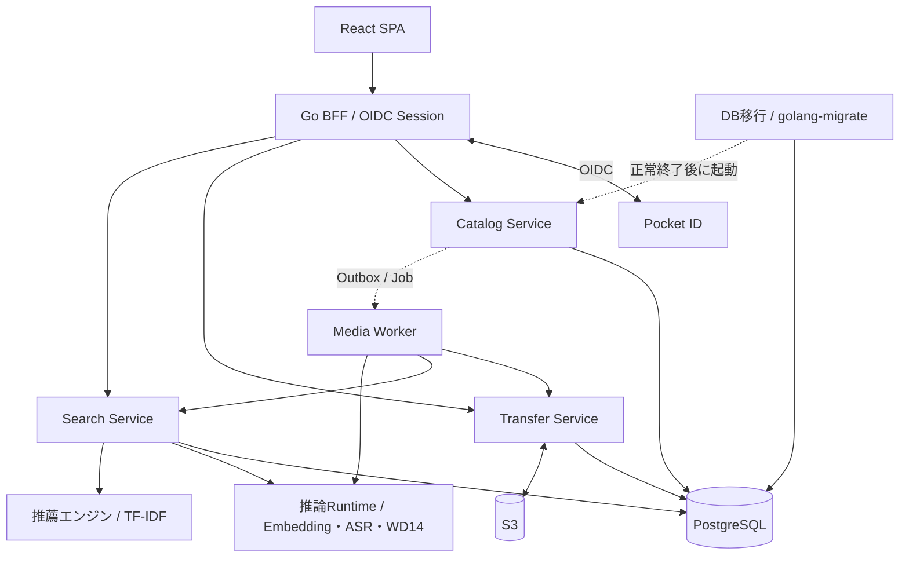
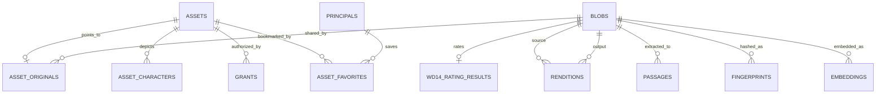
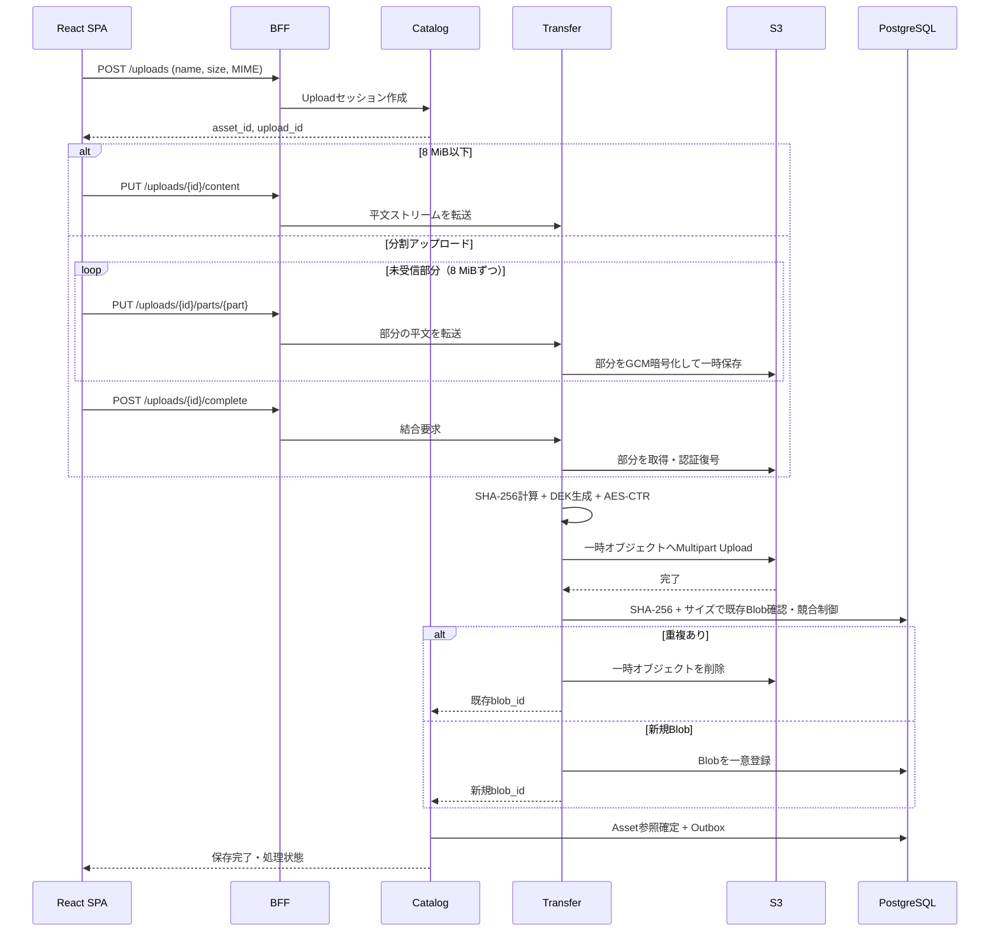
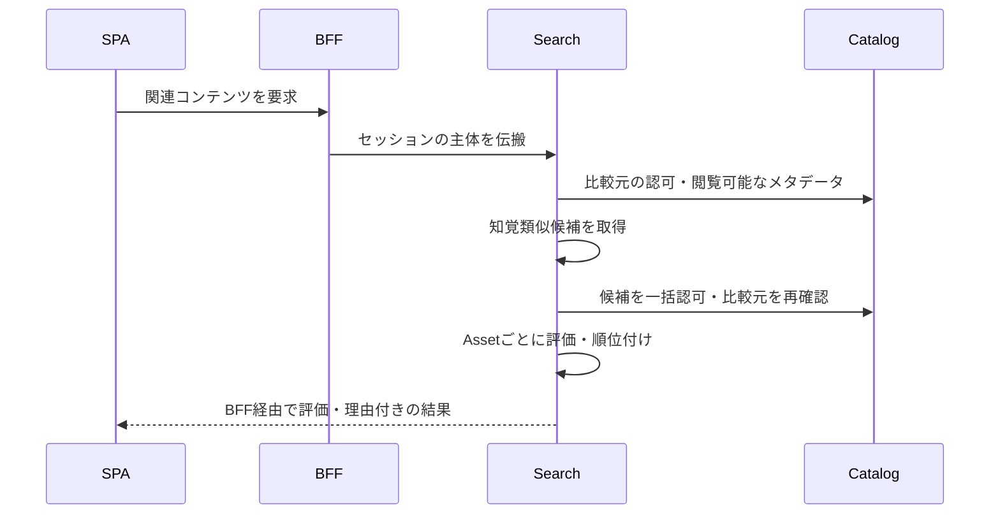

# 暗号化メディアストレージ システム仕様書

| 項目 | 内容 |
|---|---|
| 文書名 | 暗号化メディアストレージ システム仕様書 |
| バージョン | 2.0（設計ベースライン） |
| 作成日 | 2026-10-22 |
| 状態 | 要件合意済み／一部パラメータ・採用ライブラリ未確定 |
| 対象 | React SPA、Goマイクロサービス、PostgreSQL、S3互換オブジェクトストレージ |

## 1. 目的と前提

画像・動画・音声・PDFをアップロードし、サーバー側で暗号化してS3に保存する。ファイル情報・暗号鍵情報・検索用インデックスはPostgreSQLに保存する。完全一致・知覚的類似・全文・マルチモーダル意味検索を提供し、メディアの再エンコード、プレビュー、動画・音声のシーク再生に対応する。

- **E2EEは採用しない**。サーバーが平文を処理できる。
- **S3・DB・通信経路・クライアントは信頼できる**という設計上の前提を置く。保存データの改ざん検知は必須要件としない。
- 暗号化ファイルの機密性のために**AES-256-CTR**を採用する。AES-CTRは認証付き暗号ではない。暗号文の改変検出・改変への耐性は提供しない。
- マスターキーは**ローカルの設定用YAML**からロードする。KMS、Vaultは採用しない。PostgreSQLには暗号化済みDEKを保存する。
- 動画配信は**MP4 + HTTP Range（206 Partial Content）**を基本とする。**HLSは対象外**。
- ログを監査記録として利用する。監査専用DBテーブルは作成しない。
- **OpenTelemetry（Trace、Metric、Log）**に対応する。
- **インフラの構築・運用設計は対象外**。S3、PostgreSQL、Pocket ID、モデル実行環境などの用意・配置手順は定義しない。

### 1.1 機能の適用範囲

| 機能 | 対象 |
|---|---|
| ファイル形式 | 画像、動画、音声、PDF |
| SSO | Pocket ID を想定した OIDC |
| 保存 | AES-256-CTR暗号文をS3に格納 |
| 復号 | 保存時に生成したファイルごとのDEKによるサーバー側復号 |
| 重複検出 | 平文バイナリのSHA-256 + バイト数による完全一致 |
| 類似検索 | 画像pHash、動画フレームpHash、PDFページpHash、音声フィンガープリント |
| 全文検索 | ファイル名、タグ、PDF本文、OCR、文字起こし |
| 意味検索 | EmbeddingGemma 2でテキスト・画像・動画・音声を共通ベクトル空間に埋め込み |
| 派生メディア | 画像・動画・音声の再エンコード、サムネイル、PDFページプレビュー |
| 配信 | ファイルダウンロード、画像/PDFプレビュー、MP4/音声のRange再生 |

### 1.2 対象外

E2EE、DRM、HLS/ABR（回線速度に応じた自動ビットレート切替）、専用監査DB、KMS/Vault、S3/DB/ネットワークなどのインフラ設計、第三者に対する改ざん証明は実装しない。ブラウザからの途中再開可能なアップロードは初期版では対象外とする。

## 2. 採用技術

| 区分 | 技術・方式 |
|---|---|
| フロントエンド | TypeScript、React SPA |
| API / マイクロサービス | Go |
| 認証 | Pocket ID / OpenID Connect、BFFセッション |
| メインDB | PostgreSQL |
| PostgreSQL拡張 | PGroonga（日本語全文検索）、pgvector（ベクトル・bit距離検索） |
| オブジェクト保存 | S3互換ストレージ |
| ストリーム暗号 | AES-256-CTR |
| DEKラップ | AES-256-GCM（32バイトの鍵素材のラップ用途のみ） |
| 完全一致検出 | SHA-256 |
| 知覚類似 | pHash、動画のフレーム列、Chromaprint等の音響フィンガープリント |
| 再エンコード・解析 | FFmpeg/FFprobe、画像ライブラリ、PDFテキスト抽出、OCR、ASR（後二者の具体製品は未選定） |
| 意味検索モデル | `google/embeddinggemma-2`（768次元） |
| モデル実行 | 推論専用コンポーネント（当面Python + sentence-transformersを想定） |
| 非同期処理 | PostgreSQLベースのJob Queue / Transactional Outbox |
| 可観測性 | OpenTelemetry、OTLP、構造化ログ |

**注意：** EmbeddingGemma 2は**埋め込みモデル**であり、OCRやASRの代替ではない。PDFの文字抽出や時間付き文字起こしには別途抽出処理が必要。

## 3. アーキテクチャ



### 3.1 サービス責務

| サービス | 責務 | 保持しない責務 |
|---|---|---|
| **BFF / Auth** | OIDC Code Flow、セッションCookie、CSRF、フロントエンド向けAPI、内部への認証主体伝搬 | S3 I/O、暗号鍵操作 |
| **Catalog Service** | 論理Asset、所有者・ACL、アップロード状態、AssetとBlobの参照、重複結果へのアクセス制御、Asset別メタデータの認可済み推薦候補 | 暗号化・復号、モデル推論 |
| **Transfer Service** | マスターキー読み込み、DEK生成/ラップ、AES-CTR暗号化・復号、S3 I/O、SHA-256計算、HTTP Range、Blob登録 | OCR、全文検索 |
| **Search Service** | 全文・pHash・音声フィンガープリント・ベクトル検索、検索結果統合、関連コンテンツ・個人向け推薦の統合、抽選・キャッシュ・履歴・セッション、Catalog経由の一括認可 | 平文ファイル保存 |
| **推薦エンジン** | 認可済みタグ・キャラクターのTF-IDF学習と類似度計算。Python Runtimeと同じイメージの独立プロセス | DB・S3接続、ACL判断、メディア推論モデルの読み込み |
| **Media Worker** | EXIF、OCR、PDF本文抽出、ASR、再エンコード、サムネイル、知覚ハッシュ、Embedding生成、WD14タグ集約 | ユーザー直接認証、マスターキー参照 |
| **推論Runtime** | マルチモーダルEmbedding・ASR・WD14一般タグ・キャラクター・レーティング推論API | 検索DB操作、ACL判断 |

### 3.2 通信ルール

1. SPAからの要求はBFFを経由する。同期APIはHTTP/JSON、バイナリはHTTPストリーム。
2. BFFがユーザーを認証し、Catalogで認可する。サービス間ヘッダーを外部クライアントからの値として信用しない。
3. Media WorkerはTransferの内部APIから認可された復号ストリームを取得する。Worker自体にはYAMLマスターキーを渡さない。
4. 解析・再エンコード・埋め込み生成は非同期Jobとして実行する。
5. サービスはPostgreSQLのスキーマ/DBロールで論理分離する。原則として他サービスのテーブルを直接更新せず、内部API・イベントで連携する。
6. 最小構成では同一PostgreSQLクラスタを共有する。外部のメッセージブローカーは必須としない。
7. `context.Context`、リクエスト期限、キャンセルおよびトレースコンテキストを伝搬する。

## 4. データモデル

### 4.1 概念

- **Asset**：ユーザーが扱う論理ファイル。所有者、ファイル名、タグ、キャラクター、レーティング、ACLなどを持つ。同じ内容でもユーザーごとに独立する。
- **Favorite**：PrincipalとAssetの組で保持する個人のお気に入り。登録日時を持ち、Blobの共有やAssetのメタデータ編集から独立する。
- **Blob**：バイト列そのものを表す不変のS3暗号化オブジェクト。同一平文バイナリは可能な限り一つのBlobにまとめる。
- **Rendition**：既存Blobから変換された派生Blobと変換プロファイルの関係。
- **Passage**：PDFのページ、OCR抽出結果、文字起こしの時間区間などのテキスト検索単位。
- **Fingerprint**：Blobまたはそのフレーム/ページに対する知覚的特徴量。
- **Embedding**：Blob、ページ、時間区間、テキスト断片に対するベクトル。



完全一致Blobの共有と、AssetごとのACL・タグ・ファイル名は独立させる。検索インデックスは基本的にBlob単位、Asset固有の検索属性はCatalog側で管理する。

### 4.2 PostgreSQL論理スキーマ

| Schema | 主なテーブル | 所有 |
|---|---|---|
| `catalog` | `principals`, `assets`, `asset_originals`, `grants`, `upload_sessions`, `outbox_events`, `asset_characters`, `wd14_results`, `wd14_character_results`, `wd14_rating_results`, `asset_favorites` | Catalog |
| `storage` | `blobs`, `upload_objects`, `upload_parts` | Transfer |
| `media` | `renditions`, `processing_jobs` | Media Worker |
| `search` | `passages`, `perceptual_hashes`, `audio_fingerprints`, `embeddings`, `recommendation_cache`, `recommendation_sessions`, `recommendation_history` | Search |
| `public` | `schema_migrations` | DB移行管理者（golang-migrate） |

### 4.3 主要DDL（設計ベースライン）

以下は主要カラムと制約の定義。`updated_at`更新トリガー、内部サービスのDBロール・権限、細部の参照制約、マイグレーションの順序は実装時に追加する。

```sql
CREATE EXTENSION IF NOT EXISTS pgcrypto;
CREATE EXTENSION IF NOT EXISTS vector;
CREATE EXTENSION IF NOT EXISTS pgroonga;

CREATE SCHEMA IF NOT EXISTS catalog;
CREATE SCHEMA IF NOT EXISTS storage;
CREATE SCHEMA IF NOT EXISTS media;
CREATE SCHEMA IF NOT EXISTS search;

CREATE TABLE catalog.principals (
    id UUID PRIMARY KEY DEFAULT gen_random_uuid(),
    kind TEXT NOT NULL CHECK (kind IN ('user', 'group')),
    oidc_issuer TEXT NOT NULL,
    oidc_subject TEXT NOT NULL,
    UNIQUE (kind, oidc_issuer, oidc_subject)
);

CREATE TABLE catalog.assets (
    id UUID PRIMARY KEY DEFAULT gen_random_uuid(),
    owner_id UUID NOT NULL REFERENCES catalog.principals(id),
    filename TEXT NOT NULL,
    mime_type TEXT NOT NULL,
    tags TEXT[] NOT NULL DEFAULT '{}',
    rating TEXT NOT NULL DEFAULT 'unrated'
      CHECK (rating IN ('unrated','general','sensitive','questionable','explicit')),
    rating_manual BOOLEAN NOT NULL DEFAULT false,
    wd14_rated BOOLEAN NOT NULL DEFAULT false,
    metadata JSONB NOT NULL DEFAULT '{}',
    status TEXT NOT NULL CHECK
      (status IN ('pending','uploading','stored','processing','ready','failed','deleted')),
    created_at TIMESTAMPTZ NOT NULL DEFAULT now(),
    updated_at TIMESTAMPTZ NOT NULL DEFAULT now(),
    deleted_at TIMESTAMPTZ
);

-- 個人のお気に入りはAssetの共有メタデータとは独立する。
CREATE TABLE catalog.asset_favorites (
  principal_id uuid NOT NULL REFERENCES catalog.principals(id) ON DELETE CASCADE,
  asset_id uuid NOT NULL REFERENCES catalog.assets(id) ON DELETE CASCADE,
  created_at timestamptz NOT NULL DEFAULT now(),
  PRIMARY KEY (principal_id, asset_id)
);
CREATE INDEX asset_favorites_recent ON catalog.asset_favorites
  (principal_id, created_at DESC, asset_id DESC);

-- Asset -> オリジナルBlob。blob_idはTransfer所有スキーマの論理参照。
CREATE TABLE catalog.asset_originals (
    asset_id UUID PRIMARY KEY REFERENCES catalog.assets(id),
    blob_id UUID NOT NULL,
    created_at TIMESTAMPTZ NOT NULL DEFAULT now()
);
CREATE INDEX idx_asset_originals_blob ON catalog.asset_originals(blob_id);

CREATE TABLE catalog.grants (
    asset_id UUID NOT NULL REFERENCES catalog.assets(id),
    principal_id UUID NOT NULL REFERENCES catalog.principals(id),
    permission TEXT NOT NULL CHECK (permission IN ('read','write','admin')),
    PRIMARY KEY (asset_id, principal_id)
);
CREATE INDEX idx_grants_principal ON catalog.grants(principal_id, asset_id);

CREATE TABLE catalog.upload_sessions (
    id UUID PRIMARY KEY DEFAULT gen_random_uuid(),
    asset_id UUID NOT NULL REFERENCES catalog.assets(id),
    expected_size BIGINT NOT NULL CHECK (expected_size >= 0),
    state TEXT NOT NULL CHECK (state IN ('created','uploading','completed','failed','expired')),
    idempotency_key TEXT,
    expires_at TIMESTAMPTZ NOT NULL,
    created_at TIMESTAMPTZ NOT NULL DEFAULT now(),
    UNIQUE (asset_id, idempotency_key)
);

-- 分割アップロードの一時オブジェクト。暗号文はS3へ保存する。
CREATE TABLE storage.upload_parts (
    upload_id UUID NOT NULL,
    part_number INTEGER NOT NULL CHECK (part_number >= 0),
    object_key TEXT NOT NULL UNIQUE,
    size_bytes BIGINT NOT NULL CHECK (size_bytes BETWEEN 1 AND 8388608),
    sha256 BYTEA NOT NULL CHECK (octet_length(sha256) = 32),
    master_key_id TEXT NOT NULL,
    encrypted_dek BYTEA NOT NULL,
    dek_wrap_nonce BYTEA NOT NULL,
    data_nonce BYTEA NOT NULL,
    ready BOOLEAN NOT NULL DEFAULT false,
    created_at TIMESTAMPTZ NOT NULL DEFAULT now(),
    PRIMARY KEY (upload_id, part_number)
);
CREATE INDEX upload_parts_expiry ON storage.upload_parts(created_at);

-- キー本体はYAMLに保存し、DBには保存しない。
CREATE TABLE storage.blobs (
    id UUID PRIMARY KEY,
    sha256 BYTEA NOT NULL CHECK (octet_length(sha256) = 32),
    size_bytes BIGINT NOT NULL CHECK (size_bytes >= 0),
    bucket TEXT NOT NULL,
    object_key TEXT NOT NULL,
    s3_version_id TEXT,
    cipher_version SMALLINT NOT NULL DEFAULT 1,
    master_key_id TEXT NOT NULL,
    encrypted_dek BYTEA NOT NULL,
    dek_wrap_nonce BYTEA NOT NULL CHECK (octet_length(dek_wrap_nonce) = 12),
    ctr_nonce_prefix BYTEA NOT NULL CHECK (octet_length(ctr_nonce_prefix) = 8),
    status TEXT NOT NULL CHECK (status IN ('ready','deleting')),
    created_at TIMESTAMPTZ NOT NULL DEFAULT now(),
    UNIQUE (sha256, size_bytes),
    UNIQUE (bucket, object_key)
);

CREATE TABLE media.renditions (
    id UUID PRIMARY KEY DEFAULT gen_random_uuid(),
    source_blob_id UUID NOT NULL,
    output_blob_id UUID NOT NULL,
    profile_id TEXT NOT NULL,
    profile_version INTEGER NOT NULL,
    encoder_version TEXT NOT NULL,
    created_at TIMESTAMPTZ NOT NULL DEFAULT now(),
    UNIQUE (source_blob_id, profile_id, profile_version, encoder_version)
);
CREATE INDEX idx_renditions_output ON media.renditions(output_blob_id);

CREATE TABLE media.processing_jobs (
    id UUID PRIMARY KEY DEFAULT gen_random_uuid(),
    event_id UUID NOT NULL,
    source_blob_id UUID NOT NULL,
    job_type TEXT NOT NULL,
    pipeline_version INTEGER NOT NULL,
    status TEXT NOT NULL CHECK
      (status IN ('queued','running','retry','completed','failed')),
    attempts INTEGER NOT NULL DEFAULT 0,
    available_at TIMESTAMPTZ NOT NULL DEFAULT now(),
    locked_until TIMESTAMPTZ,
    error_code TEXT,
    UNIQUE (event_id, job_type, pipeline_version)
);
CREATE INDEX idx_jobs_pending ON media.processing_jobs(available_at)
    WHERE status IN ('queued','retry');

CREATE TABLE search.passages (
    id BIGINT GENERATED ALWAYS AS IDENTITY PRIMARY KEY,
    blob_id UUID NOT NULL,
    kind TEXT NOT NULL CHECK (kind IN ('pdf_text','ocr','transcript')),
    ordinal INTEGER NOT NULL,
    page_number INTEGER,
    start_ms BIGINT,
    end_ms BIGINT,
    content TEXT NOT NULL,
    extractor_version INTEGER NOT NULL,
    UNIQUE (blob_id, kind, ordinal, extractor_version)
);
CREATE INDEX idx_passages_content ON search.passages USING pgroonga(content);
CREATE INDEX idx_passages_blob ON search.passages(blob_id);

CREATE TABLE search.perceptual_hashes (
    id BIGINT GENERATED ALWAYS AS IDENTITY PRIMARY KEY,
    blob_id UUID NOT NULL,
    kind TEXT NOT NULL CHECK (kind IN ('image','video_frame','pdf_page')),
    frame_ms BIGINT,
    page_number INTEGER,
    algorithm_version INTEGER NOT NULL,
    phash BIT(64) NOT NULL
);
CREATE INDEX idx_phash_hnsw ON search.perceptual_hashes
    USING hnsw (phash bit_hamming_ops);
CREATE INDEX idx_phash_blob ON search.perceptual_hashes(blob_id);

CREATE TABLE search.audio_fingerprints (
    blob_id UUID NOT NULL,
    algorithm TEXT NOT NULL,
    algorithm_version INTEGER NOT NULL,
    duration_ms BIGINT,
    fingerprint BYTEA NOT NULL,
    PRIMARY KEY (blob_id, algorithm, algorithm_version)
);

CREATE TABLE search.embeddings (
    id BIGINT GENERATED ALWAYS AS IDENTITY PRIMARY KEY,
    blob_id UUID NOT NULL,
    source_type TEXT NOT NULL CHECK
      (source_type IN ('text','image','video','audio','pdf_page')),
    passage_id BIGINT,
    page_number INTEGER,
    start_ms BIGINT,
    end_ms BIGINT,
    model_id TEXT NOT NULL,
    model_revision TEXT NOT NULL,
    vector_dimension SMALLINT NOT NULL DEFAULT 768 CHECK (vector_dimension = 768),
    embedding VECTOR(768) NOT NULL,
    created_at TIMESTAMPTZ NOT NULL DEFAULT now()
);
CREATE INDEX idx_embeddings_hnsw ON search.embeddings
    USING hnsw (embedding vector_cosine_ops);
CREATE INDEX idx_embeddings_blob ON search.embeddings(blob_id);
```

**設計上の留意点：** `UNIQUE (sha256, size_bytes)`は完全一致判定の事実上の識別子として使う。SHA-256の衝突確率は無視できる程度に小さいものの、バイト単位で必ず同一と数学的に証明するものではない。必要な場合は衝突時の追加バイナリ比較を導入する。

### 4.4 ライフサイクルと整合性

- `Asset`の作成と保存完了を分離し、`pending → uploading → stored → processing → ready`とする。処理不能時は`failed`、削除時は`deleted`。
- Blobは内容不変。変更時は新しいBlobを作成し、参照を切り替える。
- S3の完了とDB確定は原子的ではない。Upload ID単位で完了操作を冪等化し、孤立したS3オブジェクトはリコンシラが後で回収する。
- 同時アップロード時はBlobのSHA-256/サイズのUNIQUE制約で1つに収束させる。競合時の一時Blobは回収する。
- Assetが参照するBlob、および有効なRenditionで参照される派生Blobは削除しない。GCでは参照追加と`deleting`への遷移を競合なく排他制御し、猶予期間後に再確認して削除する。
- Outboxイベントはat-least-once配送、Worker処理は冪等とする。`FOR UPDATE SKIP LOCKED`等でJobを取得し、リース切れJobを再実行できるようにする。
- Blob共有に伴う処理結果（OCR、ASR、Embedding、再エンコード）はBlobごとに再利用する。Asset固有情報（ファイル名、タグ、ACL）は再利用・混同しない。

### 4.5 DBマイグレーション

- `migrate` はgolang-migrate v4.19.1を呼び出す起動前の保守プロセスとする。番号順の適用、排他ロック、`public.schema_migrations` のバージョン・dirty状態の管理は同ツールが担う。
- SQLはアプリ共通イメージの `/app/migrations` に `NNN_name.up.sql` として同梱する。ファイルごとに `BEGIN` / `COMMIT` で原子性を保ち、適用済みSQLの変更は新規マイグレーションで行う。
- 新規DBも既存DBも未適用分だけを実行する。履歴のない既存DBは自動推測せず、管理者が適用済み番号を一度だけ `baseline` で宣言する。SQLを再実行せず、既存データを保持する。
- Catalogと検証用OIDC BFFは `migrate` の正常終了を起動条件にする。他のGoサービスはCatalogへの依存を経由して待つ。既存プロセスは更新前に停止する。失敗時はアプリを起動せず、dirty状態の確認・修復後に管理者が `force` で履歴を訂正して再実行する。
- DB管理資格情報を持つのはPostgreSQLと `migrate` に限定し、各サービスのスキーマ・ロール分離を維持する。移行失敗のログにはSQL・接続URL・資格情報・データ値を出さず、固定のエラーコードを記録する。
- 状態確認は `ocms migrate version`、通常適用は `ocms migrate up`、既存DBの引き継ぎは `ocms migrate baseline N`、確認済みの障害復旧は `ocms migrate force N` とする。自動ダウングレードは行わない。

## 5. 暗号化と鍵管理

### 5.1 鍵構造

- **KEK（Master Key）**：256bit。設定用YAMLに保存する。複数世代の鍵を保持できる。
- **DEK（Data Encryption Key）**：256bit。**Blobごとに**暗号学的乱数で生成し、ファイル本体のAES-256-CTRに使用する。
- **Wrapped DEK**：KEKを使ってAES-256-GCMでDEKをラップしたもの。PostgreSQLに保存する。

### 5.2 YAML形式

ファイル例：`secrets/crypto.yaml`

```yaml
active_key_id: master-v2
keys:
  master-v1: "<base64-of-old-32-byte-key>"
  master-v2: "<base64-of-current-32-byte-key>"
```

- キー文字列はBase64エンコードした**32バイトの乱数**。パスワード文字列をそのまま鍵として使わない。
- 起動時にBase64のデコード・鍵長・`active_key_id`の存在を検証する。
- 設定ファイルはGitに含めない。ロギング・診断出力・APIレスポンスに鍵素材を含めない。
- 鍵を読み込めない場合は起動を失敗させる。既存Blobの復号に必要な旧キーは削除しない。
- KEKの世代変更はDEKの再ラップで実施でき、S3ファイル本体の再暗号化は不要。
- マスターキーの紛失は全ファイルの復号不能につながり得る。バックアップ運用の詳細は本書の対象外だが、復旧検証は受け入れ基準に含める。

### 5.3 AES-CTRによるBlob保存

- S3オブジェクトは**暗号文バイト列のみ**。独自ヘッダーやチャンクTagを付加しない。
- 平文サイズと暗号文サイズは一致する。ファイル全体をメモリに読み込まず、`io.Reader`から逐次暗号化する。
- 初期カウンタ（128bit）は`8バイトの乱数prefix || uint64_be(0)`とする。
- カウンタは16バイトのAESブロックごとにBig Endianで増加する。各BlobのDEKは独立して生成し、再利用しない。
- 再アップロードを最初からやり直す場合は新DEK・新Blob IDを発行する。同一暗号文パートのネットワークリトライは許可する。
- サイズ上限を設け、64bitブロック番号のオーバーフローを拒否する。
- **AES-CTRは認証を提供しない**。SHA-256は重複識別に使用し、転送データの改ざん検知として利用する要件は設けない。

### 5.4 DEKのラップ

- `wrapped_dek = AES-256-GCM(KEK, 12-byte-random-nonce, DEK, AAD)`。
- `AAD`には`blob_id`と固定ドメイン文字列（例：`media-storage:dek:v1`）を組み込む。
- `master_key_id`、`encrypted_dek`、`dek_wrap_nonce`、`ctr_nonce_prefix`、`cipher_version`をBlobレコードに保存する。
- DEKラップのGCMは鍵素材を誤って取り違えないために利用する。**ファイル本体には改ざん検知を要求しない**という方針とは別の処理。
- YAML内にKEKがあるため、YAMLとDBの双方にアクセスできる主体はBlobを復号できる。信頼境界として明示する。

### 5.5 シーク可能なCTR復号

AESブロック長を16バイト、平文Range開始位置を`offset`（0始まり）とすると：

```text
block_index = offset / 16
skip        = offset % 16
counter     = nonce_prefix(8 bytes) || uint64_be(block_index)
```

S3には原則として平文と**同じバイト範囲**をRange GETする。`cipher.NewCTR`を`counter`から開始し、先頭`skip`バイト分だけキーストリームを空読みしてから、Rangeで取得した暗号文を復号する。カウンタ範囲のチェックは先に実施する。

HTTPへの応答：

| リクエスト | 応答 |
|---|---|
| Rangeなし | `200 OK`、逐次復号 |
| 有効な単一Range | `206 Partial Content`と`Content-Range` |
| 範囲外 | `416 Range Not Satisfiable`、`Content-Range: bytes */<size>` |
| HEAD | `Content-Type`、`Content-Length`、`Accept-Ranges`等（本文なし） |
| If-Range不一致 | Rangeを無視した全体応答 |
| 複数Range | 初期版はRangeを無視して`200 OK`で全体返却（複数範囲multipart非対応） |

公開する`Content-Range`、`Content-Length`は平文に対する値とする。Blob/Assetの認可確認を行い、§5.6の方針でキャッシュする。ブラウザ対応のMP4を`<video>`で再生・シークする。

### 5.6 HTTPキャッシュ

静的ファイルと認可が必要なメディアでキャッシュ方針を分ける。

| 対象 | Cache-Control | 再利用の条件 |
|---|---|---|
| Viteが生成する`/assets/`の内容ハッシュ付きファイル | `public, max-age=31536000, immutable` | 同じURLは1年間再利用できる。内容変更時はURLも変える |
| HTML、PDF.jsの固定URLなど、その他の静的ファイル | `public, no-cache` | 内容のSHA-256をETagとし、再利用前に照合する |
| 元ファイル・プレビュー・派生メディアのGET/HEAD成功応答（200/206/304） | `private, no-cache` | ブラウザ内の保存を許可し、再利用前に必ず認証・最新ACL・ETagを確認する。共有キャッシュには保存しない |
| 認証・その他のAPI・エラー応答・Worker向け内部配信 | `private, no-store` | 保存しない |

メディアのETagは配信する平文BlobのSHA-256を引用符で囲んだ値とする。`If-None-Match`が一致するGET/HEADには、認可とBlobのready状態を確認してから本文なしの`304 Not Modified`を返す。この場合、S3の読み出しと復号は省く。弱いETag、候補のリスト、`*`を受け付け、Rangeより先に評価する。不一致なら通常の200/206応答を返し、既存の`If-Range`の扱いは維持する。プレビューはページを含む要求URLで選択した派生Blobを照合する。

BFFはメディアの200/206/304に`Vary: Cookie`を付け、セッションごとにキャッシュを分ける。ログアウト後・セッション期限切れ・ACL失効・削除後は、保存済みETagを提示しても304を返さない。認可や依存サービスの確認に失敗した場合も、キャッシュを再利用させない。`no-cache`は保存禁止を意味しないため、ブラウザには復号済みデータが残り得る。取得済みデータの消去は保証しない。

BFFの静的ファイルとETagは起動時のビルドに対応する。配備時はビルドディレクトリを起動中に書き換えず、BFFを再作成する。静的ファイル・メディアともにETag一致時は本文を再送しない。メディアの認証・ACL確認の通信は毎回必要とする（[RFC 9111 §5.2.2.4](https://www.rfc-editor.org/rfc/rfc9111.html#section-5.2.2.4)、[RFC 9110 §13.1.2](https://www.rfc-editor.org/rfc/rfc9110.html#section-13.1.2)）。

## 6. 認証・認可

### 6.1 OIDC

- Pocket IDをOIDC Providerとして利用する。
- Go BFFをConfidential Clientとして登録し、Authorization Code Flow（可能ならPKCE併用）を利用する。
- BFFがトークンを保持し、SPAには`HttpOnly`、`Secure`、適切な`SameSite`属性のセッションCookieを発行する。
- `state`、`nonce`、リダイレクトURI検証、CSRF対策を実施する。
- ユーザーの識別には`(iss, sub)`を用いる。`email`は識別子として使わない。
- Pocket IDのサインイン許可はアプリ内Assetへのアクセス権とは別とする。

### 6.2 Asset ACL

- Asset所有者および明示的に付与された`read`/`write`/`admin`権限を評価する。
- Blobが別ユーザーのAssetから参照されていても、Blobそのものを直接列挙・読み出しする外部APIは提供しない。
- 検索は候補を収集後にCatalogの`BatchAuthorize`を呼び、許可されたAssetだけ返す。未許可情報を件数やスニペットに含めない。
- Workerの内部復号APIは有効なJob IDと対象Blobを照合する。

## 7. ファイルアップロード・重複排除



1. `POST /uploads`でAssetとUpload Sessionを作る。
2. 平文をTransferへ送信し、同一ストリームからSHA-256を計算すると同時にAES-CTR暗号化する。
3. S3に暗号文を一時保存する。大容量時はMultipart Uploadを使う。
4. 平文の受信サイズを申告サイズと比較する。
5. `UNIQUE (sha256, size_bytes)`を基準にBlobを一意化する。既存Blobに一致すれば一時S3オブジェクトを削除し、そのBlobを再利用する。
6. 新規Blobの場合のみBlob確定と解析Jobの発行を実施する。
7. 同じ所有者の未削除Assetに同じBlobとファイル名があれば、新しいAssetを論理削除し既存Assetを返す。並列完了も同じAssetに収束する。別名や別所有者の場合は個別のAssetとし、所有権・タグ・ファイル名を共有しない。
8. 同一アップロードのリトライはIdempotency Key / Upload IDで識別する。SPAは複数ファイルに独立したSessionを作り、最大10ファイルを並列に送信する。実際の同時通信数はブラウザや接続方式の制限を受ける。完了・失敗した枠から次のファイルを開始し、各ファイル内の部分は順番に送信する。1件の失敗後も残りを継続し、ファイルごとの進捗・結果・再試行を表示する。
9. 8 MiBを超えるファイルは8 MiB固定長の部分（末尾のみ短縮）を `PUT /uploads/{id}/parts/{part}` で送る。番号は0始まり。所有者・Session期限・申告サイズ・番号・実受信長を毎回検証する。同一部分・同一内容の再送は成功、異なる内容への上書きは409とする。
10. Transferは部分ごとに独立したDEKを生成し、AES-256-GCMで暗号化してS3の一時領域へ保存する。AADにUpload IDと部分番号を結び付け、DEKはオブジェクトキーを識別子として既存のKEKでラップする。`storage.upload_parts` に保存意図・鍵メタデータを記録し、S3保存成功後のみ受信済みとする。鍵・S3資格情報・平文ファイルを他サービスへ渡さない。
11. `GET /uploads/{id}/parts` は受信済み番号・サイズと固定部分サイズ・状態を返す。`POST /uploads/{id}/complete` は全部分の存在・長さを照合し、1部分ずつ認証復号して従来の暗号化・SHA-256・重複排除・Catalog完了処理へ流す。最終Blobの形式は§5を維持する。完了再送は同一Blobを再利用する。
12. 部分の送信・結合・回収はUpload ID単位で排他し、競合は409とする。Catalog完了後に一時オブジェクトを削除し、未回収の部分は作成から25時間経過後にリコンシラが回収する（Session期限は24時間）。KEKの再ラップには部分のDEKも含める。ブラウザ内で失敗した部分は最大3回送信し、その後は同じ画面の「再試行」で受信済み部分をスキップする。ページ再読み込み後の自動復元は対象外。

Blob削除は参照管理と分離して行い、参照がゼロになったBlobにのみGCを適用する。競合防止、冪等性、S3完了後のDB障害からの復旧は実装必須。

## 8. 非同期メディア処理と再エンコード

### 8.1 Job構成

- `media.probe`：メタ情報解析（解像度、長さ、Codec、EXIF等）
- `image.transcode`：WebP/AVIF/JPEGへの変換
- `video.transcode`：MP4（H.264/AAC）への変換、任意でWebM（VP9/Opus）
- `audio.transcode`：Opus/AACへの変換
- `preview.generate`：画像サムネイル、動画の代表画像、PDFページプレビュー
- `document.extract`：PDF本文取得と必要ページのOCR
- `audio.transcribe`：音声・動画音声のASRと時間付きPassage作成
- `fingerprint.compute`：画像・動画フレーム・PDFページpHash、音声フィンガープリント
- `embedding.generate`：EmbeddingGemma 2の埋め込み生成

Workerは `MEDIA_WORKER_CONCURRENCY`（1〜8、既定2）で指定した数のJobを同時実行する。Jobの取得はDBの行ロックとリースで競合を防ぐ。停止時は実行中Jobを中断し、リースを解放し実行回数を消費せず再試行する。Composeの `INFERENCE_WORKERS`（既定1）はRuntimeのUvicornプロセス数を指定し、各プロセスは推論を直列実行する。モデルは各プロセスに読み込まれるため、並列数の増加にはCPU・メモリの追加が必要である。

### 8.2 出力プロファイル

| 入力 | 標準出力 | 目的 |
|---|---|---|
| 画像 | WebP、サムネイル | 高速な一覧・プレビュー |
| 画像 | AVIF/JPEG（任意） | 圧縮率・互換性の選択 |
| 動画 | MP4 / H.264 + AAC、`+faststart` | ブラウザでの再生・シーク |
| 動画 | MP4 1080p/720pなど（任意） | **手動**画質切替 |
| 音声 | Opus、AAC（任意） | 再生互換性・圧縮効率 |
| PDF | 長辺1600pxのPNGページプレビュー、最大512pxのWebPサムネイル | プレビュー・OCR／一覧・pHash・タグ・画像Embedding |

新規の画像とPDFは、一覧・pHash・タグ・画像Embeddingで共用するWebPサムネイルを暗号化保存する。最大512pxから始め、80,000バイト未満を目標に解像度を保ち画質を段階的に下げる。目標は保証値ではなく、非可逆圧縮による解析結果の変化を伴う。画像のOCRは `MEDIA_IMAGE_OCR_ENABLED`（既定false）で明示的に有効にした場合だけ保存前のPNGを使う。PDFの文字がないページへのOCRはこの設定に関係なく維持する。PDFは1600pxのPNGページプレビューを保存し、OCRに利用する。先頭ページを先に描画・処理し、残りは最大8ページずつ描画して、各ページの変換・保存・OCRを `MEDIA_PDF_PAGE_CONCURRENCY`（1〜8、既定2）件まで並列に実行する。結果はページ順に索引へ追加し、エラーまたはリース失効時は残りの処理を中断する。PDFの描画結果は一時的なPPMとし、各ページのPNGプレビューとWebPサムネイルを一度の入力読み込みで生成する。画像もOCR用PNGとWebPサムネイルを一度の入力読み込みで生成する。本文は全ページを一度に抽出し、改ページから白紙ページを含むページ番号を保持する。ページプレビューは各ページの処理後に削除し、一時領域に全ページを保持しない。既存のPNGサムネイルを引き続き読み、既存PDFで解析サムネイルがない場合は保存済みプレビューを512pxへ縮小する。画像・動画はサムネイルを再エンコードより先に保存する。動画のpHash・タグ・Embeddingはそれぞれの時間サンプリングを維持し、入力シークで縮小フレームを抽出する。元ファイルの完全一致判定用SHA-256は変更しない。

Workerは派生画像を `GET /internal/blobs/{sourceBlobId}/content?rendition={outputBlobId}` でTransferから取得する。Transferは復号前に `POST /internal/jobs/{jobId}/authorize` へ `blob_id`・`lease_token` と任意の `rendition_blob_id` を送り、Workerは実行中Jobの対象Blob・リース・期限と、その元Blobに属する派生Blobであることを確認する。Workerに鍵・S3資格情報は渡さない。テーブル変更・既存Jobの自動再実行は伴わない。

**HLSプレイリスト、HLSセグメント、ABRは実装しない。** MP4は`moov` atomを先頭に配置し、HTTP Rangeでシークする。Codecやコンテナがブラウザ非対応の場合は標準MP4派生ファイルを作る。

### 8.3 WD14による一般タグ・キャラクター・レーティングの自動付与

- メディア解析完了後、画像・動画・PDFに `tags.generate` Jobを作成する。音声は対象外とする。リース・期限・最大4回の再試行を既存Jobと共有する。
- Runtimeは `SmilingWolf/wd-v1-4-convnext-tagger-v2`（リビジョン `4b34d1b07bdd8e95494072648960b8a6adcbc0ff`）をCPUで実行し、category 0の一般タグを閾値0.35、category 4のキャラクターを閾値0.85で分けて返す。category 9のレーティングは一般タグ・キャラクターと分離し、4段階のうち最大スコアの段階を返す。同点の場合は制限の強い段階を採用する。
- 画像は1枚、動画は全体を等分した最大12フレーム、PDFは全ページを判定する。タグごとの最大スコアで集約し、上位256タグを採用する。
- Workerが結果をCatalogへ送る際、CatalogはWorkerに実行中JobのBlob・リース・期限を照会して確認する。Catalogは `catalog.wd14_results` にBlob単位の推論結果とモデル情報を保存し、各Assetの `tags` へ一度だけ追加する。適用済みかどうかは `catalog.assets.wd14_tagged` で管理する。
- タグの追加は既存タグを保持する原子的な更新とする。手動タグとの合計上限は512件で、上限を超える場合は既存タグを優先する。利用者は自動付与後のタグを編集・削除でき、Jobの再試行で削除済みタグを復活させない。後から作成した重複Assetには推論結果だけをコピーし、別Assetの手動タグをコピーしない。状態同期で追加漏れを補う。
- 既存の一覧・検索・ACLを利用する。タグの内容・推論入力・元ファイル名はログやTraceに記録しない。

キャラクターは `catalog.asset_characters(asset_id, name, position)` に保存し、タグの配列とは独立させる。主キーは `(asset_id, name)` とし、同じAsset内の重複を防ぐ。推論結果は別テーブル `catalog.wd14_character_results(blob_id, characters, model_id, model_revision, created_at)` に保持し、`catalog.assets.wd14_characters_tagged` で一度だけの適用を管理する。タグと同じく既存の手動入力を優先し、合計512件・1件256バイトまでとする。削除・編集はAsset単位に保持し、再試行・状態同期で復元しない。重複Assetへは推論結果だけを追加する。旧Runtimeのキャラクター欄省略と、判定結果が空配列である場合を区別する。マイグレーション006は完了済みタグJobを再実行し、既存ファイルへキャラクターを付与する。

レーティングは `general < sensitive < questionable < explicit` の順とし、動画・PDFはサンプルフレーム・全ページの判定のうち最も制限の強い段階を採用する。音声などの対象外ファイルと判定前のAssetは `unrated` とする。推論結果は `catalog.wd14_rating_results(blob_id, rating, model_id, model_revision, created_at)` に保存する。`rating` は4段階のいずれかに制約し、Blobを主キーとする。Assetは `rating`・`rating_manual`・`wd14_rated` を持ち、Asset行のロック下で自動判定を一度だけ適用する。手動設定後は再試行・状態同期でも上書きしない。重複Assetへは保存した推論結果だけを適用する。008は完了済みタグJobを再実行し、既存ファイルも判定する。一般タグとキャラクターの適用済み状態は保持する。

### 8.4 派生Blobの再利用

同じ元Blobと`profile_id + profile_version + encoder_version`に対する変換は原則1回のみ実施する。生成物は独立したBlobとして暗号化してS3に保存し、`media.renditions`で元Blobに関連付ける。派生BlobもSHA-256重複排除の対象とする。

Workerはジョブ入力をTransferから復号取得する。FFmpegのシークを要する処理やMP4の`faststart`移動では一時的なシーク可能な平文ファイルが必要になる場合がある。作業領域の保護・処理後破棄・CPU/メモリ/処理時間の制限を実装上の要件とする（実行基盤の具体構成は範囲外）。

## 9. 検索設計

### 9.1 検索種別

| Mode | 目的 | 技術 |
|---|---|---|
| `keyword` | ファイル名、タグ、PDF本文、OCR、文字起こし検索 | PostgreSQL + PGroonga |
| `exact_duplicate` | 平文バイナリ完全一致検出 | SHA-256 + ファイルサイズ |
| `perceptual` | 同一または近い画像・動画・音源を探索 | pHash / フレーム列 / Chromaprint |
| `semantic` | 内容の意味に基づく検索、モダリティ横断検索 | EmbeddingGemma 2 + pgvector |
| `hybrid` | キーワード + 意味検索 | 検索順位をRRF等で融合 |

### 9.2 全文・時間付き検索

- PDFはテキストレイヤーを優先し、文字抽出できないページにOCRを適用する。
- OCRは有効にした画像ごと、PDFはテキストのないページごとにPassageを保持する。通常画像のOCRは既定無効とし、Workerの `MEDIA_IMAGE_OCR_ENABLED=true` で有効にする。
- 音声・動画のASRは`start_ms`/`end_ms`を保存する。結果から再生時間へ直接ジャンプできる。
- 日本語全文検索にはPGroongaを利用する。
- 検索結果には、許可済みAssetのファイル名、ハイライト、ページ番号や再生時刻などを返す。

### 9.3 知覚ハッシュ

- 画像の近似一致：64bit pHash。比較距離は`popcount(a XOR b)`（Hamming距離）。
- 動画：一定間隔またはシーン変化でフレームを抽出しpHashを保存。近傍フレームの数・順序・時間的整合性で二次判定。
- PDF：ページ画像を生成してpHashを保存。類似ページ検索を可能にする。
- 音声：Chromaprint等でフィンガープリント生成。近い録音・音源の検出に用いる。一般的な音の意味的類似はSemantic検索へ委ねる。
- pHashのHNSW検索は近似的な候補生成であり、完全な列挙が必要なら厳密な再計算を実施する。
- 閾値はサンプルデータで評価してから決定する。

### 9.4 EmbeddingGemma 2

- モデル：`google/embeddinggemma-2`、共通ベクトル空間：**768次元**。
- テキスト、画像、動画、音声のネイティブEmbeddingを利用する。
- 検索クエリと文書側で同一モデルリビジョン・同一次元・互換なプレフィックス設定を使用する。
- 動画は初期値30秒程度のクリップ、音声は30〜120秒の区間、PDFはテキスト断片とページ画像などの単位でEmbeddingを作成する。具体的な区間長は検索品質測定で調整する。
- モデルのコンテキストは8,192トークン。映像フレーム・音声もこの予算を消費する。長い入力は分割する。
- 推論エンジンは独立したコンポーネントとし、GoのSearch / WorkerからAPI経由で呼び出す。初期はPython `sentence-transformers`を想定。
- 検索用ベクトルは`vector(768)`に格納し、cosine距離`<=>`を利用する。モデル改訂時は別リビジョンとして再インデックスする。
- 将来次元を256/512等に短縮する場合、テーブル・インデックスを別途設計し、短縮後は再正規化する。

運用設定 `SEMANTIC_SEARCH_ENABLED` は既定で `true` とする。SearchとWorkerの起動時に `false` を指定した場合、`semantic`・`hybrid` 検索はHTTP 503（`SEMANTIC_SEARCH_DISABLED`）を返し、Workerは `embedding.generate` Jobの取得・再試行・期限切れによる失敗確定を停止する。Job・チェックポイント・検索ベクトルは保持し、新規Jobも待機させる。停止中のEmbedding JobはAsset状態の集約から除外し、それ以外のJobが完了すれば `ready` とする。再有効化時は通常のJob取得・状態集約を再開する。失敗確定済みJobの再実行は通常の再試行操作に従う。全文・知覚類似・完全一致検索、関連コンテンツ、OCR・ASR、自動タグは継続する。AC-14の意味検索検証は有効時に行う。

### 9.5 検索時のACL

1. Searchがキーワード・類似・ベクトル検索から候補Blob/Assetを取得する。
2. Catalogからその候補Blobを参照するAssetを取得する。
3. 現在のユーザーの`BatchAuthorize(read)`を実施する。
4. **許可されたAssetのみ**を集約・ランキング・スニペット生成して返却する。禁止Assetの内容や件数を公開しない。
5. インデックス更新には遅延があり得るが、ACLの最終判断は常にCatalogに問い合わせる。

共有Blobの検索結果はAssetごとに展開し、同じユーザーに同一Blobを指すAssetが複数ある場合の表示上の集約はUI/APIで指定できるようにする。

## 10. 外部API（v1）

| Method | Path | 概要 |
|---|---|---|
| `GET` | `/api/v1/me` | ログインユーザー |
| `POST` | `/api/v1/uploads` | Upload Session作成 |
| `PUT` | `/api/v1/uploads/{uploadId}/content` | 平文ストリーム送信 |
| `GET` | `/api/v1/uploads/{uploadId}` | Upload状態 |
| `GET` | `/api/v1/uploads/{uploadId}/parts` | 受信済み部分と固定部分サイズ・状態 |
| `PUT` | `/api/v1/uploads/{uploadId}/parts/{part}` | 0始まりの部分送信・冪等再送 |
| `POST` | `/api/v1/uploads/{uploadId}/complete` | 全部分を結合して保存完了 |
| `GET` | `/api/v1/characters` | 閲覧可能なキャラクターの一覧・件数・共起 |
| `GET` | `/api/v1/assets` | Asset一覧・フィルタ |
| `GET` | `/api/v1/assets/{assetId}` | 詳細、処理状態、自分のお気に入り状態 |
| `PUT` | `/api/v1/assets/{assetId}/favorite` | 自分のお気に入りへ登録（閲覧権限、204） |
| `DELETE` | `/api/v1/assets/{assetId}/favorite` | 自分のお気に入りを解除（閲覧権限、204） |
| `GET` | `/api/v1/assets/{assetId}/content` | 元ファイルの復号配信（Range可） |
| `HEAD` | `/api/v1/assets/{assetId}/content` | サイズ/MIME/Range情報 |
| `GET` | `/api/v1/assets/{assetId}/preview` | プレビュー。PDFの `page` はページ番号、`thumbnail=1` は一覧用WebPを優先し、未生成ならPNGへフォールバック |
| `GET` | `/api/v1/tags?q={tagName}` | 認可済みAssetのタグ・被リンク数・共起グラフ |
| `PATCH` | `/api/v1/assets/{assetId}` | ファイル名/タグ等更新 |
| `DELETE` | `/api/v1/assets/{assetId}` | 論理削除 |
| `GET` | `/api/v1/assets/{assetId}/duplicates` | 同一バイナリのAsset一覧（閲覧可能分のみ） |
| `GET` | `/api/v1/assets/{assetId}/similar` | 知覚的類似ファイル検索 |
| `GET` | `/api/v1/assets/{assetId}/recommendations` | キャラクター・タグ・知覚類似による推薦（最大200件） |
| `GET` | `/api/v1/recommendations` | お気に入りからの個人向け推薦。セッション付き200件ページング |
| `POST` | `/api/v1/search` | キーワード・意味・ハイブリッド検索 |
| `POST` | `/api/v1/search/by-media` | 画像/音声などを入力とする検索 |
| `POST` | `/api/v1/assets/{assetId}/renditions` | 再エンコード要求 |
| `GET` | `/api/v1/assets/{assetId}/renditions` | 派生メディア一覧 |
| `GET` | `/api/v1/assets/{assetId}/renditions/{renditionId}/content` | 派生メディア配信（Range可） |
| `GET` | `/api/v1/jobs/{jobId}` | 非同期ジョブ状態 |

一覧APIは `limit`（1〜200、既定200）、`offset`（0以上、既定0）、`kind`（省略、`image`、`video`、`audio`、`document`）、`q`（ファイル名・タグ・キャラクター）を受け付ける。`document` は画像・動画・音声以外を含む。応答の `assets` は作成日時の降順、同時刻の場合はAsset IDの降順で並べ、`total` は同じ検索条件・種類・ACLで絞り込んだ総件数とする。未許可・削除済みAssetは件数にも含めない。不正なページ指定は400とする。offset方式のため、ページ移動中の追加・削除によって位置が変わる場合がある。

```http
GET /api/v1/assets?limit=24&offset=24&kind=image
```

```json
{"assets":[],"total":24}
```

Asset応答の `rating` は `general`・`sensitive`・`questionable`・`explicit`・`unrated` のいずれかとする。`PATCH /api/v1/assets/{assetId}` の `rating` で手動設定し、省略時は保持する。`unrated` の手動指定も自動判定から保護する。

一覧・完全一致・知覚類似・推薦のGET APIは `ratings=general,sensitive` のようなカンマ区切り条件を受け付け、`POST /api/v1/search` は同名の文字列配列を受け付ける。省略・JSONのnullは全段階、空文字列・空配列は0件とする。不正値は400で拒否する。Catalogの認可を保ち、件数・結果上限・ページ分割の前にAsset単位で条件を適用する。タグ・キャラクター・種類の条件とはANDで結合する。

キャラクター一覧API `GET /api/v1/characters?q=...` は `{characters: [{name, asset_count}], links: [{source, target, asset_count}], total}` を返す。検索・ACL・件数・共起・上限はタグ一覧と同じ規則で、キャラクターの関連テーブルだけを集計する。Asset応答には独立した `characters: ["character_name"]` を含める。`PATCH /api/v1/assets/{assetId}` の `characters` はそのAssetのキャラクター全件を置き換え、省略時は保持する。空配列で全件削除する。Asset一覧の `character` は完全一致条件で、`tag` と併用時は両方に一致するAssetだけを返す。

タグ一覧API `GET /api/v1/tags` は `q` によるタグ名の大文字小文字を区別しない部分一致検索を受け付ける。Catalogが閲覧可能かつ未削除のAssetだけを集計し、同じAsset内の重複タグは1件として数える。空白だけのタグは除外し、その他のタグ名は保存値のまま区別する。被リンク数はタグが付いたAsset数とする。Blobを共有していても、AssetごとのタグとACLで計算する。

応答の `tags` は `{name, asset_count}` の配列、`total` は検索に一致するタグ総数、`links` は `{source, target, asset_count}` の配列とする。タグは被リンク数の降順・同数なら名前のC照合順で最大200件、グラフの線はその上位60タグの組み合わせを返す。線の件数は両方のタグを持つ閲覧可能なAsset数で、自己リンクと逆向きの重複は作らない。タグと線は同じDBスナップショットから取得する。上限を超えた場合は画面に表示範囲を示し、検索で絞り込めるようにする。

Asset一覧APIの `tag` はタグ名の完全一致で絞り込む。ページング・種類・件数にも同じ条件を適用する。

```json
{"tags":[{"name":"旅行","asset_count":3},{"name":"風景","asset_count":2}],"total":2,"links":[{"source":"旅行","target":"風景","asset_count":2}]}
```

### 10.1 代表的なリクエスト

```http
POST /api/v1/uploads
Content-Type: application/json

{"filename":"sample.mp4","mime_type":"video/mp4","size_bytes":104857600}
```

```http
PUT /api/v1/uploads/{uploadId}/content
Content-Type: application/octet-stream
Content-Length: 104857600

<binary stream>
```

```http
GET /api/v1/assets/{assetId}/content
Range: bytes=2500000-2999999
```

```http
POST /api/v1/search
Content-Type: application/json

{
  "query": "海辺の夕焼けを撮影した動画",
  "mode": "hybrid",
  "media_types": ["image", "video"],
  "ratings": ["general", "sensitive"],
  "limit": 20
}
```

レスポンスでは`asset_id`、ファイル名、`mime_type`、検索モード、スニペット、`page_number`、`start_ms`/`end_ms`等の該当位置を返す。内部の生のcosine距離やRRF点数を異なる検索モード間で同じ尺度として扱わない。

### 10.2 内部API（論理契約）

WD14連携ではRuntimeの `POST /tag` に `{kind: "image", data: "base64"}` を送り、`{tags: [{name, score}], characters: [{name, score}], rating: "general", model_id, model_revision}` を受け取る。WorkerはCatalogの `POST /internal/blobs/{blobId}/tags` に `{tags: ["general_tag"], characters: ["character_name"], rating: "general", model_id, model_revision}` を送る。サービス認証に加え、`X-Job-ID` と `X-Job-Lease` を使って対象Blobと実行中リースを照合する。

| 呼び出し | 用途 |
|---|---|
| `Catalog.Authorize(assetId, principal, action)` | 単一Asset ACL |
| `Catalog.BatchAuthorize(assetIds, principal, read)` | 検索結果のACL |
| `GET /internal/assets/{assetId}/recommendation-candidates` | 比較元と候補のACLを確認し、Asset別メタデータの上位1,000件の `asset_ids` を返す |
| `Catalog.CompleteUpload(uploadId, blobId)` | Upload完了・参照確定・Outbox |
| `Transfer.ReadBlob(blobId, optionalRange, jobContext)` | Worker用復号ストリーム |
| `Transfer.StoreDerivative(sourceBlobId, profile, stream)` | 派生Blob保存・重複排除 |
| `Search.UpsertPassages(blobId, version, passages)` | OCR/ASR等反映 |
| `Search.UpsertEmbeddings(blobId, modelRevision, vectors)` | ベクトル反映 |

外部でユーザー指定の生`blob_id`から任意のファイルを取得できる経路は提供しない。

### 10.3 関連コンテンツ

`GET /api/v1/assets/{assetId}/recommendations` は、比較元から関連する閲覧可能なAssetを取得する。比較元自身・比較元と同じBlob・削除済みAssetを除外する。未許可・削除済みの比較元は404、依存サービスの障害は503とし、障害を空結果や解析待ちとして返さない。

評価値は `100 × (0.5C + 0.3T + 0.2H)` とする。`C` と `T` はそれぞれキャラクターとタグのJaccard係数に希少性補正を加えた値とする。閲覧可能な全Asset数をN、共通の各特徴を持つAsset数をdfとし、Jaccard係数に `1 + 0.2 × 平均(1 − df/N)` を掛け、1を上限とする。種類別に数え、Asset内の重複は除く。保存された名前の完全一致で比較し、空集合同士は0点とする。`H` は画像・動画・PDFではpHashの最小距離が12以下のとき `1 − 距離/64`、音声では既存の音響距離が0.25以下のとき `1 − 距離`。非該当・未生成は0点とし、重みを再配分しない。

Catalogは閲覧可能なAssetのメタデータのスナップショットを返し、Searchはその頻度を使って `0.5C + 0.3T` の上位1,000件を取得する。Searchは知覚類似の上位1,000 Blobを取得し、両方の候補をCatalogで最終認可する。一括認可の識別子上限に収まるよう、Asset IDとBlob IDを分けて要求する。Blobを共有する別Assetのメタデータを評価に流用しない。比較元の閲覧権限も応答前に再確認する。

Searchは認可後のAssetごとに総合評価を計算し、0点を除き、丸める前の評価値の降順・同点ならAsset IDの昇順で最大200件を返す。候補上限があるため、全ライブラリの厳密な順位は保証しない。ページングと種類フィルターはSPAが取得済み結果に適用する。



応答は `source_asset_id`、`hash_status`（`ready` / `pending` / `unsupported`）、`assets` を含む。各Assetに `score`（丸めない数値）、`common_tags`、`common_characters`、知覚類似がある場合だけ `perceptual`（`visual` / `audio`）を追加する。ハッシュ未生成でもメタデータ候補を返す。知覚類似の `page_number` / `start_ms` は最も近い実際のページ・フレームの値を返し、生のハッシュは公開しない。新しい永続データ・推論・閲覧履歴は追加しない。

```json
{"source_asset_id":"00000000-0000-4000-8000-000000000001","hash_status":"pending","assets":[]}
```

### 10.4 お気に入りをもとにした個人向け推薦

Catalogの `GET /internal/recommendation-dataset?fingerprint=...` は、要求主体が現在閲覧できるAssetのID・Blob ID・タグ・キャラクター・お気に入り状態・MIME・レーティングを、Asset ID順の一つのSQLスナップショットから取得する。特徴の配列を名前順に整列したJSONのSHA-256を `fingerprint` とする。同じ指紋なら `unchanged: true` とし、メタデータを再送しない。削除・権限喪失後のお気に入りは学習対象に含めない。

独立した推薦サービス `recommender` の `POST /recommend` は、内部認証付きの `{assets: [...]}` を受け取り、scikit-learn 1.9.1のTF-IDFを使う。タグ・キャラクターの名前全体を種類別の特徴として扱い、分割・小文字化せず、出現はbinary、IDFとL2正規化を適用する。閲覧可能な全Assetで特徴空間を学習し、お気に入りの平均ベクトルをL2正規化してコサイン類似度を求める。両種類の特徴は同等に扱う。他主体の嗜好や閲覧履歴、本文、知覚ハッシュは使わない。

特徴付きのお気に入りがなければ `status: insufficient_information` とする。1件でも好みのベクトルを作れれば `ready` とし、お気に入り自身と同じBlobのAssetを除外した正の類似度上位1,000件を、同点はAsset ID順で返す。応答は `{engine_version: "tfidf-v1", status, candidates: [{asset_id, score}]}`。モデルは永続化せず、Searchが候補計算結果を保存する。

| Searchの保存先 | 内容と有効期間 |
|---|---|
| `recommendation_cache` | 主体ごとの入力指紋、エンジン版、認可済み特徴スナップショット、状態、候補IDと類似度。24時間 |
| `recommendation_sessions` | 主体、入力指紋、エンジン版、種類・レーティング条件、状態、抽選済みIDとスコア。30分 |
| `recommendation_history` | 推薦応答の先頭24件。過去24時間の直近3回を抽選に利用 |

マイグレーション009でこれらのテーブルと索引を追加し、書き込みは `search_app` に限定する。キャッシュは指紋・エンジン版・期限が一致する場合だけ再利用する。キャッシュ利用でもCatalogの指紋確認とページごとの再認可を行う。期限切れセッションと古い表示履歴は、その主体の次回正常要求で回収する。キャッシュは主体ごとに1行を更新する。

Searchは種類・レーティング条件を適用してから最大200件を重複なしで順次抽選する。選択重みは `類似度² × max(0.1, 1 − 選択済み候補との最大Jaccard係数)` とし、直近3回の先頭24件に含まれるAssetはさらに0.25倍にする。Jaccard係数は種類を区別したタグ・キャラクターの集合で計算する。要求ごとに暗号学的乱数で抽選器を初期化し、候補が24件以上で直前と先頭24件の並びが同じ場合は、最大3回の抽選で確定する。候補不足による再表示は許容する。表示順は抽選順とし、類似度順に戻さない。

```http
GET /api/v1/recommendations?kind=image&ratings=general,sensitive
GET /api/v1/recommendations?kind=image&ratings=general,sensitive&session_id=<session-id>&page=2
```

```json
{"status":"ready","session_id":"<session-id>","page":1,"total":30,"assets":[{"asset_id":"<asset-id>","score":82.1,"common_tags":["landscape"],"common_characters":[]}]}
```

各結果は通常のAsset項目も含む。`score` はコサイン類似度の100倍であり、確率ではない。新規要求は必ず新しいセッションを作り、`session_id` 付き要求は保存した並びの200件単位のページを返す。`page` は1〜9、セッション省略時は1のみ。種類は `all`（既定）・`image`・`video`・`audio`・`document`。レーティングは既存の省略・空・不正値の規則を適用し、学習対象には影響させない。候補上位1,000件を超えた全ライブラリの順位や推薦品質は保証しない。

他主体・期限切れのセッションは409 `RECOMMENDATION_SESSION_EXPIRED`、条件・特徴・お気に入り・閲覧可能範囲・エンジン版が変わったセッションは409 `RECOMMENDATION_SESSION_STALE` とし、再生成を求める。応答前に指紋を再確認し、取得中の変更でも古い件数や理由を返さない。依存障害は503で、情報不足・候補0件と区別する。Searchは要求全体を30秒で打ち切り、同一主体の競合要求は503とする。推薦エンジンの計算は同時1件で、実行中の追加計算要求は503とする。タグ・入力指紋・推薦セッションID・プロファイルはログやTraceへ記録しない。

## 11. OpenTelemetry・ログ

### 11.1 基本方針

- Goの全サービスでOpenTelemetryの**Traces、Metrics、Logs**を出力できるようにする。
- 標準リソース属性として`service.name`、`service.version`、必要なら`deployment.environment.name`を設定する。
- W3C Trace Context（`traceparent`など）を同期HTTPで伝搬する。非同期JobにはTrace Contextを保存し、Worker側のSpanと関連付ける（必要に応じてSpan Link）。
- `slog`ベースの構造化ログを基本とし、`trace_id`/`span_id`を含める。OTLPのログ出力に対応する。
- OTel Collector、バックエンド製品、ダッシュボードなどの**運用インフラは本書の対象外**。

### 11.2 主要Span

`bff.http_request`、`catalog.create_upload`、`transfer.encrypt_stream`、`transfer.s3_upload`、`transfer.decrypt_range`、`transfer.deduplicate`、`media.transcode`、`media.ocr`、`media.transcribe`、`search.keyword`、`search.semantic`、`embedding.encode`、`search.personal_recommendations`、`recommendation.rank`。

### 11.3 主要Metric

| Metric | 型 | 内容 |
|---|---|---|
| `media.upload.duration` | Histogram | アップロード時間 |
| `media.upload.bytes` | Counter | 受信バイト数 |
| `media.download.bytes` | Counter | 配信バイト数 |
| `media.dedup.hits` | Counter | 重複ヒット数 |
| `media.dedup.saved_bytes` | Counter | 重複排除による節約推定量 |
| `media.transcode.duration` | Histogram | 再エンコード時間 |
| `media.job.completed` | Counter | Job完了/失敗 |
| `media.search.duration` | Histogram | 検索時間 |
| `media.embedding.duration` | Histogram | 推論時間 |
| `media.crypto.bytes` | Counter | 暗号化・復号バイト数 |

`asset_id`、`blob_id`、`upload_id`のような高カーディナリティ値はMetric属性に入れず、Trace/Log側に記録する。

### 11.4 監査ログ

最低限のイベント：`auth.login`、`asset.created`、`asset.downloaded`、`asset.updated`、`asset.deleted`、`asset.permission_changed`、`crypto.dek_unwrapped`、`media.transcode_failed`、`search.executed`。ユーザー主体、Asset ID、処理結果、`trace_id`を構造化して出力する。

マスターキー、DEK、Cookie、OIDCトークン、検索対象の平文コンテンツはログに記録しない。監査専用テーブルは作らない。

## 12. フロントエンド

- 本番SPAはWeb App Manifest、192/512pxの通常・maskableアイコン、Apple touch iconを提供し、対応ブラウザでstandalone表示としてインストールできる。HTTPS（ローカル開発ではlocalhost）を前提とする。
- Service Workerはホームや既知の画面URLへのナビゲーションが通信失敗した場合に公開のオフライン案内と再読み込み操作を表示する。Cache Storageへ保存するのは案内HTMLとCSSのみとし、API・認証・メディア要求を介入対象にせず、認証済み応答や検索結果を永続化しない。オフラインの閲覧・検索・アップロードは対象外とする。更新時は既存クライアントの終了後にWorkerを切り替え、旧バージョンの案内キャッシュを回収する。
- BrowserRouterによるパスベースのSPAルーティングを使う。主要画面は `/library`・`/tags`・`/characters`・`/favorites`・`/recommendations`、共通ファイル詳細は `/assets/{asset_id}`、全画面閲覧は `/assets/{asset_id}/view` とする。`/` は `/library` へ置換遷移する。詳細・閲覧の `from` は `library`・`favorites`・`recommendations`（省略時 `library`）から元の一覧を指定する。
- 確定済みの検索・絞り込み・ページを `q`・`mode`・`tag`・`character`・`kind`・`ratings`・`page`、比較元を `source` に保持する。既定値は省略し、レーティング未選択は `ratings=none` で表す。タグ・キャラクター画面は `q` と `view`（`list`・`cloud`・`graph`、既定 `cloud`）を使う。タグ名入力のURL更新は200ms後の履歴置換とする。検索方式の未確定入力、アップロード処理、可視化の座標・ズームはURLへ含めない。
- 画面・検索・絞り込み・ページ・詳細・閲覧の開始はブラウザ履歴に追加し、全画面の連続ファイル移動は置換する。関連コンテンツの戻る操作は探索元の履歴へ戻る。タブ内で取得結果・推薦セッション・未送信の検索入力を履歴エントリーへ対応づけ、認証主体が変われば破棄する。共有URLや再読み込みでは最新のデータを取得し、個人向けおすすめは先頭ページから新しいセッションを開始する。選択ファイルは維持し、セッションIDはURLへ含めない。
- BFFは既知の画面パスのGET・HEADでSPAを配信する。未知の画面は404で案内を表示し、API・認証エンドポイント・静的ファイルの失敗をHTMLへ置換しない。OIDCの `return_to` は既知のローカル画面パスだけを認証flowへ保存し、成功後に復元する。外部URL・バックスラッシュ・制御文字を拒否し、復帰先・検索クエリはログ・Traceへ出力しない。詳細・比較元は既存APIで認可し、削除・未許可を共通の見つからない表示、通信失敗を再試行可能な表示にする。

- ファイル詳細の「関連コンテンツ」から比較元のサムネイル・名前と戻る操作を持つ画面を開く。推薦は関連性で分けず、評価順の詳細グリッドに評価値（小数1桁）と共通キャラクター・共通タグ・見た目や音の類似理由を表示する。評価値は確率ではない。200件単位のページ移動と種類フィルターを提供し、取得結果内で全画面閲覧と連続探索を行う。戻る操作で前の比較元・ページ・選択を復元し、最初の画面では元のライブラリ条件と選択へ戻る。読み込み・空・失敗と再試行・類似解析待ちを区別する。
- 共通ヘッダーにOCMS、ライブラリ・タグ・キャラクターの切り替え、画面の操作、ログアウトを一段で配置する。本文に切り替え行や同名の見出し行を重ねない。ページのh1は読み上げ用に維持する。ライブラリのアップロードはヘッダーから実行する。
- キャラクター画面はタグ画面と同じ一覧・検索・ワードクラウド・共起グラフを提供し、キャラクター専用APIから取得する。詳細ではタグと別の欄でキャラクターを追加・削除する。キャラクター名からライブラリのキャラクター完全一致フィルターへ移動できる。
- タグ画面でタグ名の検索、件数付き一覧、ワードクラウド、共起グラフを切り替える。ワードクラウドの配置にd3-cloud、グラフの配置・描画にCytoscape.jsを使い、可視化は遅延読み込みする。クラウドの文字とグラフの円は被リンク数に応じて大きくし、グラフの線幅は共起件数に応じて変える。グラフはタグ選択による関連の強調、拡大・縮小・ドラッグ・タッチ操作に対応する。クラウドで配置できないタグは一覧へ誘導し、キーボード操作用のタグ選択とファイル表示を用意する。タグからライブラリの完全一致フィルターへ移動でき、解除・種類変更・ページ移動を利用できる。
- グラフの配置はcytoscape-colaに任せ、ノードとラベルの境界を含めて重なりを避ける。被リンクが多いタグを大きく、少ないタグを小さく表示し、継続シミュレーションでドラッグに周囲が追従する。縮小時の小さなラベルは隠し、ホバー・選択時に表示する。タグ選択で関連を強調し、必要なら読みやすい倍率へ寄る。手動ズーム・パンは配置の更新で上書きしない。再配置、動きの停止・再開を提供し、画面外・アンマウント時はシミュレーションを停止する。動きを減らす設定では初期配置をアニメーションせず、その後も明示的に再開するまで静止する。
- ライブラリの詳細パネルではタグ名・キャラクター名のクリック・キーボード操作で、それぞれの完全一致フィルターへ移動する。検索語・種類・比較条件を解除して先頭ページを表示し、詳細パネルを閉じる。タグ名・キャラクター名と削除ボタンは独立させ、保存中はどちらも無効化する。
- TypeScript + React SPAでログイン、アップロード、ファイル一覧/詳細、プレビュー、タグ編集、検索を提供する。
- 一覧は1ページ200件とし、前後のページ移動と表示範囲・件数を表示する。通常一覧はAPIからページ単位で取得し、検索・比較は取得済み結果をページ分割する。検索・比較APIの既存の結果上限は維持する。検索・種類・比較元の変更時は先頭ページへ戻す。
- 検索条件に4段階と未判定のチェックボックスを設け、既定ではすべてオンとする。詳細パネルでレーティングの確認・手動設定を行う。リスト・グリッド・詳細グリッドでは `sensitive`・`questionable`・`explicit` に共通の「R-18」を表示し、`general` と未判定には付けない。未判定をgeneralと見なさず、詳細と検索条件では区別する。
- 幅800pxを超える画面のファイル詳細はスクロールに追従し、長い内容は詳細内でスクロールする。幅800px以下では一覧の上に表示する。
- 動画はブラウザ標準の`<video controls>`と認証済みURLを利用する。`preload="metadata"`を基本とし、MP4 + Rangeで再生・シークする。
- 音声は`<audio controls>`、画像の詳細はプレビューURL、PDFの詳細はページプレビューを使う。
- 詳細プレビューのクリック、一覧のダブルクリック、選択済みファイルの再選択で、暗い背景の全画面閲覧画面を開く。動画・音声はプレイヤー、画像は元画像、PDFはPDF.jsによるページ表示を使う。画像・PDFは画面に合わせた表示から拡大縮小でき、拡大中はドラッグで表示位置を移動できる。
- 閲覧中は左右スワイプ・左右キー・前後ボタンで現在の一覧順にファイルを移動し、一覧のページ境界も越える。画像・PDFのピンチ操作は拡大縮小に使い、拡大中のドラッグではファイルを切り替えない。PDFページは専用の前後ボタンで移動する。閉じるボタンまたはEscapeで一覧へ戻る。
- 再エンコードJobは非同期の状態（待機/実行中/完了/失敗）を表示する。
- 検索モードはキーワード、意味、ハイブリッド、完全一致、知覚類似で切替できる。
- 意味検索・ASR結果は対象ページ・再生時間へジャンプ可能にする。
- アップロードは進捗表示とエラー表示に対応する。初期版の失敗時は再アップロードとする。

### 12.1 ユーザー別のお気に入り

Catalogは `catalog.asset_favorites(principal_id, asset_id, created_at)` を保持し、PrincipalとAssetの組を一意にする。BFFが認証した主体だけを使い、登録・解除にはAssetの閲覧権限を必要とする。read共有でも自分のお気に入りを編集できる。削除・権限喪失後の記録は保持するが、最新ACLで一覧・件数・検索結果から除外する。

| API・契約 | 動作 |
|---|---|
| `PUT /api/v1/assets/{id}/favorite` | 冪等な登録、204。重複登録は日時を維持する |
| `DELETE /api/v1/assets/{id}/favorite` | 冪等な解除、204。対象が未許可・削除済みなら404 |
| `GET /api/v1/assets?favorites=true` | ACLとお気に入り条件を件数・ページング前に適用。登録日時降順、Asset ID降順 |
| Assetの `is_favorite` | 要求主体の状態をbooleanで返す。一覧・詳細・各検索・比較に共通 |
| 検索JSONの `favorites` | 省略時false。キーワード・意味・ハイブリッド・知覚検索に適用 |
| `/internal/authorize-blobs` の `favorites` | 省略時false。Catalogで最新ACLと要求主体のお気に入りを照合し、Searchの結果上限適用前に絞る |

一覧の `favorites` は `true` または `false` の単一値とし、それ以外は400とする。検索の候補・結果上限は既存の制限を維持する。ファイル名・タグ・キャラクターの直接検索候補もお気に入りへ限定する。同じBlobを共有する別Assetへ登録状態を流用しない。

SPAのナビゲーションはライブラリ・タグ・キャラクター・お気に入りの順とする。3種類の一覧表示、詳細パネル、閲覧ダイアログに登録・解除ボタンを設ける。星の輪郭と黄色の塗りつぶし、アクセシブルな状態で登録済みかを示す。お気に入り一覧は検索・種類・表示切り替え・ページ送りに対応し、検索時は関連度順とする。検索解除・類似・完全一致比較でも範囲を維持する。

### 12.2 個人向けおすすめ

ヘッダーの「お気に入り」の隣に「おすすめ」を追加する。開き直すたび・更新時に推薦を生成し、種類・レーティング変更でも新しいセッションにする。詳細グリッドに共通タグ・キャラクターと評価値を表示し、200件ずつページ移動する。詳細・閲覧・関連コンテンツ探索から戻る間はセッションと並びを維持する。おすすめ表示中のお気に入り変更は星の状態だけを反映し、更新ボタンで再取得する。特徴編集後は再取得する。遅れて届いた応答は別画面や新しい要求を上書きしない。

学習不成立では「情報が足りません」と「お気に入りを開く」、学習成立後の候補0件では「おすすめがありません」を表示する。読み込み・取得失敗と再試行・セッション失効による更新案内を区別する。

## 13. 処理品質・エラー要件

- ファイルサイズ、同時処理数、Jobタイムアウト、検索件数、動画変換プロファイルは設定値とし、具体的な上限は負荷試験後に決める。
- エラーを`AUTH_REQUIRED`、`FORBIDDEN`、`NOT_FOUND`、`UPLOAD_FAILED`、`MEDIA_UNSUPPORTED`、`TRANSCODE_FAILED`、`INDEX_PENDING`等の安定したエラーコードで返す。
- APIのタイムアウト、クライアント切断、Worker停止でキャンセルを伝播する。
- S3操作とDBトランザクションの間の障害、Job重複配送、同時Blob確定、鍵不足などをテストする。
- 不正なMIME主張、破損メディア、極端な解像度/長さ、圧縮爆弾に相当する入力を適切に制限する。
- フルテキスト/OCR/ASR/Embeddingは結果が出揃うまで**最終的整合性**を前提とする。検索不能のJob状態をUIで区別する。

## 14. 受け入れ基準

| ID | 検証項目 | 合格条件 |
|---|---|---|
| AC-01 | OIDC SSO | Pocket IDログインからSPAの認証済み操作まで動作 |
| AC-02 | 暗号化保存 | 平文をS3へ直接格納せず、AES-CTR暗号文として保存 |
| AC-03 | 鍵管理 | YAMLの現行/旧KEKで対応するDEKを復元できる |
| AC-04 | マスターキー更新 | 新KEKへのDEK再ラップ後、S3再暗号化なしで復号できる |
| AC-05 | Range復号・HTTPキャッシュ | ファイル先頭・中間・末尾および非16バイト境界を正確に復号。§5.6の静的ファイル・メディアのキャッシュと、再検証時の認証・ACL分離を保つ |
| AC-06 | 動画シーク | MP4をブラウザで再生し、途中位置にシークできる |
| AC-07 | 完全一致 | 同一バイナリの別名アップロードが同一Blobを参照する |
| AC-08 | 重複競合 | 同時アップロードでもBlobの重複保存が収束する |
| AC-09 | 派生ファイル | 画像/動画/音声を指定プロファイルに変換・暗号化保存できる |
| AC-10 | 派生結果の共有 | 同一Blob/同一プロファイルの処理結果を再利用できる |
| AC-11 | OCR/ASR | PDF本文・OCR・文字起こしをページ/時間付きで検索できる |
| AC-12 | pHash類似 | 画像・動画フレーム・PDFページの類似候補を取得できる |
| AC-13 | 音声フィンガープリント | ほぼ同一の音源を候補として検出できる |
| AC-14 | 意味検索 | テキスト→画像/動画/音声の横断検索が動作する |
| AC-15 | ACL | 別ユーザーの未許可Assetが検索・ダウンロードに現れない |
| AC-16 | OTel | サービス横断Trace、主要Metric、相関ログを出力できる |
| AC-17 | 障害復旧 | S3/DB障害、Job再実行、孤立オブジェクト回収が動作 |
| AC-18 | 秘密情報の非出力 | ログ/Trace/API応答にKEK/DEK/トークンが出力されない |
| AC-19 | 自動タグ | 画像・動画・PDFにWD14の一般タグと独立したキャラクターメタデータを付与し、手動編集・重複再利用・ACL分離を保つ |
| AC-20 | 関連コンテンツ | キャラクター・タグ・知覚類似の固定重みで推薦し、完全一致除外・Asset別メタデータ・ACL・理由表示・探索からの復帰を保つ |
| AC-21 | お気に入り | ユーザー別・Asset別に永続保存し、共有・ACL分離、3表示と詳細の状態同期、お気に入り内検索、登録順とページングが動作する |
| AC-22 | コンテンツレーティング | WD14のレーティングを独立保存し、自動判定・手動設定保持・各段階の検索切替・3表示のR-18表示・ACL分離を保つ |
| AC-23 | 個人向け推薦 | お気に入りの特徴によるTF-IDF推薦、情報不足の区別、関連度・多様性・表示履歴による抽選、キャッシュ・セッションの永続化、変更時失効、ACL分離、探索からの復帰を保つ |
| AC-24 | 複数・分割アップロード | 最大10ファイルの並列送信・部分再送・再結合・境界サイズ・ACL・重複排除・一時データ回収が動作する |

## 15. 実装順序

1. **基盤**：Go BFF + Pocket ID SSO、Catalog、PostgreSQL、S3接続、OTel初期化。
2. **暗号化Transfer**：YAML鍵ロード、DEKラップ、AES-CTR Stream、Range、Upload Session。
3. **重複排除**：SHA-256、共有Blob、参照管理、GC、競合/障害テスト。
4. **Media Worker**：FFprobe、画像/動画/音声変換、PDF・OCR・ASR、派生Blob。
5. **知覚類似**：pHash、動画フレーム列、音響フィンガープリント。
6. **意味検索**：EmbeddingGemma 2 Runtime、pgvector、マルチモーダル/ハイブリッド検索。
7. **品質評価**：検索精度・再生シーク・並列処理・鍵更新・可観測性の受け入れテスト。

## 16. 未確定項目（詳細実装で決定）

これらは未確定であり、**要件を満たす範囲で初期値を選び、実測により調整する**。

| 項目 | 現時点の方針 |
|---|---|
| 最大ファイルサイズ・同時アップロード | ベンチマーク後に設定 |
| Image処理ライブラリ | FFmpeg + 必要に応じてlibvips等 |
| OCRエンジン | 未選定（日本語・PDF対応必須） |
| ASRエンジン | 未選定（必要言語とタイムスタンプ精度を評価） |
| 音声フィンガープリント閾値 | 実データで評価 |
| 動画pHash抽出間隔と整列方法 | フレーム抽出・時系列整合性を評価 |
| Embedding分割粒度 | 動画30秒、音声30〜120秒を仮初期値に評価 |
| 検索順位融合 | RRFを初期案として評価 |
| ブラウザ対応変換プロファイル | H.264/AAC MP4を標準とし、追加形式を検証 |
| Upload途中再開 | 分割APIで受信済み部分を再利用。同じ画面から再試行できる。再読み込み後の自動復元は対象外 |
| 物理DBロール・GC協調プロトコル | API/DBトランザクション設計時に詳細確定 |

## 17. 技術リファレンス

以下は設計判断で参照した公式・一次資料（確認日：2026-10-22）。

- Google AI for Developers, [EmbeddingGemma 2 Model Card](https://ai.google.dev/gemma/docs/embeddinggemma/model_card_2)
- Google Developers Blog, [EmbeddingGemma 2: The Developer Guide](https://developers.googleblog.com/embeddinggemma-2-the-developer-guide/)
- [EmbeddingGemma 2 のマルチモーダル利用ガイド](https://ai.google.dev/gemma/docs/embeddinggemma/multimodal-embeddinggemma-with-sentence-transformers)
- [pgvector](https://github.com/pgvector/pgvector)
- [PGroonga チュートリアル](https://pgroonga.github.io/ja/tutorial/)
- [Pocket ID: Connect an app](https://pocket-id.org/docs/setup/connect-an-app)
- [OpenTelemetry for Go](https://opentelemetry.io/docs/languages/go/)
- [Go crypto/cipher](https://pkg.go.dev/crypto/cipher)

---

本仕様書は、機能・データ・API・暗号化・検索・可観測性の**アプリケーション設計ベースライン**を定義する。インフラ設計や特定デプロイ環境に関する詳細は含まない。
